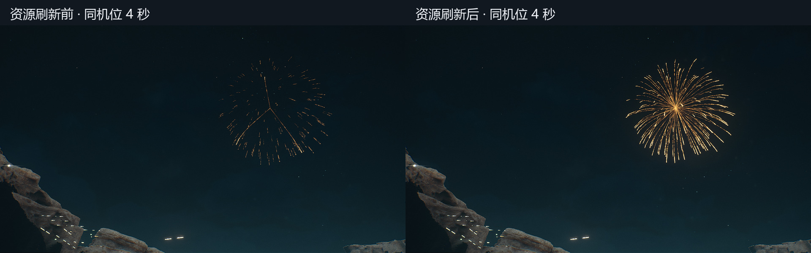
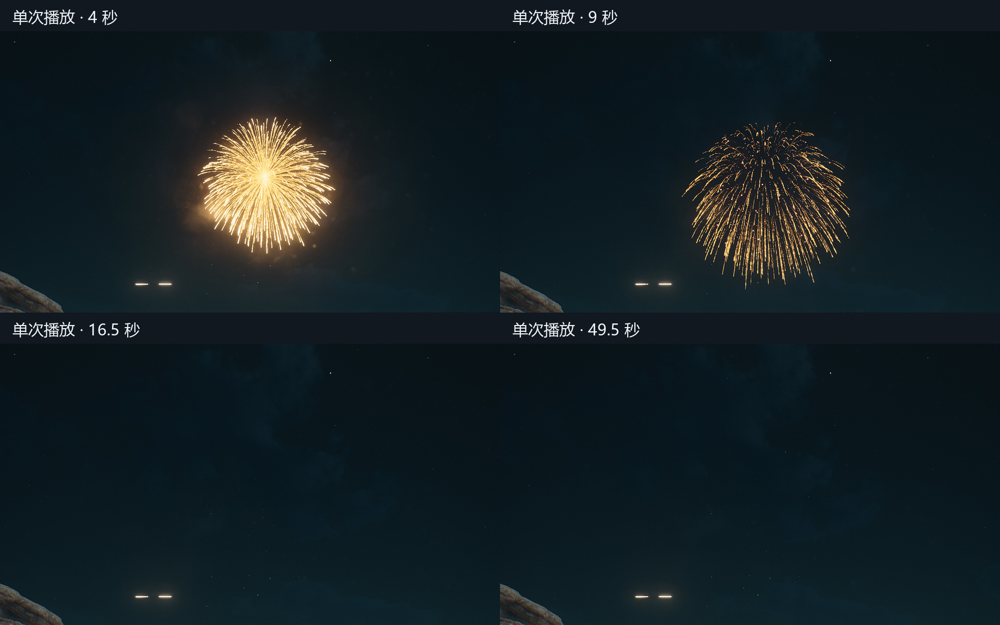

# 网格垂柳 UE v3：当前场景接入与两项修复

2026-10-22，Codex。本机 UE 4.24.2 沙盒实播自检完成，待用户查验；没有标记艺术验收通过。

## 当前入口

场景 `/Game/Maps/Dam_Iris_Long3/Dam_Iris_Long3`，文件夹 `MWAB3_v3_Review`：

| 对象 | 内容 |
|---|---|
| `MWAB3_B_PC_v3` | v3 PC：400 束网格、原 L2_Dots、新 L3_Sparkle |
| `MWAB3_B_Mobile_v3` | v3 手机资产：130 束网格，在桌面渲染器中预览 |
| `MWAB3_A_Original` | 正式原版只读对照 |

本次会话中，单选一个测试对象会单次播放；先取消选择再重新选中，可以手动重播。多选不触发播放，没有按时间自动重启。该选择回调仅在本次编辑器会话有效。

资产保存于 `/Game/Effects_HD/_Sandbox/MWAB_V3_20261022`。两 SM、两 T、MI、两 PS 以及内部完整复制用的 `PS_MW_B_L3_CopySeed` 共 8 个沙盒包保存成功；CopySeed 最终只留一个网格发射器，非查验入口。当前关卡的新增对象与机位没有保存进原地图，重启不自动恢复。查验机位约 725 m、仰角 45°，与测试包观察距离一致。

## 两项问题与修复

| 问题 | 本次证据与处理 |
|---|---|
| 三束过长、其余束只有短头 | 手机 130 束里，整数 U 偏移为 0 的恰好有 3 束，其方向匹配异常长线。主图原生读回曾显示 X Wrap，但画面仍异常，Y 一度实际为 Wrap。仅原生字段写入/读回没有修复画面；改用 `set_editor_property` 逐项写入 X Wrap、Y Clamp、Bilinear、NoMip，并更新 MI 后，同机位完整亮尾恢复。说明导入属性与渲染采样状态未一致生效；旧 RHI sampler 缓存是依据现象的推断，未做独立 RHI 抓帧证明。 |
| 整朵消失后继续重播 | 本次 `stage.py` 查验回调每 16.5 秒执行 `set_template(None)`、恢复模板、`activate(True)`。注销前已自动重置 16 次。已注销存活回调并删除定时分支；只保留用户单选对象时的一次激活。资产 Loops 原本就是 1，未把它虚构成从 2 改为 1。 |

主图最终为 sRGB 关、VectorDisplacementmap、NoMip、Bilinear、X Wrap/Y Clamp；辅助噪声恢复开 mip、X/Y Wrap。两图均 DistantVFX（Project03）、NeverStream=false。MI 为 ColorPower=2、ColorIntensity=16、hardness=0.3，UseParticleSubUV=0；网格顶点 PC/手机 10988/1998，全精度 UV。数值及源文件哈希见 [核验摘要.json](核验摘要.json)。

PC/手机沙盒改用 RealTime，避免原系统 FixedTime60 的播放时长随编辑器帧率变化；正式来源未改。PC 三层均开启，手机一层。网格 Rate=0、Burst=1、Loops=1；L3 延迟1秒、持续10秒、Loops=1。L3 的 Sphere 半径与 Z 曲线已读回，GPU Alpha 运行表非零，2/7秒隔层图可见范围扩大及下落。原 L2 保留原样。

## 单次实播验证与历史区别

PC 和手机各明确激活一次，随后只记录、不切选择、不重置模板。Windows 单调墙钟记录 2805 个样本，覆盖 0.0186–52.0059 秒；模板路径保持不变。PC 14.0532 秒、手机 14.3547 秒后计数归零，未再生；20–52秒共1730个样本，两端最大粒子数均为0。16.5、33、49.5秒检查点均为0，画面未重新亮起。该计时不是 ParticleAge，GPU计数也不用于宣称实际屏上火星数量。

安装最终“单选触发一次”的会话回调后，又持续记录38秒：自动重置计数始终0，20秒后PC粒子数持续0，没有错误。该回调没有任何按 elapsed 触发的重启分支。

旧 [10-16 排查记录](../MESH_WILLOW_20261016/QUALITY_REPEAT_1725/排查结论与修复.md) 处理的是“同一朵没消失就又流一次”：当时 Rate=0/Burst1/Loops1，35秒未见再生；采样与旧发射器/LOD组合修复后有用户高低画质正常回执，但没有证明局部重复流动的唯一根因。本次整朵重播有明确的外部 reset 代码证据，不能直接套用旧问题归因。主图 Panner 的 frac 只作用于 Time×Speed，不应据此改母材质；网页演示循环与 UE 资产单次发射分别处理。

## 限制与现场恢复

未测真手机、完整高低画质档位、同机 GPU 性能；手机130束与简化分段仍可见稀疏及少量折点。关键帧与计数没有代替逐帧连续 UV 测量。另有生成器先量化8位再开方的暗尾精度限制，本轮没有改 PNG、OBJ、生成器或参数数值。

本次18:35因脚本先挂空LOD后补Required，触发 `RequiredModule` 断言，原编辑器退出。此构建方式已弃用，后续使用完整发射器复制。开工已有9个脏内容包、18个脏地图包，自动恢复清单为空，未保存修改无法保证恢复。当前从磁盘重载同一主地图及已知子关卡后为1665个对象，原现场42167个对象未完整恢复。未保存原地图、未提交P4；三项正式来源磁盘 SHA256 与开工一致。详细经过只记在[本对话记录](../../../对话记录/对话框网格垂柳UEv3.md)，原始截图和运行日志留本机 `analysis/local/20261022_网格垂柳UEv3/`。
