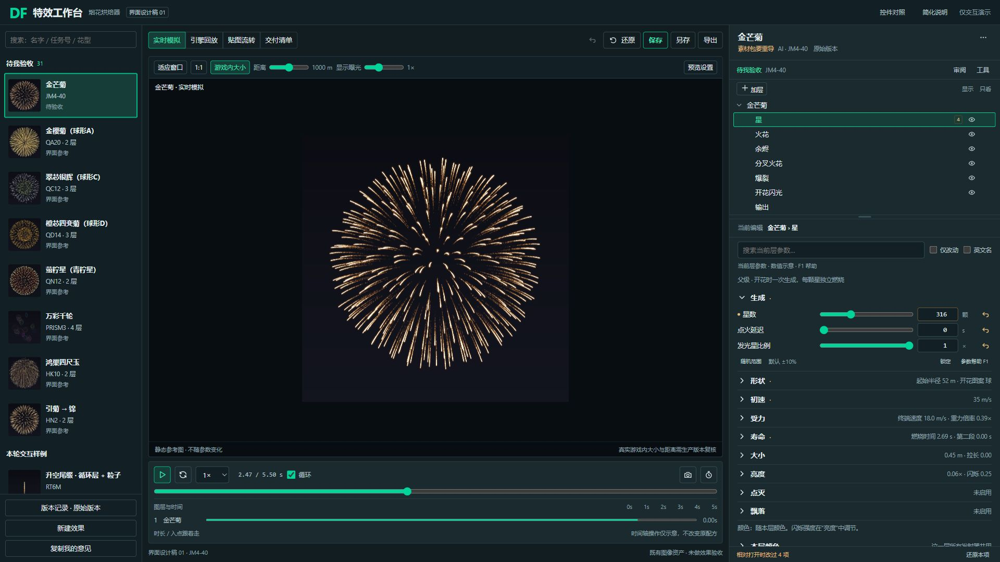
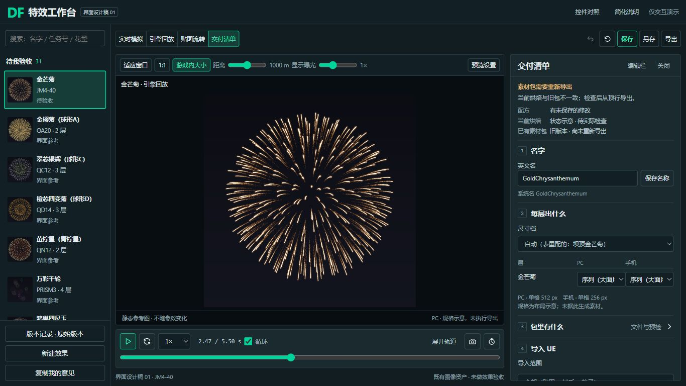
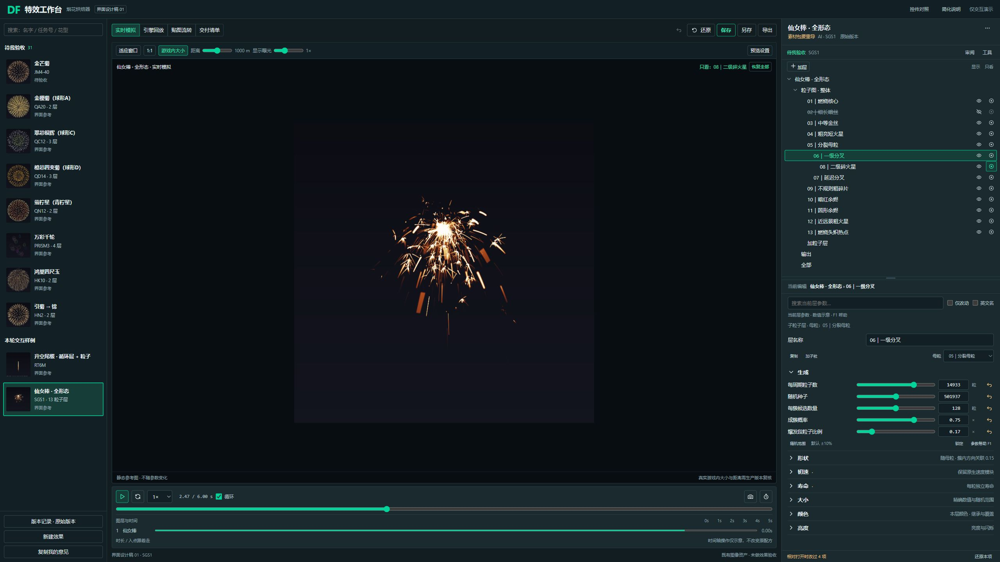

# V5 布局 × 124 风格 · 设计稿 01

已完成一套可编辑 HTML/CSS 原型和 A–F 审阅内容。状态：设计产物已制作、AI 自检通过，待用户确认视觉；未进入生产实现。

[打开本机原型](http://127.0.0.1:8034/design-system/prototypes/v5-124-20261028/index.html)。不需要安装前端依赖，复用仓库既有 8034 HTTP 服务。服务未运行时，在仓库运行 `python -X utf8 tool/local_http/preflight.py --tool baker --start`，通过后打开链接。

源码：`tool/design-system/prototypes/v5-124-20261028/index.html`、`prototype.css`、`prototype.js`。只需修改这些独立文件即可继续改稿；未覆盖生产样式或共享 tokens。

## 1. 方向与来源

- 布局基线：`c045f46a63df82c01c440a56003d5df7db29e6a0`，开工 fetch 后仍是 `origin/v5-4.9.125` 最新提交。
- 画风基线：`975ee1425649118ea96d75b9a30c2aa10dc11a55` 的 4.9.124 实页、对应 CSS、tokens/components。真实参考原图随原型保存在 `refs/124-edit.jpg`。
- 用户指定「直角与边框与整体风格」，原蓝灰 / 青绿主题保持。
- 复用实页的 3–4px 控件轮廓、细边框、深绿选中底与青绿描边、参数行30px / 数值框26px / 摘要35px。没有直接套通用组件的8/12px圆角。
- 真实图像来源、版本、尺寸和哈希见原型 `assets/sources.json`。金芒菊使用旧版回归单帧，仙女棒使用既有运动候选单帧，RT6M由4.9.124真实预览捕获；它们都不是本轮新烟花效果。图标直接复用既有 Tabler 子集和125的V5_SVG。

## 2. A–F 实际入口

| 稿件 | 打开方式 | 看什么 |
| --- | --- | --- |
| A 编辑主稿 | [编辑](http://127.0.0.1:8034/design-system/prototypes/v5-124-20261028/index.html) | 左库、中预览、右上结构 / 右下参数，常用动作在中栏顶行 |
| B 交付主稿 | [交付](http://127.0.0.1:8034/design-system/prototypes/v5-124-20261028/index.html?view=delivery) | 默认暂收编辑栏，名字 / 每层产物 / 包内容与预检 / 导入范围四块 |
| C RT6 | [编辑与只看](http://127.0.0.1:8034/design-system/prototypes/v5-124-20261028/index.html?example=rt6&state=inspect) | 编辑星头、关闭白热火花、只看远段；分隔条可加高以同时看全树 |
| C 粒子图 | [父子层级](http://127.0.0.1:8034/design-system/prototypes/v5-124-20261028/index.html?example=sgs&state=child) | 13层真实名称与缩进，编辑06、母粒05、只看08、02关闭 |
| D 多尺寸 | 调整浏览器CSS视口 | 已审看1920×1080、1366×768、2560×1440，见下表 |
| E 控件状态 | [控件对照](http://127.0.0.1:8034/design-system/prototypes/v5-124-20261028/index.html?review=states) | 普通 / 悬停 / 选中 / 焦点 / 禁用 / 修改 / 错误 / 进行中，含124实页参考 |
| F 简化说明 | [一页说明](http://127.0.0.1:8034/design-system/prototypes/v5-124-20261028/index.html?review=notes) | D1–D7、保留能力、进入 / 返回时的状态恢复 |

顶栏的「控件对照 / 简化说明」是设计审阅入口，供本阶段使用；不作为生产顶栏的新功能要求。页面只演示本轮必要的导航、选择、折叠、筛选和状态，刷新恢复起始稿。

## 3. 空间与尺寸

| 视口 / 状态 | 预览框 | 清单 | 结构区 / 参数滚动区 |
| --- | --- | --- | --- |
| 1920×1080 编辑 | 1103×770 px | — | 224 / 525 px 高 |
| 1920×1080 交付 | 1191×847 px | 420 px 宽 | 默认暂收 |
| 1366×768 编辑 | 736×490 px | — | 140 / 303 px 高，参数局部滚动 |
| 1366×768 交付 | **774×539 px** | **340 px 宽** | 默认暂收 |
| 2560×1440 粒子图 | 1702×1130 px | — | **520 / 589 px 高** |

1366旧125交付页预览框约398×447 px，本稿约774×539 px；预览占「预览 + 清单」宽度约69.5%。1920交付约74%，在清单最大420px后把剩余宽度留给预览。交付时详细轨道默认收起，播放、时间拖动和「展开轨道」入口保留。

这是**界面外框**的测量。静态烟花图用于排版，不代表真实游戏内花径；没有通过改配方、距离或模拟缩放来证明“预览变大”。默认仍标示游戏内大小、1000m，实际尺寸标定在生产实现阶段接原控制器。

上述是CSS视口，截图像素与目标视口一致。系统缩放会改变可用CSS宽度；27寸不等于2560或1920。未宣称已在不同Windows缩放档逐一实测。

## 4. 本稿的简化与行为

| 项 | 已画入 / 接入的设计行为 | 保留内容 |
| --- | --- | --- |
| D1 | 交付暂收编辑栏，默认收详细轨道；关闭返回原查看模式 | 可主动打开编辑栏；编辑对象、树 / 参数滚动、模块折叠、分隔高度保留 |
| D2 | 参数上方固定一行当前编辑路径 | 观察状态另写「只看：…」，不暗中更换参数对象 |
| D3 | RT6长观察条收为「观察…」；状态旁可恢复全部 | 树单项只看、多项临时观察；真实8个粒子输出名称；输出节点没有眼睛 |
| D4 | 更多菜单短标题、自动行高、独立说明 | 原命令；Esc关闭后焦点回入口 |
| D5 | 搜索只展示匹配项、必要归属、结果数；无结果有提示 | 清空按钮、输入框删光、仅改动筛选均恢复原参数位置 |
| D6 | 明确「保存名称」，区分配方、当前烘焙、已有素材包 | 顶部保存 / 另存、PC / 手机产物同源、唯一整包导出入口 |
| D7 | 重排、折叠直接完成，无装饰位移、缩放或高度动画 | 必要的选中、悬停和可见焦点；减少动态效果规则 |

眼睛和只看均为原型内状态：关闭眼睛后划线，仍可选中编辑，可撤销；关闭正在只看的项会清掉对应只看并禁用其只看入口。多层至少保留一层显示。临时观察不进入产物选择；原型不会实际过滤静态图像。

## 5. 三张关键图

### 编辑主稿 · 1920

### 交付主稿 · 1366

### 粒子图 · 2560

其它尺寸、RT6、控件和简化页均可在原型直接打开。完整8张截图及原始走查在 `analysis/local/20261028_界面交互-本机_设计稿01/`，按仓库过程材料规则保留14天；Git保留上述3张关键图和小证据JSON。

## 6. 自检、局限与待确认取舍

浏览器走查9项通过：交付返回恢复；搜索聚焦与清空恢复；输出 / 清单同源；名称错误反馈；菜单行高及Esc焦点；多层至少显示一层；粒子母子 / 隐藏 / 只看 / 撤销；RT6多选观察；八种控件状态一页可读。三种视口无页面横向溢出，控制台未见错误。详细设计QA在原型目录的 `design-qa.md`，数值和文件哈希见本目录 `设计证据.json`。

本阶段没有连接烟花模拟、真实保存、烘焙、素材包生成或UE。参数数值标为排版示意；未完整实现全部发射器参数与联动。播放 / 时间拖动只演示控件状态；库中四条提供轻交互，其余为库排版参考。未做Edge、真实OS缩放、完整无障碍或UE验收。

推荐用户重点确认这三个具体取舍：

1. 当前近直角、细边框及高亮是否达到希望保留的124感觉。
2. 交付默认暂收编辑栏、收起详细轨道的空间分配是否合适。
3. RT6采用「观察…」多选 + 树单项只看，参数路径始终可见，是否顺手。

确认设计稿后再使用第二阶段提示词实现。此稿不表示用户已确认，不合入125分支。
