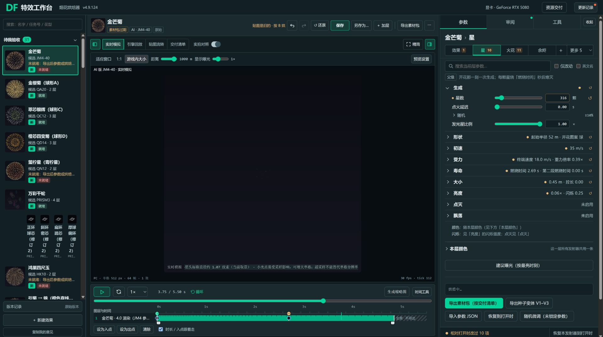
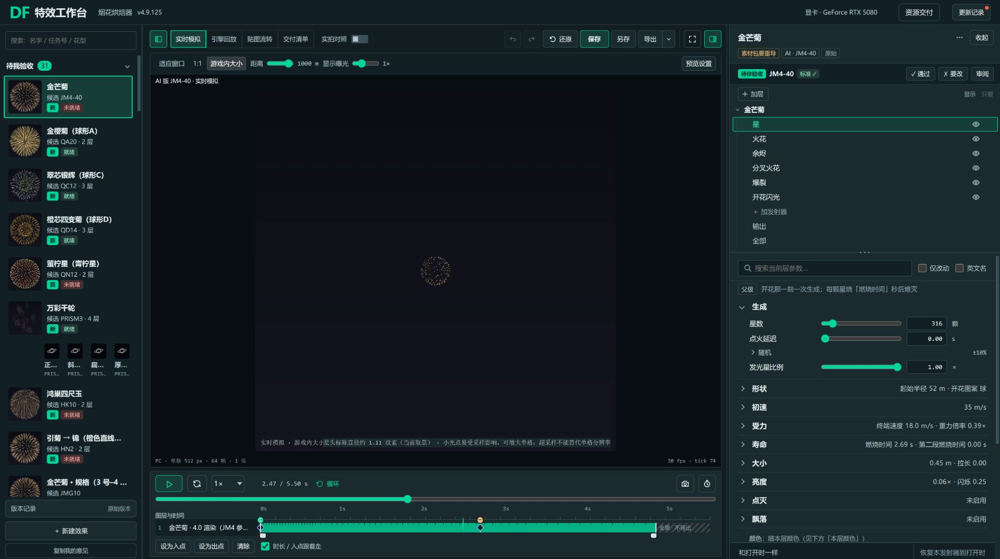
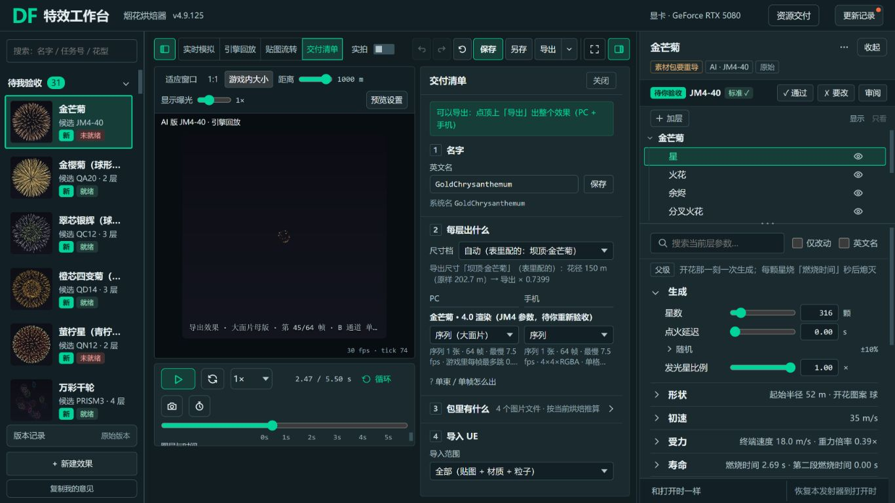

# V5 布局 × 4.9.124 风格：设计交互复核

本轮结论：沿用 4.9.125 的工作区结构，以 4.9.124 的直角感、小圆角、边框、配色和高亮为视觉基准，优先消除重复入口、空间挤占与状态歧义。无需另造一套视觉体系。

状态：已完成本轮代表流程审查、问题筛选和两阶段提示词；尚未生成本轮新设计稿、未修改生产代码、未合入 4.9.125、未经用户视觉验收。

## 1. 要求与边界

用户明确要求：

- 以云端最新 4.9.125 的布局为基础。
- 更喜欢 4.9.124；本轮进一步指定保留「直角与边框与整体风格」，主题色沿用。
- 检查交互，筛掉不必要的复杂设计；简单办法能解决就用简单办法。
- 先形成设计稿，再根据确认的设计稿实现，交付可直接使用的两阶段提示词。
- 延续交付清单「预览大、文字小，主次清楚」的要求。

本轮补全的推荐：

- 把布局、视觉、行为分别验收，避免恢复画风时撤掉新布局，或重排布局时重新换皮。
- “直角”指 124 实页已有的近直角轮廓，不把所有圆角机械设为 0。边框颜色、粗细、分隔线、选中描边都需保留。
- 简化对象是装饰、重复信息和操作成本。烟花模拟、参数、PC/手机产物能力、保存与撤销均保留。
- 先做一套推荐设计，覆盖编辑、交付、尾缀、粒子图和关键状态；避免先画大量风格变体。
- 小屏通过收起次要区域、保留上下文解决空间问题，不通过缩小字号和点击区来硬塞。

## 2. 依据与验证范围

| 来源 | 精确版本 | 用途 |
| --- | --- | --- |
| main | `975ee1425649118ea96d75b9a30c2aa10dc11a55`，成品 4.9.124 | 视觉基线 |
| origin/v5-4.9.125 | `c045f46a63df82c01c440a56003d5df7db29e6a0` | 本次审查的最新布局与实现 |
| 云端分支内对话框9、交互宪章 | 上述同一提交 | 核对已决定的行为与版本演进 |
| 用户本轮补充 | 「直角与边框与整体风格」 | 视觉取舍优先级 |

分支先后包含 `45739151` 首版、`6907ed76` 画风回退、`0f40aefb` 显示开关、`c045f46a` 再次区分布局与画风。本轮没有把首版截图当最新版本。

逐项比较 `tool/design-system/tokens.json`：排除版本号和描述，124 已有 token 在最新 125 中没有值差异。**这只证明 token 恢复，不能证明新布局和新增控件整体看起来完全相同。** 实际控件还有 `style.css` 的局部规则，不能用一个全局圆角值代表整个页面。

本机 HTTP 预检通过，复用根目录为 `F:/FireWorksLab/tool` 的 8034 服务。124 使用正式 `/baker`；125 使用服务已有静态路由下的临时分支快照，HTML 和四个 data 依赖逐字节核对，未替换正式成品、未切分支。临时快照已转入过程目录并清理服务临时目录。

本轮实际使用内置浏览器截图与 DOM 检查；视口设置覆盖 1920×1080、1366×768，以及粒子图的 2560×1440。落盘的两张 1920 编辑图实际为 1920×1074，交付图为 1366×768，准确像素和哈希见证据 JSON。27 寸并不等于固定 CSS 分辨率，系统缩放还需后续按实际常用配置验收。浏览器后台运行，未操作用户 Chrome 的文件入口。

## 3. 走查结果

| 步骤 | 实际操作与总体状态 | 证据 |
| --- | --- | --- |
| 1 | 124/125 金芒菊编辑页对照：基础画风延续，125 的新树区明显增加纵向占用 | 图 01、02 |
| 2 | 125 编辑与结构导航：单层、RT6、粒子图均有对应树；窄屏需要在树和参数间来回滚动，当前编辑对象提示不足 | 图 02；过程图 05、07、08、11 |
| 3 | 眼睛关闭火花再撤销：按钮状态、划线、未保存提示可见，撤销后眼睛恢复；RT6 只看远段可切入/退出 | 过程图 06、08及 DOM |
| 4 | 打开/关闭交付清单：能回到原视图；1920 有大预览，但 1366 仍被清单和编辑右栏挤压 | 图 03；过程图 03 |
| 5 | RT6 搜索“开花高度”：目标可找到，但同屏出现不匹配的效果、产物与输出控件，搜索结果不够聚焦 | 过程图 09 |
| 6 | 打开更多菜单、Esc 关闭：关闭正常；长菜单项出现文字高度超出行高 | 过程图 10，菜单测量见证据 JSON |
| 7 | 2560 粒子图：父子缩进与 13 层呈现可读；Enter 可切换树区收起/恢复，收起时出现当前路径 | 过程图 11及 DOM；未完整走查所有键盘路径 |

### 图 01：4.9.124 视觉参考（1920）

只用于控件、边框和布局参考。与图 02 的预览时间、烘焙状态不同，不用于比较烟花画质或参数改动数量。

### 图 02：最新 4.9.125 编辑页（1920）

### 图 03：最新 4.9.125 交付清单（1366）

## 4. 优先修正与最简单方案

| 编号 / 优先级 | 观察到的问题 | 推荐修正 | 保留的能力 |
| --- | --- | --- | --- |
| D1 / 高 | 1366 下预览外框约 398 px，清单 320 px，编辑右栏 390 px。两个文字区合计约 710 px；预览内部画布仅约 312 px | 进入交付时暂收编辑右栏，继续使用现有清单和预览。返回编辑时恢复原右栏、选中项、滚动及分隔位置。默认让预览约占主工作区 2/3 | 结构树仍用于编辑；交付时可主动打开右栏；不改游戏内大小、距离或烟花真实尺寸来制造“变大” |
| D2 / 高 | 结构树滚动到输出后，选中的星头已离开可见区域；参数顶端没有始终可见的简短对象路径。用户还可能正“只看远段”，但改的是星头 | 复用现有路径，固定一行“当前编辑：效果 › 层 › 发射器”。只看状态用独立短句表达。保留拖动分隔条，默认树高以调参任务优先 | 树选中、临时只看、配方显示三种状态各有明确含义 |
| D3 / 中 | RT6 画布上方旧的观察按钮长条与新树输出节点并存，1366 下占两行；同一个观察状态要看两处 | 树保留定位和单项只看；旧长条收口到一个“观察…”入口，只在启用观察过滤时显示“只看：远段 / 恢复全部”。已有临时多选观察若继续保留，集中到这个入口 | 不能直接删除旧长条而丢失它独有的多项观察能力；眼睛仍影响配方和导出 |
| D4 / 高 | 更多菜单“连接仓库文件夹（保存时顺便存进 git）…”行高 32 px、内容滚动高度 46 px，换行文字挤向下一项 | 菜单项高度随内容增长；常用标题简化为“连接仓库文件夹…”，解释保留在帮助。只保留少量有意义的分组 | 不新增多级子菜单，不删现有命令 |
| D5 / 中 | 搜索“开花高度”同时露出效果卡、产物及输出规格等无关内容；125 继承的搜索行为不够聚焦 | 搜索状态只展示命中项及必要的发射器/模块归属，显示范围与结果数；清空后回原选中对象和滚动位置 | 搜索、仅改动、英文名均保留；不改参数值 |
| D6 / 中 | 交付区名称按钮也叫“保存”；顶部还有“保存”。状态同时出现“素材包要重导”“标准✓”“可以导出”，对象不同但不易理解 | 名称按钮恢复清楚的“保存名称”；状态明确指向配方、烘焙或交付包，优先显示当前需处理的动作。正常长说明折叠，阻断原因就地显示 | 不把“可导出”误写为“已通过”或“已导出”，不合并不同保存命令 |
| D7 / 低，设计建议 | 新增全局过渡、菜单位移、对话框缩放、模块高度动画；历史走查已有针对聚焦、滚动恢复的动画修补 | 保留必要的轻量悬停/选中反馈；折叠和区域重排直接完成。菜单可短淡入，不必位移；不保留装饰性缩放。减少动态效果设置下取消非必要动画 | 不把反馈全部删掉；程序刷新不触发装饰动画 |

D7 是基于源码及维护记录的简化建议，本轮没有测量动画性能，也没有把过去已修好的动画缺陷记成当前复现问题。

D2/D5/D6 包含可读性或旧有行为问题，并非都能归因于 125 新增代码。D4 是本轮实测的具体排版缺陷。上述项已进入设计和实施提示词，**生产修复尚未执行**。

## 5. 应保留的优点与不可误删项

- 124：蓝灰底、青绿强调、小圆角与直角感、细边框、深绿选中底与明确描边；参数名—滑杆—数值—单位的紧凑对齐；折叠摘要；改动标记、还原、锁定、帮助。
- 125：左库/中预览/右结构加参数；上方主动作；树区可调；单层、多层、粒子图、尾缀在同一套工作区；统一的下拉、勾选、单选和滚动条；唯一素材包导出入口。
- 眼睛 = 显示这层，关闭影响配方与导出，支持撤销；只看 = 临时观察。两者不能合并为一个模糊的“隐藏”。
- PC/手机产物选择、每层输出与交付清单同源；输出是配置，导出是动作。
- 不用卡片套卡片、渐变装饰、玻璃效果、大面积发光、层层弹窗或新的导航模式来表现“设计升级”。

## 6. 两阶段交付与验收

先使用 [01 设计稿提示词](../../../协作/提示词/V5_保留124风格_01设计稿_2026-10-28.md)，得到一套可检查的推荐稿、关键状态、简化对照及尺寸说明。确认视觉后，再使用 [02 按稿实现提示词](../../../协作/提示词/V5_保留124风格_02按稿实现_2026-10-28.md)。两段均可完整复制。

补全的验收重点：

1. 1920/1366/2560 的布局与实际缩放，尤其交付预览的有效面积。
2. 正常、悬停、选中、键盘焦点、禁用、修改、错误、烘焙中、旧包、只看状态。
3. 进入/退出交付、切层/搜索/清空、审阅返回时，选择与滚动上下文不丢失。
4. 菜单不重叠、不越界；长名字可读；关键原因可通过键盘获取，不只藏在鼠标悬停中。
5. 保存、另存、撤销、显示/只看、输出与导出沿用现有语义。界面修复不能改变模拟、默认值或已认可效果。
6. 对照图验证风格，实际操作验证交互，仓库检查验证工程结果；三者分别报告。

## 7. 局限与证据存放

- 本轮不是所有花型、所有参数和完整交付链的全量验收。未执行新素材包导出、UE 导入、UE 回放、Edge 实测或完整无障碍认证。
- 多层 QA20 打开时触发组合烘焙，本轮取消后未完成其稳定多层审查；后续稿件及实现必须补测，不能拿粒子图替代多层效果。
- 124/125 日志均出现一次 `MutationObserver.observe` 参数错误，缺少可归因堆栈；不据此判为 125 回归，待实施时复核。124 取消组合烘焙后的状态文字也不作为视觉回归依据。
- 截图为当前代码实页，只用来评审界面；不是烟花效果验收。加载中或截图缩放导致裁切的图均未纳入接受的证据。
- 三张关键图和 `审查证据.json` 随本报告入 Git。其它截图、DOM、来源和原始快照在 `analysis/local/20261028_界面交互-本机_125审查/`，为本机过程材料，按仓库规则保留 14 天。

技术定位：`tool/src/js/92_v5shell.js`（树、路径、分隔、控件与入口）、`tool/src/style.css`（布局和菜单）、`tool/src/js/79_workbench.js`（交付清单）、`tool/src/js/71_panel43.js`（参数与搜索）、`tool/design-system/`（共享视觉基础）。这些文件本轮均未修改。
