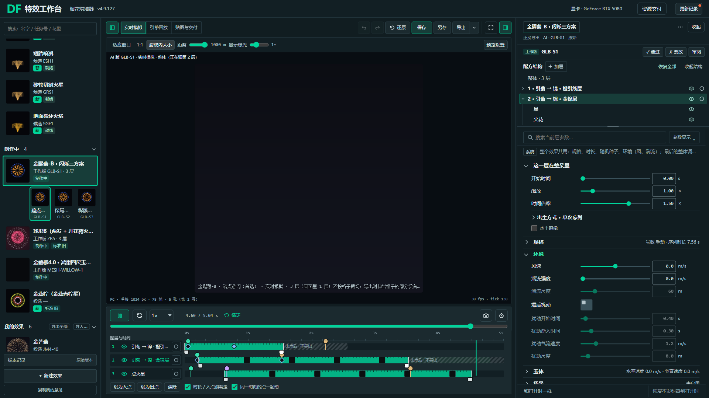
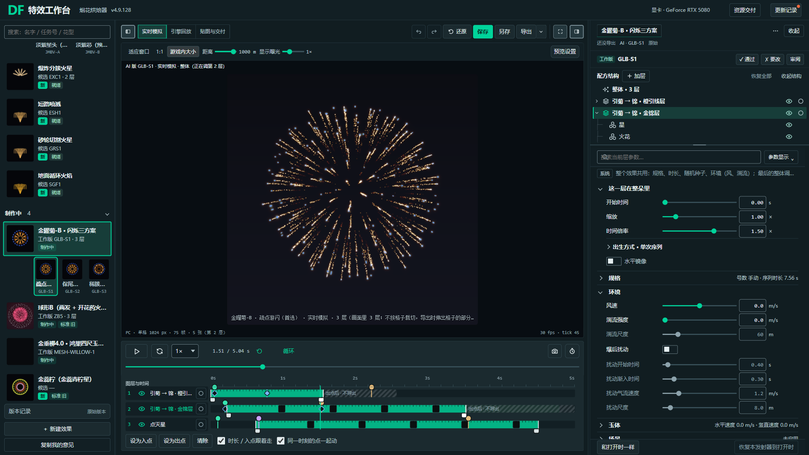
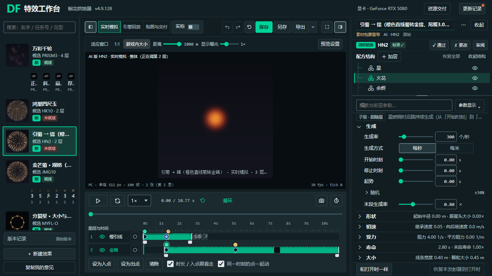

# 完整B组件覆盖复核 · 4.9.128独立评审

127没有完成全组件统一。它接通了完整业务，但主要适配右侧部分参数和新增工作区；行为检查通过不能证明组件视觉一致。用户这次指出的树类型图形、层头输入、镜像与爆后扰动，确有遗漏。

128把重复控件的可执行规则集中到 `tool/src/material-b-components.css`，`material-b.css`只保留工作区布局；97给原DOM分类、同步轨道与复用图标，不复制参数或控制器。以用户左图的蓝灰/青绿、细边框、小圆角为依据，保留真实树层级及完整烘焙器业务。**这是完整B文档的统一适配候选，不代表所有实例、全部组合状态或整个产品生态已验收。**

## 操作入口

- 当前完整B：[8034评审入口](http://127.0.0.1:8034/baker?ui=material-b)，版本4.9.128；本地 `tool/FireworkBaker_MaterialB.html`。
- 冻结旧版：`tool/FireworkBaker_MaterialB_4.9.127.html`；与开工前已提交127的工作树字节完全一致。126与旧稿继续保留。
- 默认旧布局：[8034旧入口](http://127.0.0.1:8034/baker)。共享tokens、配方、模拟/烘焙/导出、导入器、节目和UE未改。本分支不合入main或125。
- 全范围及未测状态见[25区域覆盖表](组件覆盖表.md)；静态路由不提供冻结HTML的HTTP地址，旧版用本地文件打开，不提供无效链接。

## 本次统一的规格

| 对象 | 128的共同规则 | 保留的差别 |
|---|---|---|
| 动作 | 普通32px；库标题24px、行内/图标28px专用变体；统一边界、焦点与禁用 | 树节点、模板、说明、时间轴和清单层名属于结构动作，不套普通按钮内边距 |
| 输入/下拉 | 同一主题外框、字号、焦点与错误；长命令/选项按内容增高 | 数值、颜色、checkbox/radio/range各按类型匹配，不用通配input规则 |
| 参数行 | 名称—滑杆—数值—40px单位槽—还原；数字30px，短窗28px | 层头/出生/材质等非panelRows实例也复用；原值、范围、单位、还原含义不变 |
| 开关/多选 | 即时布尔36×20方形开关；选择复选与radio18×18 | RT观察、联动/资产多选不变成开关；锁定仍可编辑，和禁用/inert分开 |
| 树 | 原28px行高、16px逐层缩进、18px同源类型资产和细导线；选中路径独立表达 | 去掉视觉人工序号/◆，完整原ARIA名保留；眼睛与只看原语义不合并 |
| 色/曲线/表格 | 32px方形色井、紧凑删除、可读HEX、统一外围与阅读角色 | 真实颜色、Ramp渐变、SVG曲线、进度值和贴图不主题化、不伪造 |
| 菜单/对话框/反馈 | 同一外框/文字层级；长文换行；真实错误/陈旧/进行中按已有状态表达 | #status没有可靠错误类型时保持中性，不根据文案猜成功；iframe/系统UI另列 |

## 实测及改进

先以127运行同一复现检查，记录了未分类、无类型资产、镜像仍为原生灰框及爆后扰动被撑成32×30等失败。128改正后，再通过实页发现并修正了两轮扩大选择器的副作用：

1. 库内档位/模板、模块说明和时间轴观察被当成普通动作，出现多余方框与高度；将它们归回原结构变体，清单层名同样保留轻量动作。
2. 1366长标题把“收起”挤成两行，使标题栏由62.67变为80px；行内动作禁止收缩/换行后恢复62.67，不缩字号、不隐藏物理字段、不降低首屏门槛。

人工打开真实HTTP页，检查1920×1080层头/环境和保存框、1366×768长标题/火花参数、1366与900×900清单滚动及2560×1440交付。CSS视口由浏览器设备指标指定，DPR约1；OS缩放未改。截图是完整浏览器合成画面，固定clip曾漏绘边缘文字的中间图没有作为交付证据。

1366交付时编辑栏暂收，预览777×571.67px、清单336px；大屏预览1827×1243.67px、清单420px；900窄窗预览552px、清单320px，页面无横向溢出。预览比例/烟花物理大小/观看距离未为排版改动。

| 检查 | 结果与范围 |
|---|---|
| 构建/静态 | 0错误；保留原22条脚本提示与8条静态提示 |
| 组件 | 最终183/183，六组真实DOM；原176项加7项库行内、方形色井、Toast回调和进度几何检查；0页面错误 |
| 交互 | 原91/91及W14通过；树eye/临时观察、RT首次列表、关闭层查看、合并工作区、宽度/偏好与配方不变 |
| 首屏 | 菊三尺寸均9/9模块；金锦1366为6/9、1440为8/9、1920为9/9；门槛未改 |
| 保护 | 开工424文件核对，无越界变更或丢失；127冻结字节与原提交一致；他方探索文件保留 |
| 推送门禁 | 随最终提交的原pre-push门禁核对，结果见验证摘要；不绕过钩子 |

组件与91项在隔离上下文、原假烘焙和暂停RAF机制下验证DOM、几何及控制器，不能称为像素或真实素材包验收。人工实页使用原正常入口与真实预览；本轮未重新导出真实ZIP、未做UE实测。126的真实ZIP链路和127的数据检查记录仅作历史证据，不冒充128产物验证。历史全量条目检查中MESH-WILLOW-1缺项仍在范围外。

## 对照证据

同一CSS1920视口、GLB-S1金锦层、相同层头与环境展开。下面两图仅比较UI，预览时刻不同，不作渲染像素对比。

## 明确边界

外部导入器iframe内部、系统文件/目录/颜色选择器及浏览器原生回退弹层没有统一。本轮覆盖规则及所列实例已验证，未逐一人工验收全部hover/focus/disabled/readonly/修改+错误组合，也未重做所有领域编辑器。真实保存框已打开并取消，取消后焦点回body，回触发器尚未验收。未把这些项目写成完成。

期间main新增了独立 `style-match-20261029` 图稿与令牌候选，未启用到当前B。其40px控件/32px树行等探索规格与本轮原28px树测量不同；保留候选作比较，不未经选择直接替换本轮已验证的工作区与控件尺寸。停在独立分支的视觉和操作评审阶段。
