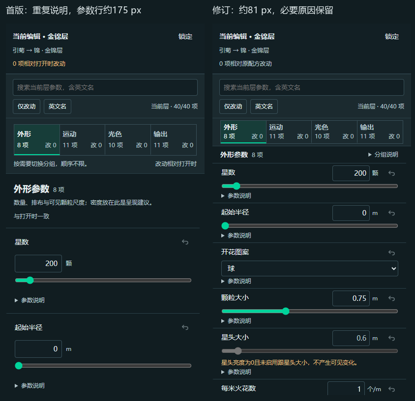
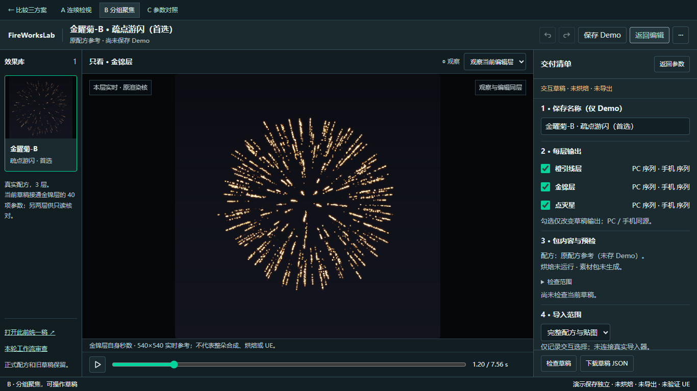

# 三套真实工作流 Demo · 交付评审

**推荐先评审B「分组聚焦」**。三稿都已做成独立可操作HTML；A适合跨组连续联调，B减少当前任务干扰，C便于先核对差异再精调。这是针对当前目标的设计判断，尚未做用户效率实验，用户没有被预设为已认可。

入口：[比较三套方案](http://127.0.0.1:8034/design-system/drafts/v4-workflows-20261029/review.html)。本轮在独立分支 `codex/ui-workflow-demos-20261029`，不合入main或125；正式项目、共享tokens、旧v1/v2/v3及他方未提交三套探索完整保留。

## 主要变化与依据

仍用蓝灰/青绿、小圆角直角感与细边框、左库/大预览/右结构和参数。新40项来自金曜菊真实原配方与原参数表，按外形/运动/光色/输出做找参数投影，原发射器/模块与来源可追溯，不改物理含义。统一数值/滑杆/单位/帮助与状态，正常状态不泛滥警告；锁定、只读、条件无效、输入错误、原配方差异与未保存分别表达。

Spectrum用于连续量/精确值与上下文属性，Fluent用于就近命令与焦点，Carbon用于密集扫描和就地错误。三者共同构成项目判断，不把A/B/C做成三套品牌拼贴，不强换框架。官方链接及具体取舍见新稿 `design-language.md`。

[原V3完整稿](http://127.0.0.1:8034/design-system/drafts/v3-unified/demo.html)可对照；以下为本轮首版到修订的同尺度参数面板，B数字行从约175收至约81px，必要原因仍直接可见：

交付进入时收参数栏、保留预览与320px清单；返回保留对象、分组、筛选和滚动。1366×768时预览栏884px，占去库后主区73.42%；实际可见方画布520×520，未改dist=1000或粒子世界大小。内部540×540是实时参考解析度，不冒充烘焙输出。四块标题及导入选择可直接看到，范围说明按需展开：

## 可操作与未连接

三套均支持真实金锦参数、另两层原值只读与单独观察、精确/滑杆/枚举/Ramp输入、条件原因、搜索/仅改动/英文、折叠、锁定、恢复、撤销重做、独立Demo保存刷新、草稿形式检查与明确标识的JSON下载。真实预览在隔离内存副本中复用原核；编辑、观察、输出互不混淆。

未连接正式保存/另存、整朵三层合成与同批联动、烘焙/业务预检/素材包/真实导入/UE。40项是代表集，RT6/粒子图与其他工具本轮没有全量迁移，旧稿仍保留。完整读屏与其他GPU环境未经认证。

## 验证及待选

两浏览器212项控件/降级检查、66项真实核实页复核、23项末轮增补通过；三阶段范围单列于 `verification.json`，没有混称生产或用户通过。覆盖长名称、长输入、无结果/错误/条件无效、滚动接续、菜单/焦点、1920/1366/2560与短高/DPR2。实际打开后的浏览器入口和审看记录在新稿设计QA中接续。

用户只需选择默认工作方式：A减少切组但滚动更长；B当前组更清楚但跨组需切换；C差异最直接但精调需展开。主题、参数含义和共用状态规则不需要重新选择。停止Demo评审，选定后才进入正式库实施。

实际Chrome已打开并操作，修改/撤销后回到原配方0.75、完整40项，未写正式配方。CSS1536×769，浏览器DPR2.5，不推定为某个系统缩放。比较页与B均保留为用户交付入口：

原全量筛查中未覆盖/未复现项目继续按原报告待验；本轮代表Demo不替这些缺口销账。
