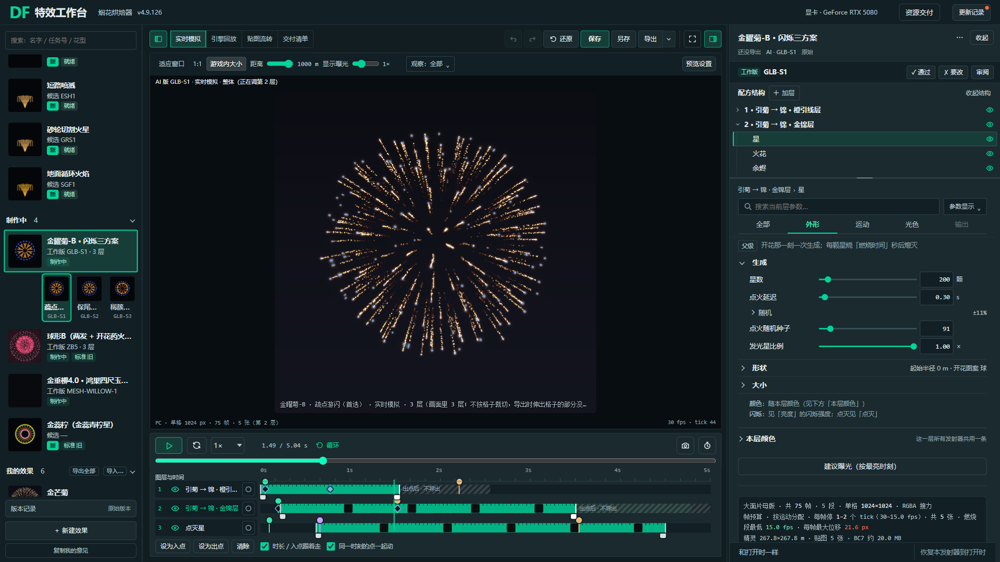
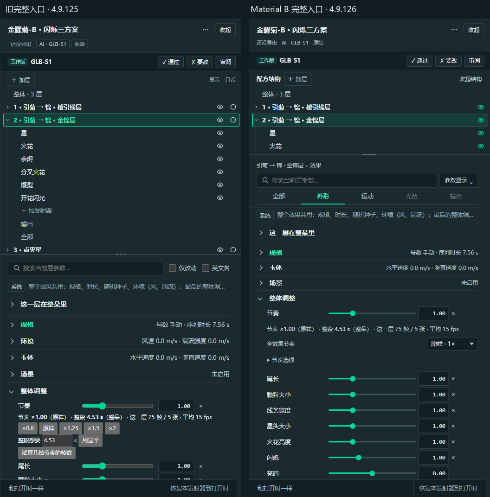
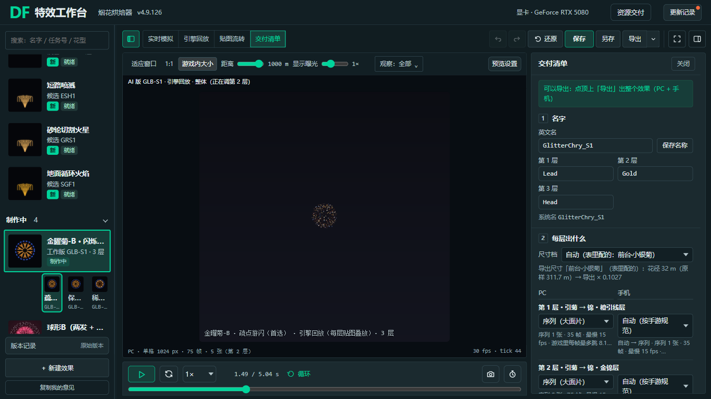

# 完整烘焙器 Material B · 本机评审候选

已接入完整烘焙器，可测试真实参数、保存、烘焙与导出；旧入口和旧草稿保留。**尚未达到提交条件：W14 的窄屏模块密度项未通过，因此本轮界面改动未提交、未推送，未合入 main 或125。** 不能把本机可测、检查通过和用户认可混为一谈。

- 新入口：<http://127.0.0.1:8034/baker?ui=material-b>
- 旧布局入口：<http://127.0.0.1:8034/baker>
- 完整文件：[FireworkBaker_MaterialB.html](F:/FWL-副本/20261028-界面交互-本机-全量筛查/tool/FireworkBaker_MaterialB.html)，在原 tool 文件夹内打开以读取同目录 data。
- 本机分支：`codex/ui-material-baker-review-20261029`。远端当前只有认领提交 `f9185b4e`，不含下面的新UI；新UI在本机工作区。
- 基线：已核对 `origin/v5-4.9.125` 的 `76eadd33`；本次只增加布局投影/样式及节奏呈现，UI版本4.9.126。结束时fetch核对125未变；main新增的PPT记录 `ea62eac6` 与本轮源码无关，未混入。

## 这轮怎样处理截图问题

| 问题 | 实际处理与保留能力 |
| --- | --- |
| B的选框 | 层名整行是树项选中；四组是Tabs；仅改动/英文名是复选选项。没有把三种语义混成同一种框。 |
| 结构图标与粗糙工具条 | 标题只写“配方结构”，不加装饰图标；明确“收起结构/展开结构”。眼睛留在树上，控制配方及输出；只看集中到预览区“观察…”。尾缀原多选、双击只看和全部恢复均保留。 |
| 当前编辑、仅改动、英文名 | 原路径压成搜索上方一行，不再重复“当前编辑”身份卡；两项显示偏好进单层“参数显示”菜单。搜索范围、数量、无结果和清除入口仍可见。 |
| 参数行四个东西 | “×”是单位，原草稿只有后三项是动作。正式版沿用名称—滑杆—数值＋单位；只在改动后露恢复，帮助用参数名/F1。正式锁是“排除号数/随机微调”，手动编辑仍可用。重复的名称尾部×仅在呈现层去掉。 |
| 0.8/1.25/1.5一排 | 改为“全效果节奏”下拉；精确数值框、自定值、目标秒数及试算保留。下拉仍调用原applyTempo，速度/重力/时间联动没有换一套算法。 |
| 绿色滑杆 | 主题绿表示有效轨与把手，中性余轨/禁用、独立焦点框；原数字输入不加新的硬边界。 |

设计依据及官方链接见[组件决策.md](组件决策.md)。采用Material基础、B的分组与Adobe的层级收敛方法，未安装或替换业务组件框架。

**分组范围明确：** 四任务组作用于树中当前原发射器/对象；点击层名仍进入这一层的整体参数。它不是旧Demo的40项混排。保留发射器和模块归属；“全部”是兜底，SGR1的三个“分叉”模块共15项暂未归四类，但完整可达。数量证据不包含info/spec宿主内部动作，不能宣称所有控件逐个验证。

## 实页与一轮改进

同一GLB-S1、金锦层、1.49s、1000m、显示曝光1×，旧4.9.125与新候选在1920×1080 CSS视口对照；截图使用deviceScaleFactor=1，未改变系统缩放。保留真实字号、内容与预览，不用生成图代替功能证据。

首轮实测后已修：树默认占高过多；随机子行搬移后的统计归属；尾缀原观察动作不刷新摘要；交付临时编辑栏的关闭/P/Esc/窄屏外点；限高菜单把长命令压回32px。长命令现自然两行52px，菜单在1366屏内滚动，文本盒不重叠。

默认树自动高度84–140px，把更多高度给参数；用户拖过分隔条的高度继续有效。新增Tabs仅组名，不堆“改0/项数”。搜索时跨任务组，清空恢复原任务组；原控制器继续恢复自动展开的模块，新呈现层补恢复滚动位置。

## 交付页预览

默认暂收编辑右栏与层轨道，保留播放/时间滑杆及主动打开参数入口；离开恢复原面板偏好和原任务组。没有写回临时收栏状态。

| 1366×768 CSS视口，同一配方和时刻 | 原V5 | 新候选 |
| --- | ---: | ---: |
| 预览工作区 | 398×350 px | 777×588 px |
| 实际canvas CSS面积 | 216×216 px | 482×482 px |
| 清单宽 | 320 px | 336 px |
| 编辑右栏默认 | 390 px | 暂收，可主动打开 |

新预览工作区宽约占“预览＋清单”的70%。引擎回放仍按原32m产物标定、1000m观看距离显示；截图中的烟花大小遵循真实产物比例。

## 已验证

1. 双完整HTML构建、两份脚本静态检查及参数/DOM静态核对：0错误；保留原有提示。
2. 新布局下既有N3/W7/W37/R10/R11/X1/R12/R13共8项通过；705项SCHEMA默认值、命名与归属一致。
3. 独立分组检查309/309：菊124、金锦层133、RT6 135、SGR1 609项的实际DOM归属、分组可达、搜索/清除、仅改动、英文重建、键盘、未知模块兜底、观察不改P/M/层输出。RT6/SGR使用拒绝emitset/loop的旧假烘焙，只证明参数UI，未冒充真烘焙。
4. 节奏接线18/18：原生选1.25及1，原时间÷、速度×、重力ײ联动和还原；精确1.37出现自定项，目标秒数/试算入口可见。此项为单层接线检查，未额外真烘。
5. 真GPU主流程W16通过：选层、调参/调色、撤销重做、保存刷新重开、最新贴图及PC/手机组包。随后在IAB实际另存三层测试副本并下载ZIP：20,585,979字节、45文件、40 PNG、PC/手机配置齐、CRC无错误。下载在 `C:/Users/locmai/Downloads/UIReview_MaterialB_20261029.zip`，未执行UE导入。
6. 1366长菜单、参数显示及Esc，大屏1920/2560的主动作、搜索与根页面溢出检查14/14。900窄窗交付抽屉关闭和外点实测通过；1366交付进出前后配方、右栏偏好和任务组相同。
7. 筛选位置恢复13/13：未命中清除430→430，英文重建后510→510；开合/任务组/模型不变。跨层时保留新层0，不把旧层460带过去。
8. 420个保护文件核对：只有已授权的版本、节奏UI、build和默认生成HTML改变，其他旧稿/共享组件/引擎/工作台源未变。浏览器原保存版本2个key未改，只新增明确命名测试副本及其版本记录；导出目的地恢复原“指定目录”。

## 未通过与未完成

**W14的旧模块密度阈值未通过。** 原入口本身已有失败；新候选虽把1920下两个对象都改善为9/9，窄屏“全部”视图仍需要滚动：

| 视口 | 旧 菊/金锦火花 | 新 菊/金锦火花 | W14要求 |
| --- | --- | --- | --- |
| 1366×768 | 6/2 | 6/1 | 至少6/6 |
| 1440×900 | 7/5 | 8/3 | 9/6 |
| 1920×1080 | 9/5 | 9/9 | 9/9 |

保留此失败证据；未改阈值、未把分组切换算作“同屏全见”、未用缩小字体掩盖。按用户AGENTS“检查未通过时停止相关提交”的规则，**停止提交/推送这轮UI**。本机完整候选可操作，不能称正式验收通过。

未做：UE导入/实播、所有效果的真GPU重烘、完整屏幕阅读器/WCAG认证、全业务逐控件验证；未把以前门禁或其他任务的截图算成本轮通过。最终提交/推送门禁未执行，认领前的18效果199行门禁不冒充本轮最终验证。

建议先测试：选层后四任务组是否符合查找习惯；单层与组合里的节奏/锁/帮助是否清楚；1366下是否接受分组及滚动的密度取舍。保持正式库、125和旧入口供比较。

机器可读摘要见[验证摘要.json](验证摘要.json)。完整过程证据保存在同名 `analysis/local` 目录，未把测试副本/ZIP写进Git。
