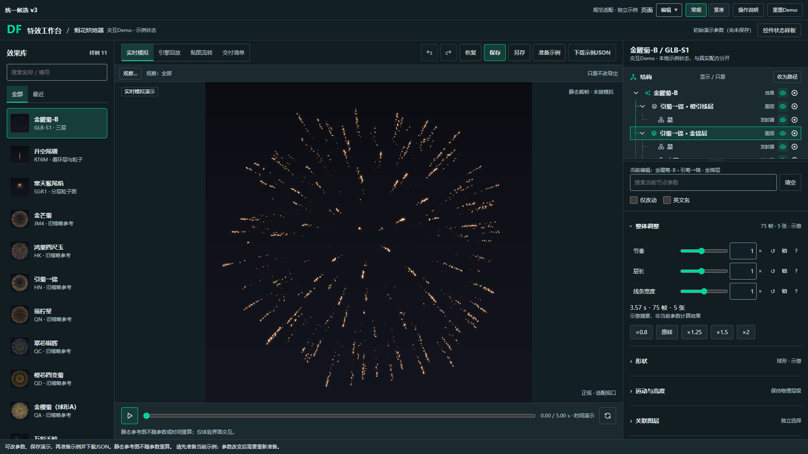
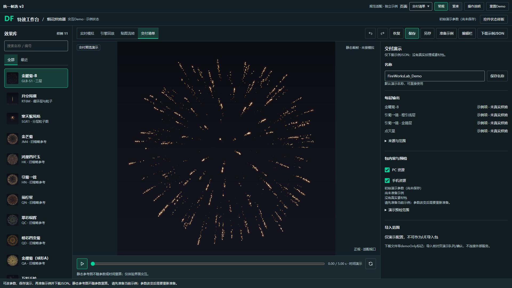
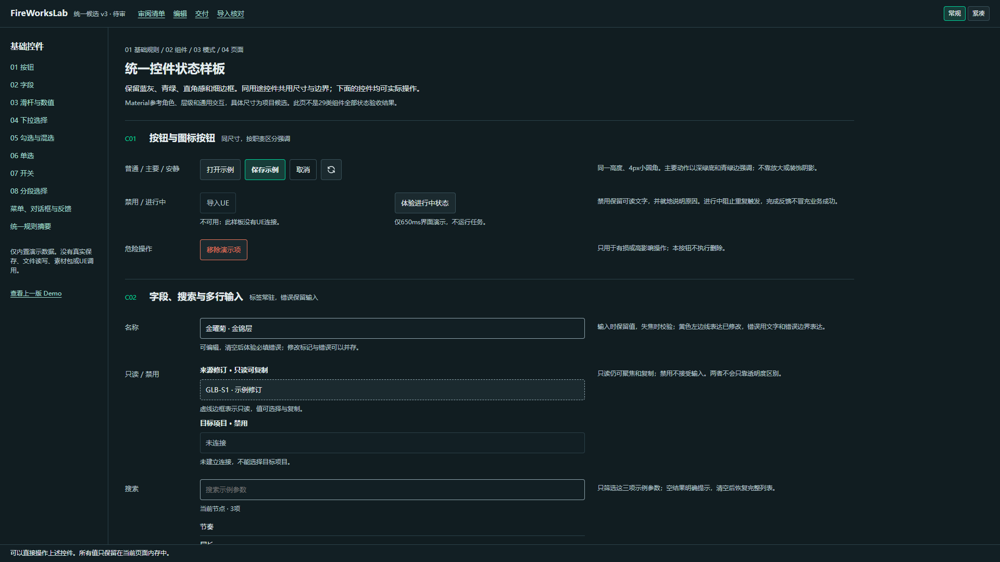

# 统一组件候选v3 · 待用户验收

用户要求将规范映射、统一状态样板、三个代表页与Demo/同视口对照设为目标并执行。本轮设计交付已完成，用户视觉验收尚未发生；正式组件库和生产迁移未执行。

[审阅入口](http://127.0.0.1:8034/design-system/drafts/v3-unified/index.html) · [状态样板](http://127.0.0.1:8034/design-system/drafts/v3-unified/components.html) · [可操作Demo](http://127.0.0.1:8034/design-system/drafts/v3-unified/demo.html) · [前后对照](http://127.0.0.1:8034/design-system/drafts/v3-unified/compare.html)。本机Chrome已实际打开并保留。

29类映射为Material参考8/桌面适配14/领域自定义7；14模式、8模板保留规格。八类基础与代表页消费同一候选样式，适用状态按交互/值/可用性/校验四轴。124主题色、直角感、细边框保持；继承f814a849已选结构类型图标/父子导线与原布局，合并同用途历史差异。

同视口1920/DPR1初始示例前后对照、参数重点和最终窄高图已审看。Chrome154/Edge156核心链、64默认态与最后12短高真实滚动状态有限自检通过；审阅页/对照另8状态。最终短高媒体修订与此前矩阵分别记源哈希，不写成全部同版全覆盖。1366交付预览容器793.8px/主工作区1134px=70%，静态图适配499.7×491px；未改烟花尺寸或观看距离。

关键图直接复用设计目录，避免重复提交：

详细取舍、规范与验证在设计目录README.md、decisions.md、standards-map.json、state-contracts.json、verification.json、design-qa.md；过程原图/失败修订历史只留analysis/local/20261029_组件规范统一。原v1/v2稿、共享tokens/组件、宪章、生产、配方、私有导入器、节目与UE均未修改。

请用户审同类一致、信息主次、密度和状态表达。Demo只使用fwl.ui-demo.v3-unified专属存档，静态图不重算，下载是demoOnly JSON。未验证file入口、原生系统缩放/其它OS、完整读屏/WCAG符合性、全部领域状态或真实UE业务。原全量筛查的7/9校准及其它缺口不会因本稿完成被改为通过。
