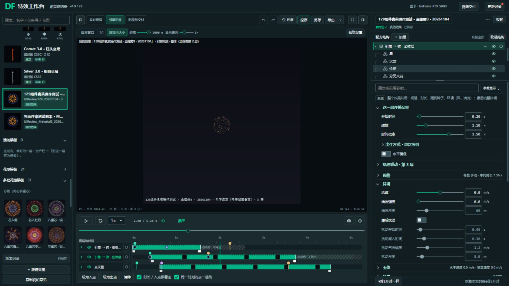
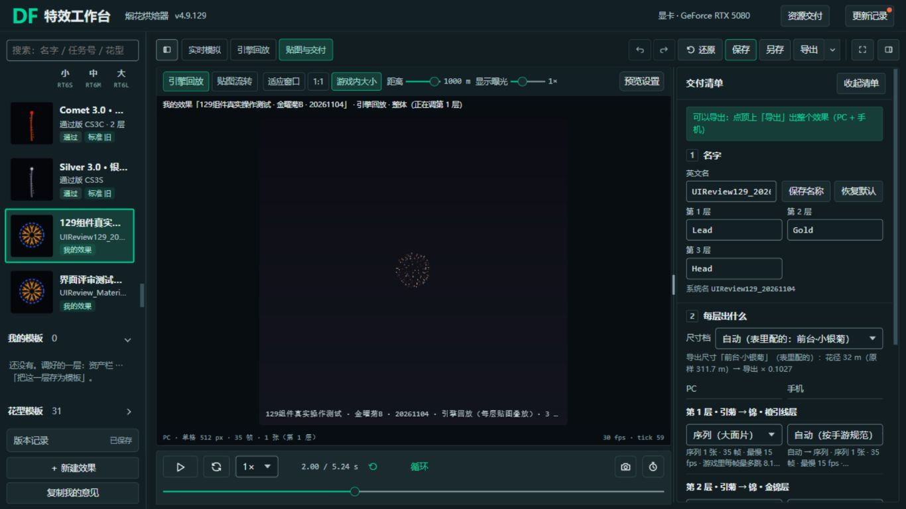
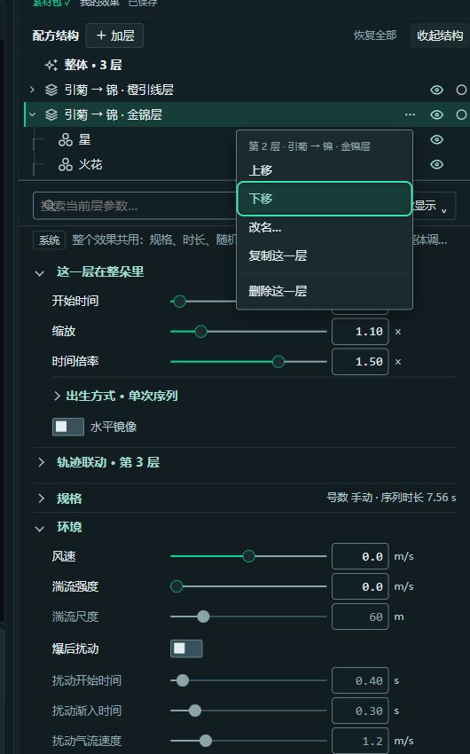

# 完整烘焙器 4.9.129 · 用户确认的组件组合

14 类选型、三条绿色备注与纯直线树选中已接入完整 128 业务。此入口可以真实调参、撤销/重做、保存个人效果、GPU 烘焙和导出素材包；不载入组件 Demo 控制器。旧 128 与全部旧稿保留。

## 直接测试

- 新完整入口：http://127.0.0.1:8034/design-system/selected129/FireworkBaker_129.html
- 项目内文件：`tool/FireworkBaker_129.html`（与旧入口同级；建议从这里或 HTTP 测试完整关联功能）。
- 下载副本：`C:/Users/locmai/Downloads/FWL-完整烘焙器-4.9.129-我的组合.html`。
- 旧完整 128：http://127.0.0.1:8034/baker?ui=material-b ；旧默认 `/baker` 和旧 129 组件对照稿都保留。

单 HTML 内嵌全部业务脚本及 review / standard / thumbs / size_spec 数据，项目内文件与 HTTP 镜像、下载副本逐字节一致。外部视频、资源交付导入器仍依赖原项目目录；复制到 Downloads 后不代表这些外部入口也可脱离项目运行。本轮真实操作测试使用 HTTP，不声称已验证 file://。

## 本次采用的 14 类

| 组件 | 采用 | 应用到完整工具 |
|---|---|---|
| C01 按钮与图标按钮 | Material | 主动作、图标动作与禁用状态 |
| C02 字段、搜索与参数行 | Adobe | 文本、数字、搜索、单位对齐 |
| C03 滑杆 | Adobe + 主题绿 | 细轨与空心滑块；禁用时保留同一几何 |
| C04 下拉 | Adobe + 绿色选中 | 字段和展开选项；窄列闭合单行、展开长文换行 |
| C05 复选框与混选 | Material | 18 px 复选框、主题绿 |
| C06 单选组 | Material | 真实单选输入 |
| C07 即时布尔开关 | Material | 36 × 20 px 开关 |
| C08 页签与短选项分段 | Material | 参数分组以及预览/平台/贴图分段 |
| C09 折叠、摘要与帮助 | Material | 普通参数组、出生方式与本层颜色 |
| C11 菜单 | Adobe + 绿色选中 | 树菜单、参数显示及动作菜单；键盘焦点同色 |
| C12 对话框 | Adobe | 原真实保存/确认等表单壳与控件 |
| C16 进度 | Adobe | 原真实烘焙/导出进度；没有模拟百分比 |
| TREE 结构树 | Adobe 定向稿 | 类型图标、父子层级、眼睛/只看；0 圆角和 2 px 左侧纯直线 |
| COLOR 颜色/Ramp/曲线 | Adobe 定向稿 | 32 px 色井及外围字段；实际色值与曲线运算不变 |

这里的 Material / Adobe 指用户已经确认的项目候选稿，不宣称安装了官方整套组件库。三条备注原文与 14 项记录原样内嵌；实际样式规则与 129 对照稿共用生成器。

## 实测与改进

- 使用独立测试效果“129组件真实操作测试 · 金曜菊B · 20261104”。金锦层开始时间 0.20、缩放 1.10，真实输入、撤销/重做、保存并重开读回正确；原效果没有覆盖。
- 树选择/折叠、眼睛开关、只看及恢复分别操作。树选中实际计算样式为 `border-radius: 0px`、2 px 绿色内侧直线；不统一清除其他控件的小圆角。
- 下载真实 `UIReview129_20261104.zip`：20,584,094 字节，45 个文件、40 张可解码 PNG；PC 的 27 个贴图引用和手机的 3 个贴图引用全部存在且 SHA 匹配，两份配置均标识 4.9.129。手机自动输出沿用原规范，不把未输出的重叠层伪装成全部已通过。详见 `素材包检查.json`。
- 1920×1080 与 1366×768 CSS 视口检查。1366 交付预览 777 px、清单 336 px（预览占两者总宽约 70%）；拖动可改为预览 717 / 清单 396。离开交付恢复右侧编辑，预览大小没有靠改变烟花/观看距离实现。
- 复用了普通 Schema、层头出生联动、RT6、SGR1、SGS1、跨区域外壳 6 组、183 项既有 DOM/几何检查，全部通过。这部分使用隔离 FAKE/停 RAF，不能证明真实烘焙；真实烘焙与 ZIP 来自另行操作的实页。
- 实测后修复了直属树菜单被旧按钮样式覆盖的绿色焦点、方向键与 Esc 回焦点、禁用滑杆形状、遗漏的折叠/颜色/分段映射。最终又修复窄列下拉闭合换行问题，并重载实页验证：闭合高度/滚动高度均 31 px，展开完整换行且绿色选中。

## 改动范围与后续

`tool/design-system/selected129/build.py` 从完整 128、已确认 129 profile 和同一组件生成器构建两个相同成品；`real-controls.css/js` 仅补真实 DOM 和菜单键盘操作。原业务主脚本除 VERSION 外一致。361 个保护文件哈希未变，覆盖旧入口、共享源/令牌/数据、旧稿及他方未提交文件。

构建：`python -X utf8 tool/design-system/selected129/build.py`。契约检查：`python -X utf8 tool/design-system/selected129/check.py`；加 `--runtime` 可跑既有隔离组件回归。构建静态检查 0 错误，22 条原有提示。未来若完整基底升级，本构建会拒绝悄悄换到别的版本，需要重新核验。

未执行 UE 导入、P4 或个人节目操作；未验证所有浏览器/读屏/配方组合。系统文件/颜色选择器以及资源交付 iframe 是原项目边界。本次成功导出不等于已通过烟花画质或 UE 验收。代码停留在独立评审分支，main 和旧 128 入口未替换。

