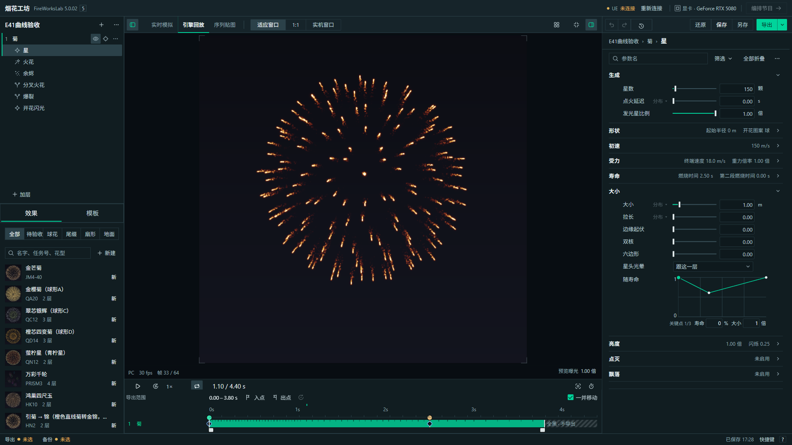
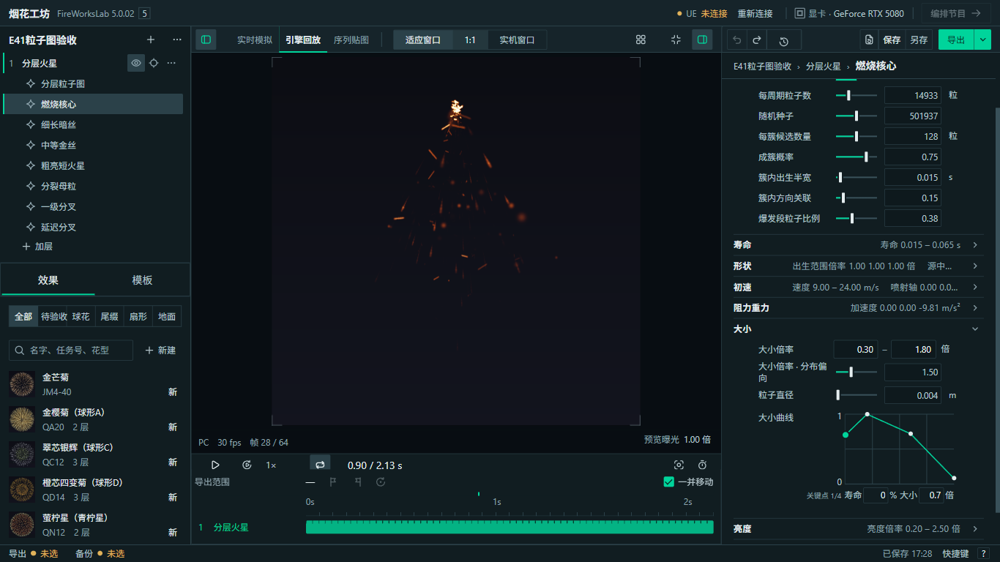
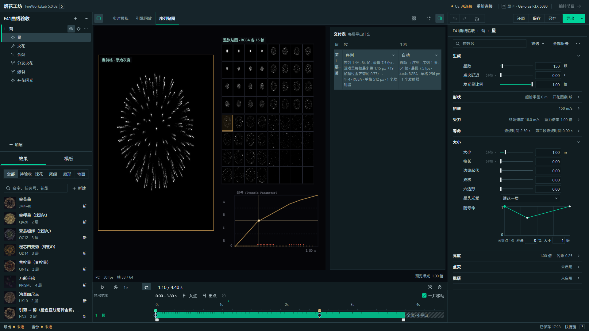

# E 4.1 合入返工 · 工坊 5.0.02

2026-11-12，LOCMAI-PC1。正式入口：`tool/烟花工坊.html`；内部烘焙器 4.9.138。状态：本机自检通过，待用户验收。

上次 12478a43 只取了预览分支的局部生产覆盖，夹带了另一版双行工具栏。正式曲线仍是文字输入和只读图，工坊版本也没有递增。旧门禁验证的是回归和导出契约，不能证明完整样板已接入；上次的完整合入结论不成立。

此次依据完整 `outputs/E样板4.1/E样板_v4.1.html`、预览分支 `E样板_v4.1_改动单.md`、`协作/方案/E设计规范_v4_2026-11-05.md` 和用户 11-12 截图反馈逐项核对。

| 部分 | 正式实现与核对结果 |
| --- | --- |
| 图标、数值框、滑杆 | 沿用已合入的 4.1 图标；数值与范围输入都有浅边框；滑杆未填段 2 px；窄栏数值列仍对齐 |
| 树与参数状态 | 树操作常驻弱显；改动行有还原；分布入口补常驻 45% 弱显；开关、分布与颜色继续走现有参数保存和撤销 |
| 工作模式 | 下划线标签，与画面大小分段有分隔；单行工具栏；距离 / 预览曝光在画面右下 |
| 工具组 | 撤销 / 重做 / 版本、还原 / 保存 / 另存各一组；导出为主按钮；1366 入出点只显示图标 |
| 效果库 | 筛选在搜索上面；缩略图 40 px / 窄屏 36 px；选中用浅底，去掉旧绿色外框 |
| 曲线 | `FWDesign.createCurveEditor` 一份实现，组件库样例、普通发射器、尾缀、自定义发射器和分层粒子图共用；原字符串 / 数组格式保持 |
| 曲线交互 | 拖点、双击加点、Delete 删中间点、精确输入、数值拖动、方向键、Esc 取消；一次拖动一次撤销；普通曲线补改动统计、按行 / 发射器还原；双击名字恢复模板默认 |
| 保存与重开 | 修改曲线后保存、刷新、重新打开，关键点保留；空曲线只展示恒定 1，不自动写入配方 |
| 输出与数据 | 保持上一轮输出常用 / 更多参数与「数据」模块；W13 复核默认展开、折叠及偏好恢复 |
| 版本发布 | 顶栏与更新说明 5.0.02，烘焙器 4.9.138；离线 ZIP 版本与内嵌 HTML 一致 |

此前用户确认的 V02 一屏看序列贴图、V03 删除实拍对照、T04 时间轴轨道不改继续有效；已删除的审阅 / 工具 / 意见入口没有恢复。本次不改物理、插值和导出含义。

检查证据：

- [E 4.1 实际操作](检查结果.json)：28/28，离线页面真实 GPU 烘焙，含 1920 / 1366、保存刷新、粒子图曲线与组件样例。修改前该脚本先复现正式面板 0 个可编辑曲线组件。
- [新旧导出对照](新旧导出对照.json)：菊、V5 尾缀、分层粒子图、JM4-40、SGR1、HN2 共 6 项，参数、帧计划、文件名、Cascade 配置和拦截结果 0 变化、0 错误。此对照使用原门禁的替代贴图数据，不能替代像素审看。
- 制作区 V1、W12–W15 通过；[W16 完整操作复核](W16复核.json)通过，输出 PC / 手机配置与 9 张 PNG（共 13 个文件）。第一次把 W16 指向工坊外壳时，停在首次导出目录选择，不能算通过；复核改回该脚本支持的独立烘焙器入口。外壳的目录交付另外通过 48/48。
- 共享组件静态检查通过；构建、两份成品脚本静态检查无错误。新增组件检查已登记进推送门禁，工坊 HTML 也纳入源码 / 成品一致核对。
- 未连接或写入 UE。外壳导入流程使用内存目录和导入模块替身；真模块只验证离线断开状态。

以下是真实成品截图，回放使用「适应窗口」以看清曲线修改后的画面。它们不是 4.1 样板中的预置图片，也不代表用户已认可视觉结果。

全部过程截图、外壳检查与失败记录保存在本机 `analysis/local/20261112_E4.1返工/`。正式代码提交 `0889f00e` 已推上 main；正常推送门禁 225 s 通过：构建及成品一致、18 个代表效果 199 行契约、导出、界面 9/9、组件 26 项操作。专项报告另含组件存在及无脚本错误，共 28 项。用户验收仍待进行。
