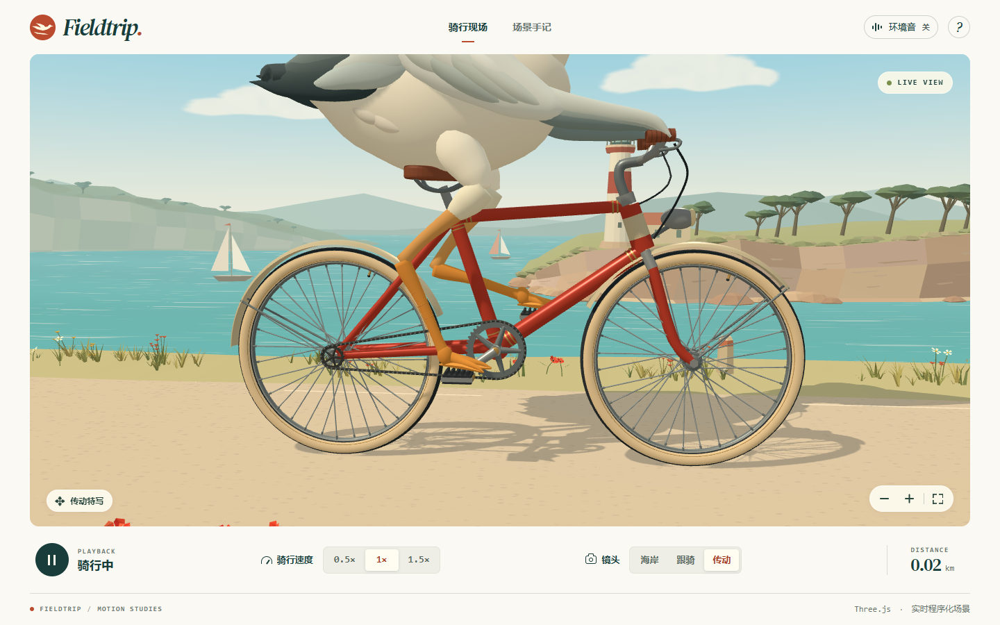

# 鹈鹕的海岸骑行

双击 [Pelican Passage](../../../experiments/pelican-passage/index.html) 即可打开场景。成品把 Three.js、模型生成代码、界面与字体打包在同一个 HTML 中。浏览器需要支持 WebGL 2。

默认海岸镜头可看到骑手全身、脚踏和轮胎的接地位置。「传动」镜头展示两条腿在相反踏板相位下屈伸，以及齿盘与链条的运动。

## 自检

- 在 `experiments/pelican-passage/` 运行 `npm ci` 后可用 `npm run build` 重建入口，用 `node check-motion.mjs` 检查模型联动。
- 每隔一度检查一次完整踏圈，361 个相位的两轮转角、左右曲柄、踏板水平度、蹼足位置、两段腿骨的长度及连接均通过。另在四个象限用射线检测实际足底和防滑棱的表面，接触误差在 1 毫米内。
- Chrome 桌面实测三个镜头、变速、暂停、继续、自由环视、缩放、全屏、快捷键、环境音和车铃。暂停时画面与里程冻结。0.5× 和 1.5× 两档走过相同距离的时间比实测为 2.97。
- 320 至 520 像素宽的 Chrome 模拟视口检查了操作指南、布局与触控。窄屏全身镜头留足标题和车轮空间。移动设备表现仅经模拟验证。
- 审看图来自本机 HTTP 打开的离线成品。成品 SHA-256 为 `d854b1925a4d3b906beabf2c72edf4b0956733b872663b97c5a194927eca9594`。浏览器加载与交互期间未向外部发起请求。
