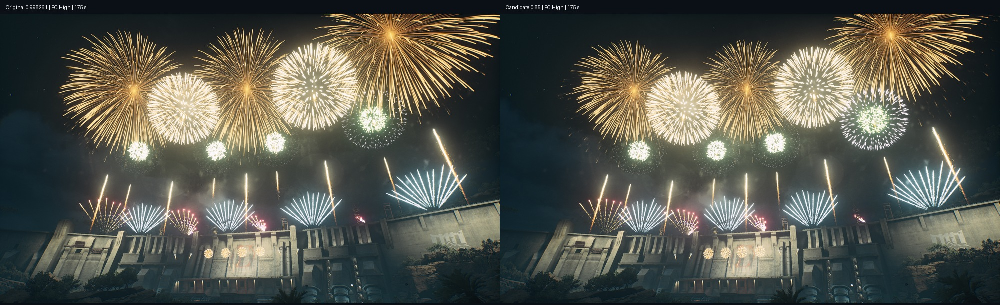

# B09 导演实放与视觉对照

> 2026-10-17 恢复补正：原清理漏了实际模拟平台，Mobile残留已恢复PC/极高；扇形实放已确认。见[恢复说明](预览平台恢复说明.md)。

2026-10-17，编排实放（Codex）。**UE 实放及视觉自检已完成；用户未验收。** 已补上此前 T10 没完成的整场视觉截图与主角对照，T10 的性能采样缺项仍单独保留。UE 已恢复并释放，回执提交 `5381a6ee`。

**建议下一次编排发布采用主角缩放 0.85 的候选，保留 400 m、现有点位、时序和数量。** 它让主角与下托大花更容易分开，代价是主角体量稍收；不是完全消除重叠。正式 B09 / 云端编排 16.0.44 保持原样，遵守此前周一再更新的安排。本次没有发布 B10，也没有保存 UE 资产或地图、提交 P4。

## 版本与现场

- 当前 Night 导演的三表与 B09 文件逐项一致；源文件为 `FXtools/节目/NewYearFireWorks_v01/导演表-B09-主角400-手游金垂柳-名字更正-一张表.json`，SHA256 `be3888b1c33c48bcc23c1c82d5ce0cdc432676802d638dd0e2878055262cad4b`。
- 原机位位置 cm：`366268.843750, -754650.750000, -15286.675781`；朝向度：Pitch `4.180194`、Yaw `-802.658264`、Roll `0`。诊断镜头只把同一位置的 Pitch 改为 22° / 30°，每轮结束恢复；未改 FOV，其数值未读取。
- 原始截图为 1993×1153。保留现场光照、曝光与渲染设置：Effects / Texture / PostProcess 均 3，ScreenPercentage 100，SeparateTranslucencyScreenPercentage 0，MaxAnisotropy 8。PC Low / Mobile Medium 是**导演筛选档位**，没有把整套渲染设置切成低档或移动端。

## 看到了什么

| 项目 | 实放判断 | 证据 |
|---|---|---|
| 原机位 | 开场及多处中大花碰到画面上沿，主角轮廓看不全；抬头后能区分大部分花型。不能依据原机位的裁切就统一缩小整场 | `原机位_高配_1/2.jpg` 对照 `抬头22度_高配_1/2/3.jpg` |
| 主角的间距 | 实际 P0–P4 **361.24 m**、P4–P8 **317.67 m**，不是文档假设的两边各375 m；P0–P8为662.34 m，舞台也不是直线等距布点 | `实际点位.json`，无父组件的根坐标、未加密字段；全0的 K2_GetActorLocation 读数弃用 |
| 108 s 单主角 | 110 s 与周围大花叠亮；112 s 主角最清楚，后续大排再次接管画面。14–14.5 s是粒子寿命上界，不能等同于持续14 s都很醒目 | 高配整场第2张接触表；单主角原版/候选的逐时刻缩略图 |
| 171 s 三主角 | 三个花心已分开；175–178 s主角下垂部分与后续整排大花仍有明显交叠。0.85使轮廓和下托更容易辨认；右侧近点仍显得更大，也仍可能碰到画面边缘 | `PC三主角_原版与085.jpg` |
| 扇形、前景、收尾 | 高配的左右扇和小平台能支撑上下层次；140 s彩色过渡应保留。低配较多时刻依赖球花与尾缀，方向感弱于高配。本轮保持既有数量；收尾整排仍在，没有改回孤零零一朵主角 | 高/低完整接触表；195.5、198、202、210、218 s |

## 唯一候选及取舍

`候选_仅主角缩放0.85_一张表.json` 只改 `EffectSubTemplates → GoldKamuro → P_EFX_FireWorks_GoldKamuro → EffectScale` 的 X/Y/Z：**0.998261 → 0.85**，线性体量减少约14.85%。花的位置仍是39792.079005 cm，尾缀缩放仍1，开花偏移仍7.3651 s。全部点位、过滤条件、时序、花数、扇数和资源ID不变。

PC 单主角、三主角已各做同机位 A/B。推荐0.85的理由是给下托和邻花留空间，气势略减是明确代价；它不解决取景裁切或灯光绑定。本轮没有调暗、改曝光、改材质、改寿命，也没有为候选增加数量。粒子自身随机保持，A/B用于判断空间与层级，不作逐像素等价比较。

## 两个独立的落地缺口

1. **Night 灯光绑定未接好。** 当前 `light_A` 声明 RequiredPointCount=4，Group=Light，本次开始日志反复报 `Required=4 Actual=0`。场景唯一序列点 `light1` 的 DirectorId仍是旧的 `NewYear`，不是 `NewYear_Night`，绑定只有Light/Slot0。当前模板也只有Slot0的一条序列Entry。新版四灯流程是否已经正确导入、这个场景该使用几条Entry/几个点，需要按现行灯光交付核对，不能只机械补3个点。本轮没有修改或保存灯光/序列/绑定，也不把场景变亮认作新版灯光已经生效。原始配置与点位见 `灯光绑定证据.json`。
2. **Mobile 过滤不等于本轮验证了手机版粒子。** 补测时DebugPlatform=Mobile、DebugQualityLevel=Medium，实际播放中的3个GoldKamuro和3个Hero尾缀仍指向 `_HD` 路径；已排除Cascade窗口及不活动缓存。因此 `Mobile筛选_原版与085_HD资源.jpg` 只证明该筛选下的编排与尺寸试验，**不证明 `_M` 资产、移动RHI或手机真机通过**。见 `Mobile实际资源指向.json`。不擅自改资源分支来伪装手机测试。

给跨年秀（22）/ 灯光落地接续：先核对上述Night的序列交付与点归属；后续发布时可采用本候选。给手机验收：须在确实选用手游表/_M资产的环境补看108/171 s。960整场性能及实际音画同步本轮未验；没有使用ProfileGPU，也未将缩放推断成性能毫秒数。

## 采样与恢复

共180张核心截图，PNG哈希、命令时刻、缩略图及每轮读回见 `实放索引.json`。原始PNG与完整运行回执留在本机 `F:/FireWorksLab/analysis/local/B09_DIRECTOR_20261017/`。

| 运行 | 覆盖 | 图数 |
|---|---|---:|
| 原机位高配预走查 | 墙钟0–214.5 s，实读世界时间至约211.2 s；只用于原机位观察 | 48 |
| 22°高配正式整场 | 引擎时钟0–218 s，包含尾声空场 | 49 |
| 22°低配正式整场 | 引擎时钟0–218 s，包含尾声空场 | 33 |
| 30°PC三主角原版 / 0.85 | 从155 s起放，168–190 s采样 | 9 + 9 |
| 30°Mobile筛选三主角原版 / 0.85 | 同上，实际资源为HD | 9 + 9 |
| 30°PC单主角原版 / 0.85 | 从93 s起放，105–123 s采样 | 7 + 7 |

首轮发现截图会暂停编辑器世界时钟，墙钟累计领先约3.3 s，故两轮正式整场及A/B均改用实读引擎时钟等待；索引同时保留命令前后区间和墙钟。区间描述截图命令的执行时刻，呈现还可能差一帧，不宣称逐帧同步。分段起点早于主角升空，保留必要预热。

`bShowActive` 是运行时标志，编辑器FTicker预览时仍可为false，不能用它判断编辑器是否开播。各轮同时核对本次日志的“编辑器预览已开始”与DebugStopShow回执；失败预检未混入180张核心证据。

恢复结论补正（用户反馈后）：原 DefaultConfig、三个Debug字段、RandomSeed、原机位及六项CVar读回一致，但这不足以证明实际模拟状态恢复。最后 Mobile=1 残留；用户以 None 再开播只更新画质3，导致 PC 扇形继续被筛掉。这是本任务清理遗漏，原“完全恢复”结论撤回。现已明确切回 PC / EQuality_VeryHigh / 起点0，真实日志平台2/画质4、18个活动银星扇组件及截图确认；新清理入口在PC/极高尾声实测通过。保留用户新机位和当前CVar，不重新写三表、不保存UE/P4。见 `预览平台恢复说明.md`、`PC_极高恢复核对.json`。原采样/哈希保持历史原貌。

检查：采样脚本 `node --check`；候选相对源表仅3个缩放数值变化；旧资源快照的B05结构/ID检查missing=[]；当前UE三表安装/恢复读回；高低整场和候选关键帧人工审看。它们不代替用户美术验收。
