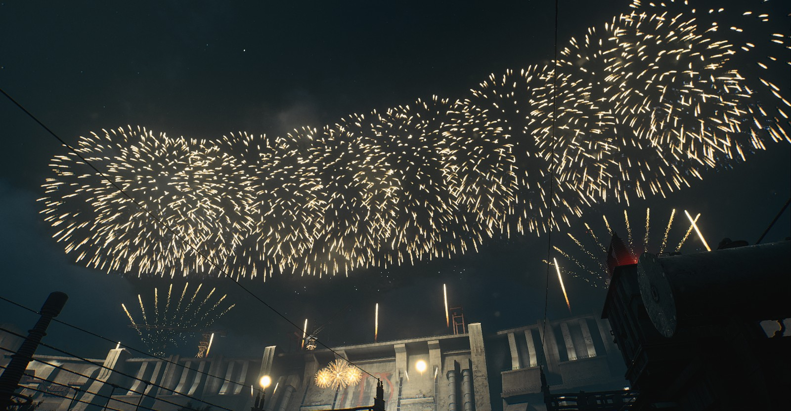

# Mobile预览残留已恢复

用户反馈正确：本任务上次把三表和面板字段恢复了，却没有清掉实际生效的 Mobile 模拟平台。`None` 表示不再次写平台，不能据此认定此前覆盖已清除。原“已完全恢复”结论不成立。

三表与任务开始的备份逐项一致（79子模板、364父模板、3组调度），PC扇形条目保留；不需要重新导入导演文件。日志最后的平台写入是本任务13:58:47的Mobile=1；用户14:44:06以None再次预览时仅设置了画质3。PC扇形条目平台掩码12（PC/Gamepad）因而仍被过滤。

本次已明确设置并实际应用 **PC / 极高（EQuality_VeryHigh）/ 起点0**。短放15–约18.8秒，日志平台2、画质4，读到18个活动银星扇组件，截图中左右扇形恢复。随后停止预览，保持从头播放就绪。三表、种子、用户新机位和本次开始的六项CVar逐项不变；AF当前16是用户现场值，本任务没有改回旧备份的8。

采样脚本改为：开始前要求明确平台和可读日志；初始None时零写入退出。结束后除恢复字段，还用原平台/画质从尾声之后短开再停，核对新增平台/画质日志，再恢复原起点。支持极高；即使预览已生效后请求报错也执行恢复，恢复缺日志必须报错。离线有状态替身先复现4项失败，修复后4项通过，接入`标准检查.py --director-preview-only`。真实新清理入口仅用当前PC/极高尾声空场补验，全部通过，没有再切Mobile。

完整恢复证据见`PC_极高恢复核对.json`；本机完整原始回执/PNG在`analysis/local/B09_DIRECTOR_20261017/RESTORE_FOLLOWUP/`。原180张采样的旧脚本哈希与截图不改，`现场恢复核对.json`和`自检.json`撤回全恢复结论并链接本次补正。未修改正式编排、烟花资源、地图或P4，用户美术验收仍单独记录。
