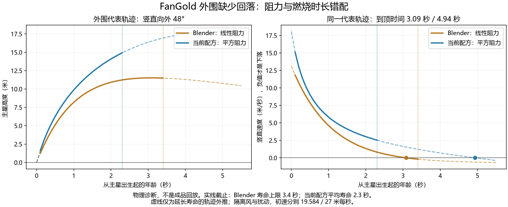

# FanGold：扰动、阻力与外围回落对照（2026-10-13）

结论：当前 FC6O 是不完整的近似。重力已生效，主星重力与 Blender 几乎一致；主要错配是主星阻力模型、初速和燃烧寿命，以及未移植的连贯尾流形变。不能将这次差异归结为烘焙器整体做不到，也不能把标准检查通过当作参考效果已复现。

对象：Blender `Fan_Gold_Comets/V04_Draft` 原生构建代码/参数，与烘焙器 4.9.79、FC6O `31fb0001·master4.3.8-core1` 的完整参数及真实 Sim。源码基线 8e3658a7。此次只做诊断，未修改配方、生产源码、Blender 工程或导出包。

## 1. 重力没有丢，但主星减速方式不同

| 项目 | Blender V04 | 当前 FC6O |
|---|---|---|
| 主星重力（向下） | 0.700 m/s²，Z 向上 | 9.81 × 0.07 = 0.6867 m/s²，Y 向上 |
| 主星阻力 | 线性，k = 0.95 /s | 平方，c = 9.81 / 11.8² ≈ 0.07045 /m |
| 外侧第 1 束主星初速 | 均值 19.584 m/s，截断正态 15.84–23.04 | 全扇统一 27 m/s，正态抖动 16% |
| 主星燃烧寿命 | 均匀 2.35–3.4 s | 均值 2.3 s，正态抖动 15% |
| 脱落火花阻力 | 线性 k = 5.5 /s | 线性 k = 5.5 /s，sparkQ = 0 |
| 脱落火花重力 | 0.700 m/s² | 1.1772 m/s²（反而更大） |

主星在线性模型中按速度减速；平方模型按速度平方减速，后段低速时保留的向上速度不同。这里比较的是两组实际系数，不能推广成任何平方阻力都比线性弱。两者不是同一参数单位，不能直接把 0.95 填进 vt。

Blender 解析解：A = (1 − exp(−kt))/k，B = (t − A)/k；p = p0 + v0 A + g B，v = v0 exp(−kt) + g A（本例风为零）。烘焙器主星逐步用 v ← v/(1+c|v|h) + gh，再推进位置。当前 vt 是用于求阻力系数的参数；重力倍率 0.07 下的自由落体终端速率约为 11.8√0.07 = 3.12 m/s，不是 11.8 m/s。

代码：[Blender analytic.py](/D:/Blender/Firework_FX_Lab/src/fxlab/nodes/analytic.py:97)；[烘焙器主星 Sim](/F:/FireWorksLab/tool/src/js/20_sim.js:451)；[火花线性解析 mot](/F:/FireWorksLab/tool/src/js/40_gl.js:122)。Blender 另有平方阻力分支，但这个 V04 使用的是线性解析，不要把仓库支持的所有模型混成此素材实际路径。

## 2. 真实数值证明：主星先灭了，还没等到下落

运行当前配方的真实 Sim、保留当前湍流与随机种子，时间步长 1/480 s：378 颗主星，在活着期间进入 vy < 0 的数量是 **0**。2.3 秒剩 186 颗活星，3.0 秒剩 7 颗，3.5 秒剩 1 颗，均还向上；全部主星寿命范围为 1.441–3.612 秒。已脱落火花仍独立运动，本结论不等于“所有火花不下落”。

为隔离主轨迹，取向竖直外偏 48°、各自代表初速，关闭扰动并延长单星寿命找顶点：

| 量 | Blender 代表星 | 当前配方代表星 |
|---|---:|---:|
| 出生后 3 秒的竖直速度 | +0.064 m/s | +1.636 m/s |
| 到顶年龄 | 3.087 s | 4.935 s |
| 主星寿命设置 | 2.35–3.4 s | 平均 2.3 s |

这些顶点是隔离扰动的代表轨迹，不是每颗星真实像素顶点；以星出生为时间零点，Blender 另有约 0.116 s 发射延迟。即使把两边初速和重力都统一为 19.584 m/s、0.6867 m/s²，仅改变实际阻力模型/系数，到顶仍为 3.107 s 对 4.754 s。因此差异不能仅用当前初速较大解释。

数值稳定性复核：时间步长由 1/480 改为 1/960，到顶只差约 0.00104 s；3 秒高度差约 0.00934 m，解释不了约 1.85 秒的模型差。Blender 线性公式对其独立 Decimal 解析参考的最大误差 3.55e-15。此处没有重新执行 Blender 节点，也没有重做 GPU 画质验收。

## 3. 你看到的扰动，原版有独立实现

原版并非只有重力、随机散布和环境风：

- 主星自身还有振幅 0.013 m、角频率 12 rad/s 的微动，并将导数计入速度。[analytic.py](/D:/Blender/Firework_FX_Lab/src/fxlab/nodes/analytic.py:158)
- V04 对尾流几何另加连贯摆动：同一条尾巴用稳定 root_id，共享相位；沿释放时刻形成波形，并随当前时间推进。尾龄前 0.08 s 保护新生段，随后用 1−exp(−2.2(age−0.08)) 渐强。基础摆幅 0.11 m，横向主波叠小波及少量深度位移。这是美术尾流近似，并非流体仿真。[fan_gold_motion_v04.py](/D:/Blender/Firework_FX_Lab/production/fan_gold_motion_v04.py:25)
- 脱落火花还有按整条尾巴及沿尾位置关联的寿命变化、各粒不同的燃烧淡出和明暗频率、随释放速度减弱的发光、随年龄缩小的颗粒。这些共同造成错落燃烧，不能全部用闪烁强度替代。[fan_gold_shedding.py](/D:/Blender/Firework_FX_Lab/production/fan_gold_shedding.py:27)

当前配方只有很弱的 turb = 0.1 m/s、尺度 60 m；tailDiffuse = 0、flutter = 0。**0.1 m/s 的扰流速度不等于原版 0.11 m 的尾流位移**。GPU 火花在出生处采样风后用于该粒的解析运动；已有 tailDiffuse 按尾龄和出生处旋涡场扩散，也不等于原版随时间传播的多波连贯摆动。[20_sim.js](/F:/FireWorksLab/tool/src/js/20_sim.js:28)、[40_gl.js](/F:/FireWorksLab/tool/src/js/40_gl.js:225)、[尾迹扩散](/F:/FireWorksLab/tool/src/js/40_gl.js:261)。

另发现我在配方里写入了 `sparkSizeJit: 75`，该字段未被当前生产代码读取；真正的 `tailJit` 为 0。这是无效配方字段，未实现预期的粗细随机，不是用户操作问题。后续修复需改用受支持的字段，不能只保留看似正确的参数名。

## 4. 为什么脱落火花也不显得大幅下坠

它们的线性阻力 5.5 /s 很强。只看零初速火花由重力引起的位移：尾龄 1 秒，原版下落约 0.104 m、当前约 0.175 m；1.5 秒约 0.168 / 0.282 m。相对于十几米的整面扇，这些位移较小，还叠加继承的向上速度、冷却淡出。原版自然感的一部分来自横向/斜向尾流及错落消散，不能都当作重力下坠。

因此，单纯调大 sparkGrav 不能还原原版主星到顶时机和尾流摆动，可能先把尾巴拉直、拉长。原版自身也不是大幅抛物线下垂的重力模型；复现应匹配原版的细微回落和松散微动。

## 5. 能力边界与后续最小修复方向

1. 已有重力、火花线性阻力、湍流、尾迹扩散、寿命/亮度随机等能力。此次没用好或没有对齐，属于本次配方和复现工作的缺漏。
2. 主星普通路径默认平方阻力；自定义星已有线性阻力内核，但 FC6O 当前路径没有按原版采用它。精确复现需要在合适的主星路径接入线性模型，并对齐逐束初速、寿命与释放时序。
3. 原版这种“新生段不动、旧尾渐强、按同条尾巴相位传播”的尾流波形，现有选项不能等价表达。应补通用尾流形变，而不是持续加大全局风。
4. 内部可以保留短头、近段、远段及各束不同物理，最后仍合成整面一个导出。用户说“不分开导出”不要求内部只有一套物理/发光参数。

本轮完成原因诊断，当前候选保持原样；还原实现、重新烘焙、对照视觉验收与 UE 验证都尚未发生。

复现命令：`node analysis/scripts/fangold_physics_diagnosis.mjs <Blender根目录>`，随后 `python analysis/scripts/fangold_physics_plot.py <Blender根目录>`。数值与源码哈希在同目录 `扰动与物理数值.json`；未提供路径时用原本机 Blender 目录。
