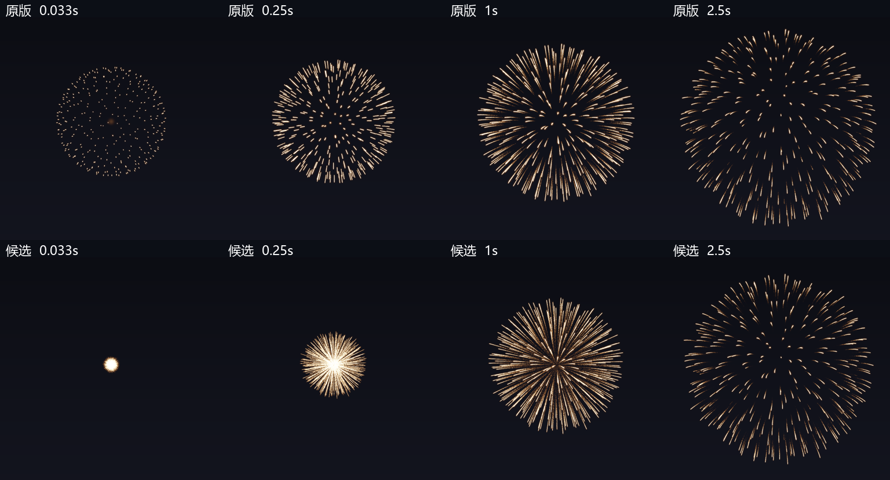
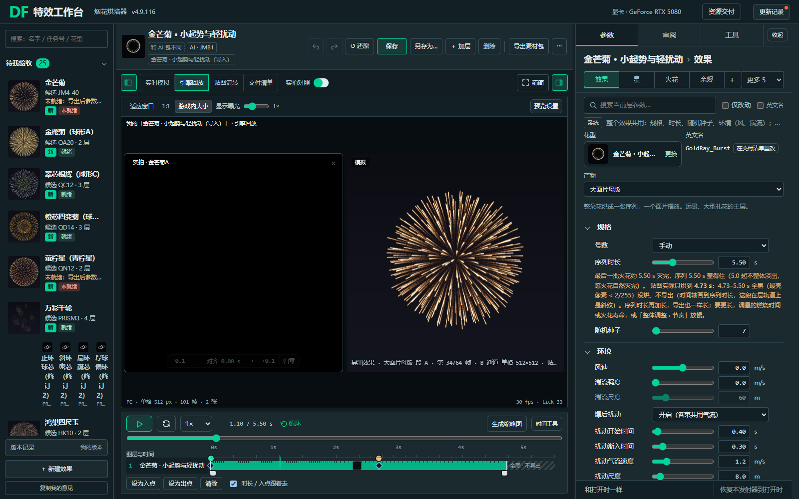

# 金芒菊 · 小起势与轻扰动（JMB1）

唯一推荐候选已具备本轮AI验收证据；旧金芒菊保持原样。烘焙器 **4.9.116**，指纹 **3135e4c9·burstflow4.9.116+master4.9.31**，导出记录 **JMB1E1**。未做UE实播、目标机性能或用户艺术验收。

## 目标、判断与取舍

用户明确要求新效果、开头小一些、保持流畅、爆后各束有统一可开关的扰动；随后确认开关在烘焙器内，随贴图导出。独立引菊层只是候选方案。

旧JM4-40模拟的起始半径为52m，因此一出现就是约104m花盘；叠加另一层并不会消掉主层的大初态。最终用**同一批316颗星的一层模拟**，起始半径0.5m，初速约212.636m/s，既有二次阻力使其迅速减速。主星燃烧2.685s保持，测得主体花径约199.93m，旧版约202.74m；保留原金芒颜色、火花数量、寿命与冷却，开花闪光半径明确设回2m，避免跟着新初速被放大。

扰动复用Comet/Silver现有连续气流和受力积分，作用于主星、普通/余烬/分叉火花。推荐从0.4s开始、0.3s渐入、气流1.2m/s、尺度8m，形成轻微相关弯曲。此数值是AI试配结果，不是用户预先确认的数值。原有风、湍流、尾迹扩散和燃尽后控制含义不变；所有旧配方缺省关闭。

单张64帧内部试包的停帧跨度约1.50px，不能据此保证与旧版同样顺滑。推荐采用现成分段序列，**两张主图、同刻一个面片**，不新增独立引菊层或UE气流计算。计划113帧；裁掉末尾全黑段后实包101帧（64+37），可见时长约4.733s，时间轴仍保留5.5s物理时长。

| 项目 | 旧版 | 推荐候选 |
|---|---:|---:|
| 停≥2tick的最大位移（800m） | 0.92px | 0.65px |
| 最慢计划帧率 | 7.5fps | 15fps |
| 超0.77px标定线的停帧数 | 7 | 0 |
| 运行时同时显示的序列面片 | 1 | 1 |
| PC主图 | 单张2K基线 | 两张2K |
| 手机主图 | 单张1K基线 | 两张1K |

快速起势按30fps采样，单tick最大位移3.75px；0.65px只描述停帧，不混作全程最大位移。按BC7且NoMip估算，PC主图8MiB，较单张增加4MiB；手机按同字节率估2MiB，增加1MiB，实际平台压缩以UE为准。未以“同刻一面片”冒称零额外内存或目标机性能已通过。

## 实包与真实入口

- PC单格512、手机单格256，主图分别2048/1024；两平台均101/101帧可显示，无回跳、暗帧、裁边；最亮帧过曝比例≤0.04%。手机初次有6帧触内圈，候选留边改为6px后重导，两平台边缘占比均0。
- 2.267s附近与展开、燃烧、余烬关键时刻均按实际包回放审看；固定取景没有SizeByLife缩放脉动。主体金芒保留，快速引线是同一轨迹的前段，接力无额外一批星跳出。
- 统一入口实际操作：总开关及从属灰显、强度编辑、撤销重做、保存、刷新、PC/手机回放、连续三次循环；原生配方文件也实际导入并核对候选参数和64+37帧。
- 空中条目保存成“我的效果”时会成为单层组合；单层recipe文件要在相应单层AI条目中导入。此前自动检查误在组合中导入，按已有形态规则被拦；修正测试入口后通过，未改写导入器。
- 本轮保留旧金芒菊作为形态/颜色基线，并沿用项目原参考视频入口；新起势和扰动不按旧实拍作逐帧拟合目标。

## 回归与边界

- 正式核检查：扰动开始前主星位移差0；同配方重复确定；开始前GPU画面逐像素相同、之后有变化；燃尽前火花已受场影响；渐入连续、节奏同步；单束/GPU光点不能表达空间轨迹时明确禁用并拦截。
- 旧存档真实逐层体检：金芒菊·我的，1层5项，开关有效、关闭时其余四项有灰显原因，无“骗人”或“灰错”；缺字段按面板显示的默认值计算。
- 认领提交98686170的旧模拟核与当前47个现行空中层轨迹/取景一致；六模板18张定帧逐像素一致；普通与原燃尽后着色器源码保持。
- 标准检查JMB1通过；合入门禁18类195行契约、导出与界面8/8通过。开工时`--ui-state-only`有两条既有离线夹具失败（base对象和store缺失），本轮未修，不把它们写成已通过。
- 未写UE、P4、母材质或导入器；未替换正式库。UE的实际压缩、Bloom、接力实播、GTX960/目标机整场帧时间和用户审美仍待验。

证据：`实包检查.json`、`气流行为检查.json`、`关闭默认回归.json`、`真实存档体检/`、`统一入口检查.json`、`合入门禁.json`；完整配方/实包参数与同指纹导出清单为准。

素材：`analysis/local/输出/金芒菊小起势_20261018/GoldRay_Burst.zip`；刷新烘焙器→待我验收→金芒菊·小起势与轻扰动。用户可在效果›环境关闭或调节爆后扰动后重新导出。
