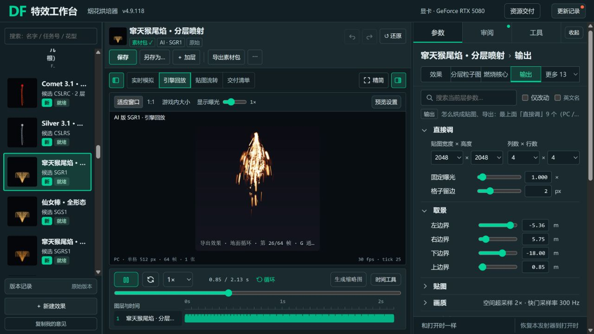
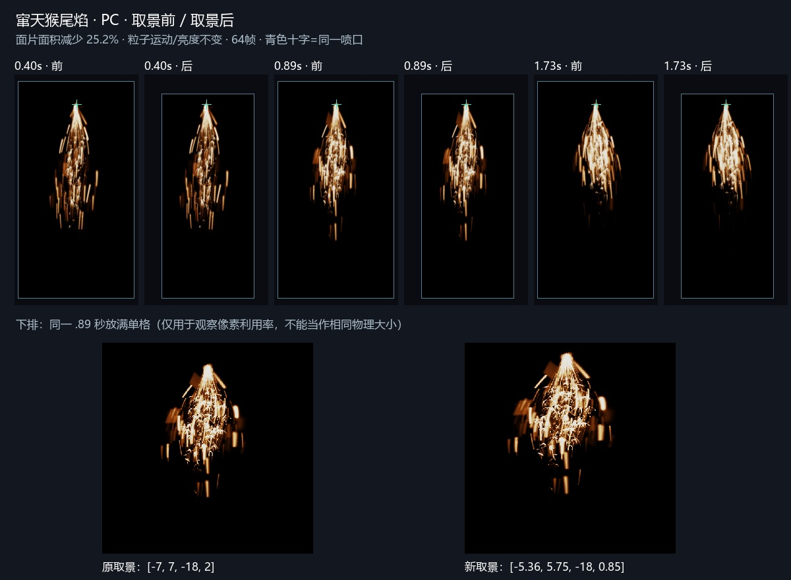
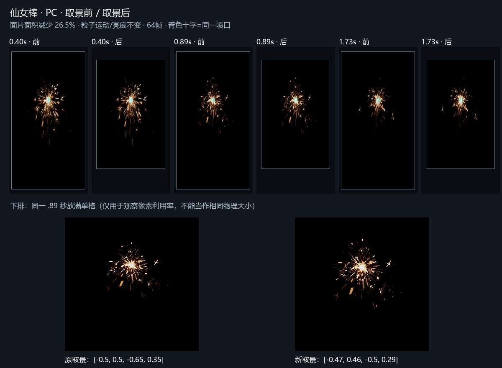
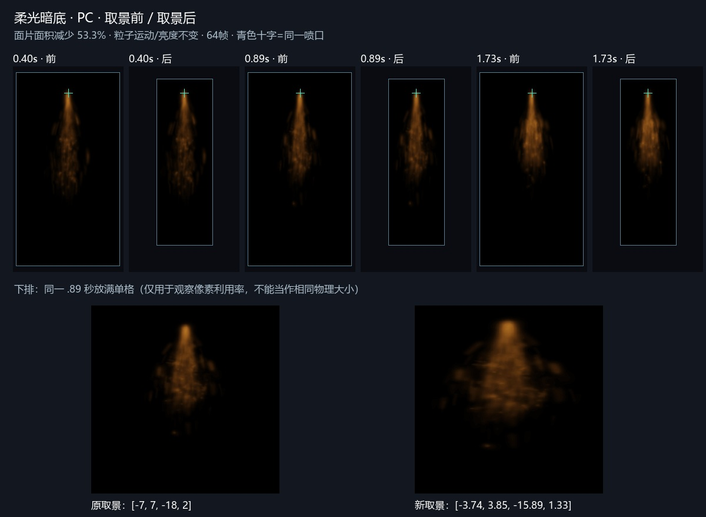

# 固定取景修复 · 4.9.118

首选已实现：复用原四边参数，放到统一右栏「输出 → 取景」，修正横向被强制对称的问题。整个周期使用一个固定矩形，喷口在世界中不动；不新增另一套缩放或逐帧紧裁。SGR1、SGS1、SGRS1各只有一个推荐候选，用户原存档不覆盖。

## 根因与取舍

原来的bounds已经存在，但藏在粒子图配置里，横向又按较大半边强制对称，调较小一侧没有效果。这次左、右、下、上边界各自生效，单位米、相对喷口。改框只改采样和输出面片，不能靠缩小粒子或调暗画面来减少留白。

| 候选 | 原边界：左/右/下/上 m | 新边界 m | 面片面积减少 |
| --- | --- | --- | --- |
| SGR1 尾焰 | -7 / 7 / -18 / 2 | -5.36 / 5.75 / -18 / .85 | 25.2% |
| SGS1 仙女棒 | -.5 / .5 / -.65 / .35 | -.47 / .46 / -.5 / .29 | 26.5% |
| SGRS1 柔层 | -7 / 7 / -18 / 2 | -3.74 / 3.85 / -15.89 / 1.33 | 53.3% |

从PC/手机真实包全部64帧的非零/低亮/标准阈值并集量范围，保留弱火星、软光和固定余量。尾焰最初拟收紧约48%，真实包过曝像素比例达2.57%，超过原2%门槛；没有降低曝光或放宽标准，最终放宽左右边界。失败证据保留于`首轮尾焰过紧检查.json`。

这是面片面积减少，不是内存或GPU帧率实测收益。每个效果仍各64帧，PC单格512、手机256，主图2048/1024各一张；不因收紧而减少纹理内存。调整后的贴图像素密度变高，细节可与原取景略有差异，但候选完整参数逐键比较只变`P.sparkGraph.bounds`，运动/分叉/数量/随机/寿命/亮度/颜色/曝光/周期不变。用户主尾焰、粒子版、柔层的原生文件三份SHA与修复前一致。

## 锚点与实际输出

`cx`随计划贯通实时、烘焙、单层及组合引擎回放，横竖缩放同时作用在中心上。Cascade用各层真实宽高与独立Pivot保持原喷口；实包按JSON重建的中心最大误差小于0.3毫米（输出数值四舍五入）。各层可以有不同面片尺寸，共用世界喷口与起播相位即可，不应强制改成相同大小。

循环效果实际`cascadeText(loop)`入口原来还写Square与旧位置值，已同步修正为Rectangle、LocalSpace、位置0与独立PivotOffset模块。JSON内部Pivot中心为(-.5,-.5)，UE模块面板中心为(0,0)，手填说明提供转换后的面板值及可复制文本。

**改取景后完整导入/全部更新发射器**，同步InitialSize与Pivot，不能只换贴图。`plan_sig`补几何信息以识别这种变化；旧哈希首次比较可能保守要求完整更新。私有导入器未改，缺历史记录时不能声称自动守卫一定拦截，仍需选完整更新。未写任何UE资产或材质。

收紧还暴露原镜头积分150万样本单批上限。现在分批提交相同样本，保留每粒采样、顺序、权重、快门、散焦和质量。新旧同样本单批对照及强制2/7/3批的软件Float32/像素均严格零差；实际当前三包成功导出。单粒极端采样8192护栏保留，遇到它仍应扩大取景或缩短曝光。

## 检查与审看

- 修复前契约17项中15项按预期失败；现18项全部通过，已接`标准检查.py --graph-framing-only`，含实际循环文字入口。
- SGR1/SGS1/SGRS1标准检查全部通过；6份PC/手机实包全周期回放检查全部通过，边缘违规、空帧为0，显示63/64帧、约98.4%，过曝最差低于2%。未放宽任何门槛。
- 已亲眼审看本目录两平台前后对照及实际包关键帧：同米制空间的轮廓和喷口一致，底部弱火星保留；仙女棒13形态与短促爆发、柔层低亮软光保留。对照图下排单格放满只用于观察像素利用率，不能据此判断物理大小变化。
- 默认回归：全32个现行条目/54独立层的缺省中心映射通过；六模板、三粒子图及JM4共10项在SwiftShader中严格像素零差。本机D3D11同函数重复渲染本身有约1灰阶差异，原硬件哈希失败报告保留，不能写硬件18项逐像素全过；详见`默认像素回归诊断.md`。不是全量重新测GPU包围盒，也不假定本次跑在独显。
- UI集成：三个候选的原生单层文件、四边控件、实际64帧回放连续三周期通过；SGR1右边界编辑、撤销/重做、临时另存、刷新读回通过，真实主按钮ZIP下载通过，三份原件SHA保持。另存为沿用原来的单层派生combo规则，不改变保存形态；UI脚本两次错误（details布尔属性判断、用single文件导入combo上下文）独立保留失败证据，修测试后通过，未把脚本错误写成产品缺陷。
- 合入门禁191秒全部通过：18个代表效果、199行输出契约，导出拦截与界面8/8；普通提交后的pre-push仍照常执行，不绕过。

界面旧自检的「过曝帧」用封顶像素/非零像素，实包标准用封顶像素/全格像素，两者分母不同。因此UI可能仍显示部分过曝帧，不能把它直接当作本报告2%整格标准失败；本次没有改该既有统计或隐去警告，真实下载包另行检查。

实际SGR1主按钮下载ZIP也已单独量完，PC最差1.81%、手机1.89%、边缘违规0、两者通过；原生Graph/M、帧号、尺寸与Pivot和推荐候选一致。精确预览为scale=1、单格512、SS2/300Hz，非降质；非零像素分母的maxClip约12.97%。证据`UI尾焰导出检查.json`和`UI尾焰ZIP实包RC.json`，专属测试浏览器已关闭。

## 当前范围

本次必须做的是四边可调、固定取景、世界尺寸/Pivot同步、安全候选与两平台真实包，均在本任务范围。可后做「一键按整周期内容收紧」，这次不新增。暂不建议逐帧紧裁，会需要额外位置/尺寸曲线并可能引入抖动；也不为减少黑底自动缩小贴图规格。

本机完整原生副本、ZIP和报告：`analysis/local/输出/取景修复_20261019/`。AI检查与用户艺术验收分开；UE三层、Bloom、BC7/手机压缩、GPU扰动、实际尺寸和性能未实播，不把浏览器回放写成UE验证。

最新实际IAB入口已核对三候选「就绪」与118版本，保留独立尾焰引擎回放/四边参数页，不刷新用户原标签或覆盖其配方。

