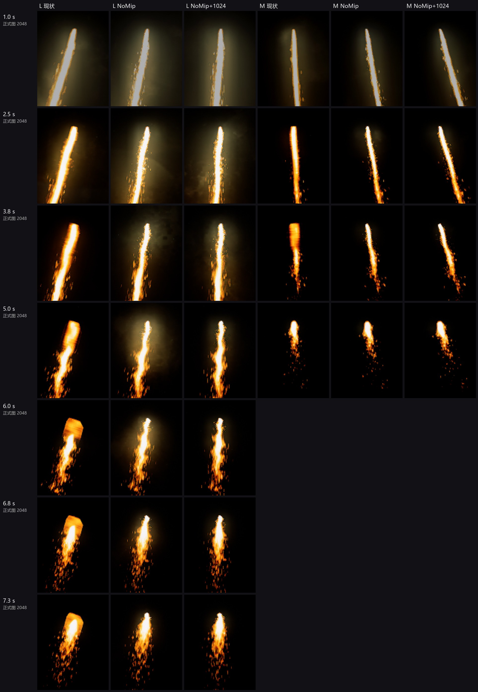
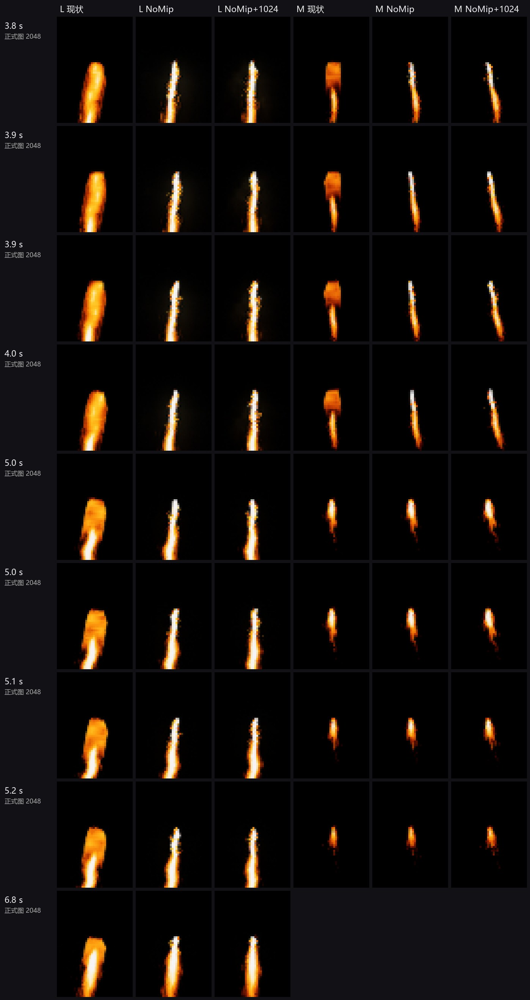
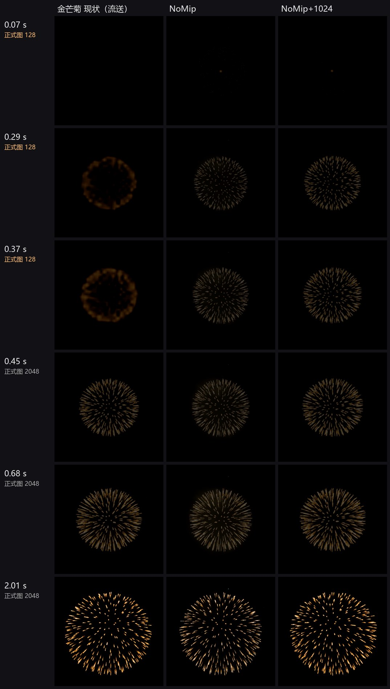
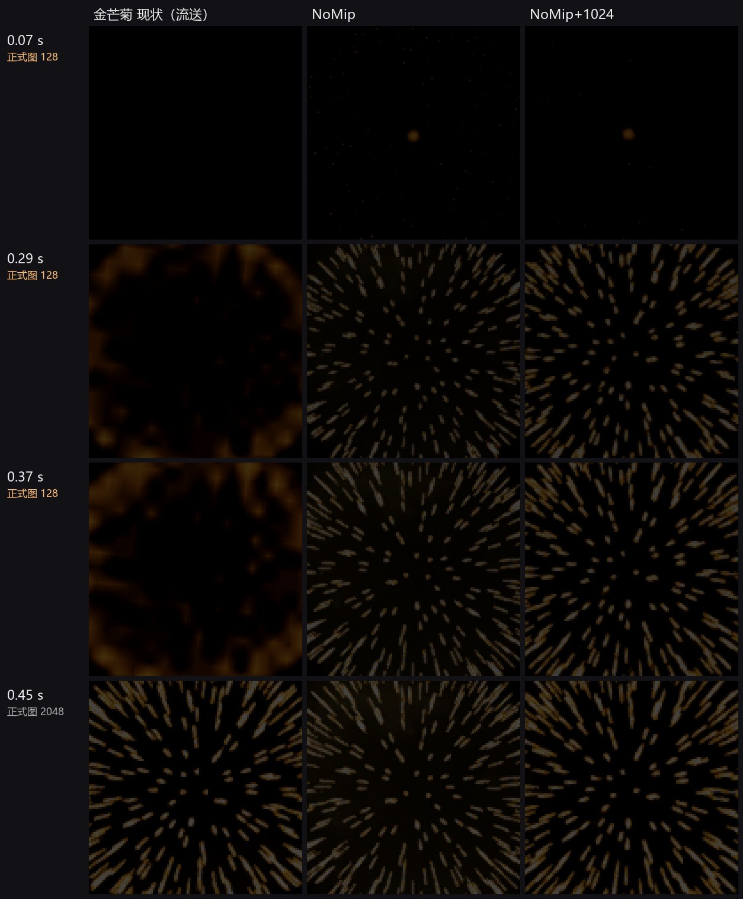

# 低画质方头 / 金芒菊绽放糊：修复方案与对比（PC）

2026-10-18 15:0x–15:4x，本机同步检测（Claude Code）。UE 4.24 本机编辑器，地图 Dam_Iris_Long3，**用户当前的 PerfGear 低档原样不动**（没改任何画质 CVar）。只建了 FWL18_ 临时对象，正式资产只读、没保存、没迁出；以下是 AI 自检，不是用户验收。

## 一句话

两件事，原因不同，修法相同：给 3 张主图开 NoMip（新规范第 ④ 条「主序列 NoMip 只给实测需要的少数图」），其余设置都不动。

| 症状 | 原因（UE 里实测） | 修法 |
| --- | --- | --- |
| RiseTrail L / M 星头方块 | 近段 RiseLoop 每格 128×2048，SizeByLife 只把 Y 缩到 15%，X 不缩，长图被压扁（L 最多约 7.9 倍、M 约 6.0 倍）；PerfGear 低档 `r.MaxAnisotropy 1`（各向异性关），GPU 按压扁方向挑 mip，128 宽的格子被糊成几个像素宽 → 平头宽块 | 近段主图 NoMip |
| 金芒菊绽放一瞬糊 | 关 NeverStream 后这张 4×4 主图会流送：没出现时只留 128×128（每格 32×32），激活后约 0.4 s 才流送到 2048；绽放正好在这 0.4 s 里（本机 RTX 5080 + 固态盘，低配机只会更久） | 主图 NoMip（不流送，一直是全分辨率） |

**用户问「是不是没把近段远段分开」：不是。** L / M 本来就是分开的（同一个粒子里 RiseLoop 近段 + TrailFar 远段两个发射器）。方头出在近段 RiseLoop 自己的「只缩 Y」，远段没有这个问题；重新分开或合并都不解决。

## 先纠正一个前提

用户说的「全局低画质」是项目的 PerfGear 低档（日志 10:30 `Perf=0`），不是引擎 `DefaultScalability.ini` 的 @0。两者对贴图影响最大的几项不一样：

| | PerfGear 低档（用户测的） | DefaultScalability @0（之前画质线测的） |
| --- | --- | --- |
| 各向异性 r.MaxAnisotropy | 1（关） | 0（关） |
| 半透明分辨率 | 100% | 50% |
| r.Streaming.MipBias | 0 | 16 |

所以：方头这一条两者一致（都关各向异性）；**半透明在 PerfGear 低档本来就是 100%，「局部全分辨率」在这一档起不了作用**（另有 `g.Significance.Translucency*` 会在半透明耗时高时动态降分辨率，本轮没触发、没测）。

## 对比（同机位、同时播放、只裁切 + 整倍最近邻放大，没调色）

升空约 271 m，从左到右：L 现状 / L NoMip / L NoMip+1024 / M 现状 / M NoMip / M NoMip+1024。左栏标的是该时刻正式图在显存里的尺寸（日志 InvestigateTexture 读回）：0.5 s 起已经是 2048，所以后面的方头和流送无关。

约 800 m、相邻 50 ms 的连续帧（看 NoMip 远处会不会闪）：NoMip 两列形状逐帧稳定，只有个别像素级闪点；现状在这个距离仍是宽块。

金芒菊约 800 m，从左到右：现状（流送）/ NoMip / NoMip+1024。左栏橙字 = 正式图那一刻只有 128。

- 现状 0.07 s 还看不见，0.29–0.37 s 是一圈糊光环；NoMip 两列一开始就是清楚的芒线。0.45 s 后三列一样。
- 2048 和 1024 在 271 m / 800 m 下肉眼看不出差别。

## 方案

**推荐 A：3 张主图 MipGenSettings → NoMipmaps，其余不动（NeverStream 关、DistantVFX、尺寸 2048、过滤 / 压缩 / sRGB 全不变）。**

- `T_EFX_FireWorks_RiseTrail_L_Loop_16x1_01_HD`
- `T_EFX_FireWorks_RiseTrail_M_Loop_16x1_01_HD`
- `T_EFX_FireWorks_GoldRayChry_4x4_01_HD`

三张图各只被一个材质实例引用（10-18 预检的引用者），在 3.0 行里只出现在这 3 个 PC 粒子。不动粒子、材质、母材质、远段。

**备选 B：A 再把尺寸降到 1024**（显存再省 3/4，对比里看不出差别）。但交付入口对 HD 贴图强制 MaxTextureSize = 2048：在 UE 里改 1024，下次「更新同名」会被改回 2048，复用核查也会判不合规。要做 B，得从烘焙器把这 3 张按 1024 导出再导入（1024 源图放在 2048 上限下合规）。先不做，显存紧了再说。

## 消耗

BC7 每像素 1 字节；不涉及半透明分辨率、发射器、面片、材质，渲染量不变。

| 每张 | 现在（可流送） | A：NoMip 2048 | B：NoMip 1024 | 10-18 前（NeverStream） |
| --- | --- | --- | --- | --- |
| 画面上有它时 | 5.3 MB（带 mip 链） | 4 MB | 1 MB | 5.3 MB |
| 没出现时 | ≈ 0.02 MB（128² 起） | 4 MB | 1 MB | 5.3 MB |

A 的 3 张合计：常驻 12 MB（比 10-18 前的 16 MB 少，比现在多 12 MB）；放的时候反而比现在少 4 MB。NoMip 远处每像素直接读原图，纹理带宽略高，只有这几个粒子，推断可忽略（没上 GPU 剖析）。

## 风险与没验证的

- **高档没测**：PerfGear 怎么切档没查到命令，本轮只测了用户当前的低档。高档下 NoMip 的远处闪烁要用户看一眼。
- **GTX960 / 打包客户端没测**；本机流送很快，低配机「先糊后清」更长，NoMip 的好处只会更明显。
- **S 档没报**：S 近段同结构，但压扁最多约 2.9 倍，推断轻得多；Hero / XS / Tiny 的 32 格长条、Comet3 / Silver3 的 16×1 也没逐个测。用户在演出里看到哪个方头，就同样只给那一张开 NoMip。
- **别的效果也会「先糊后清」**：所有烟花贴图出现前都只留 128²。金芒菊明显，是因为最亮的绽放在头 0.4 s；其它效果用户说大多不明显，不批量改。
- 交付入口「更新同名」保留 NoMip（keepTex 读回原值）；**「新建」重导会按示例回到有 mip**，要再开一次。

## 验收

PerfGear 低档全局播放：

1. L / M 升空后半段（M 约 3 s、L 约 4 s 起）星头是尖头，不是平头宽块。
2. 金芒菊第一次绽放就清楚，没有「一圈糊光环」再变清楚。
3. 切高档再看一遍：远处星头和金芒菊没有新的闪烁 / 颗粒。

用户点头后：备份 3 个 uasset → P4 迁出 → 只改 MipGenSettings → 读回 → 保存，不提交（用户测完自己提交）。

## 方法与现场

- 脚本 `ue/`：`fue.mjs` 白名单客户端（只读 + 只改自建 FWL18_MI，写不重试）；`setup.mjs` 建贴图 / 材质实例副本；`cap.py` / `cap.mjs` SceneCapture2D 离屏逐帧、视口机位挪到同处让流送按这个视角算；`run.mjs` 每张截图时把正式图流送状态打进日志（`stream/*.json`）；`compose.py` 拼图；`final.mjs` 收尾比对。配置 `cfg_rise_live` / `cfg_gold_live` / `cfg_rise_far`（spawnLate：预热完才生成并立刻激活，同演出）。
- 早期几轮预热时组件已经生成，流送有 0.3 s 提前量，金芒菊看不出糊——这几轮不作证据。
- 临时贴图副本：复制接口会自动存到 `Engine/Content/FWL18_TMP`（9 个，不在 P4，哈希见 `ue/engine-tmp-files.txt`），测完逐个删除、目录已删，磁盘无残留。第一次收尾请求断连（UE 没崩、指令没执行），读回状态后分步重做。
- 收尾比对（`ue/state-after.json`）：FWL18_ Actor 0、Actor 总数与开工相同、视口机位和选择恢复、别人的 1 个未保存内容包 / 52 个未保存地图包集合不变、16 个相关 CVar 零差异。原始逐帧截图只留本机 `analysis/local/LOWQ_FIX_20261018/`。

## 10-18 16:2x 已写 3 张；「全部主序列 NoMip」的评估

**已写**：上面推荐的 3 张，只改 MipGenSettings → NoMipmaps，读回只变这一个字段，已迁出、没提交 P4；InvestigateTexture 查不到它们了（不再流送，一直全分辨率）。备份在本机 `analysis/local/输出/LOWQ_FIX_20261018_备份/`，证据 `apply3-dry / backup / verify.json`。

**全部主序列 NoMip 要付出什么**（`stats.json`，只读统计 3.0 行，PC BC7 按 1 B/像素估，没在 UE 里量显存）：

| PC 主序列（42 张，40 张 2048²） | 常驻显存 |
| --- | --- |
| 10-18 前（勾着 NeverStream，带 mip） | 约 213 MB（B09 性能测试就是这个状态） |
| 现在（只有这 3 张 NoMip） | 约 12 MB（其余放的时候临时流送进来） |
| 全部 NoMip | 约 161 MB |

另外两类风险没有显存那么好算：远处缩小采样的闪烁 / 颗粒感（镜头转动时最明显），以及大面片重叠处纹理带宽略升。按带宽粗算影响很小，需要在下一轮性能测试和高档目视里确认。手游 53 张，全 NoMip 约 37 MB，手机带宽和发热更敏感，先不动。

## 10-18 16:4x 用户定：PC + 手游主序列全部 NoMip，交付入口默认写

用户测了 3 张：方头没了；金芒菊「偶尔有偶尔没有，大多数时候都没有」。

- **金芒菊库里只有一张主图**：PC `T_EFX_FireWorks_GoldRayChry_4x4_01_HD`（16:2x 已 NoMip），手游 `T_EFX_FireWorks_GoldRayChry_4x4_01`（AssetRegistry 按名字查 Effects / Effects_HD 全部）。同在「中型 B」的**金锦菊**（`P_EFX_FireWorks_GoldRay_HD`，主图 GoldRay_A / B 两张 4×4）样子相近，当时还没改——推断「偶尔」的那几次可能是它，这次一起改了。
- **已写 70 张**（`nomip_targets.json`：3.0 行用到、只被烟花引用、材质参数 MainTex / BaseTex、还没 NoMip；PC 37 + 手游 33）：每批 5 张，备份（哈希核过，本机 `analysis/local/输出/LOWQ_FIX_20261018_备份/全部主序列/`）→ P4 迁出 → 只改 MipGenSettings → 读回 → 保存；独立重读 70 / 70 只变这一个字段、磁盘已变、已迁出可写（`nomip_verify.json`）。没提交 P4。加上 16:2x 的 3 张和原有的 Hero_FlowFixed，3.0 行非共享主序列已全部 NoMip。
- **常驻**：这 70 张 PC 约 148 MB、手游约 34 MB（加上先前 3 张，PC 约 160 MB）。
- **没改**：共享贴图 15 张（PC 2：T_EFX_Noise_SandSmoke_01_HD、M_EFX_Dust_Loop_08x08_SA_01_HD；手游 13：Spark / Glow / Mask / Noise / SmokeTrail / FireWokr_Star 等，别的项目也在用）；辅助图 6 张（PrismWheels 的遮罩 / 噪声、GoldSpark_2x2_01D 溶解、Main_05D / Head_05D 噪声）；Ramp（本来就 NoMip）、Cutout。
- **交付入口**：主序列（贴图类型 flipbook）导入时新建、更新同名都写 NoMip（同 Ramp）；溶解图（dissolve）、Cutout 不变。新检查先在旧成品上失败、重建后通过；8034 /importer 已是新成品。
