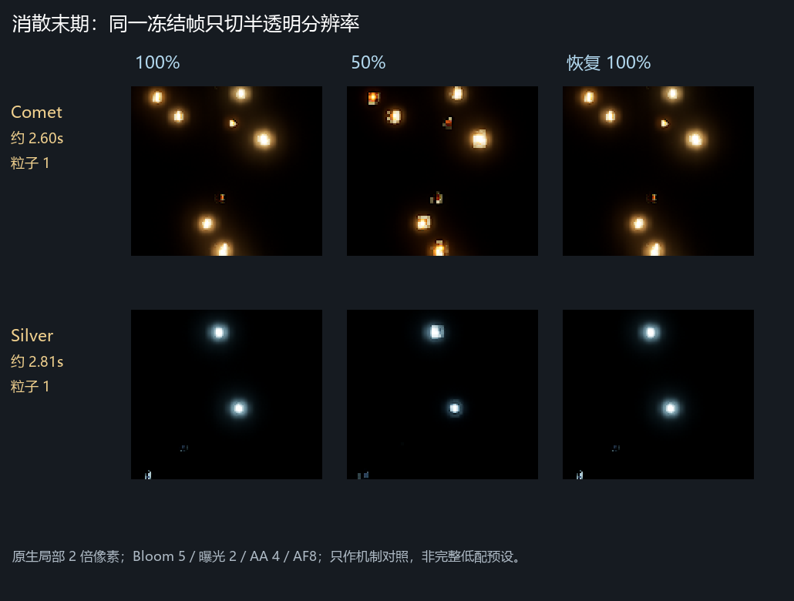
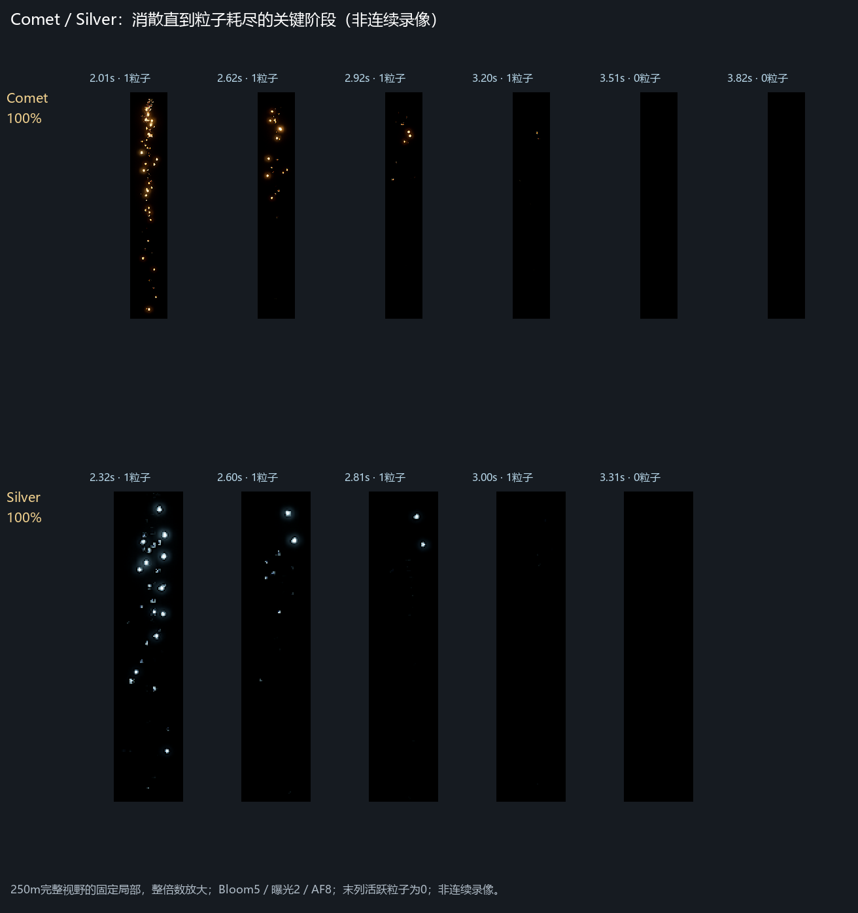
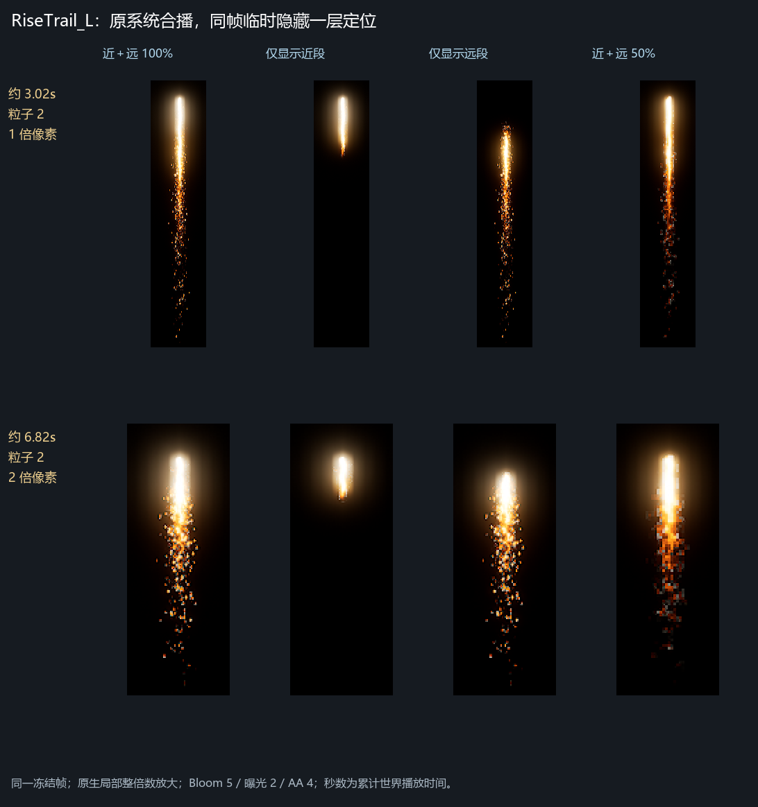
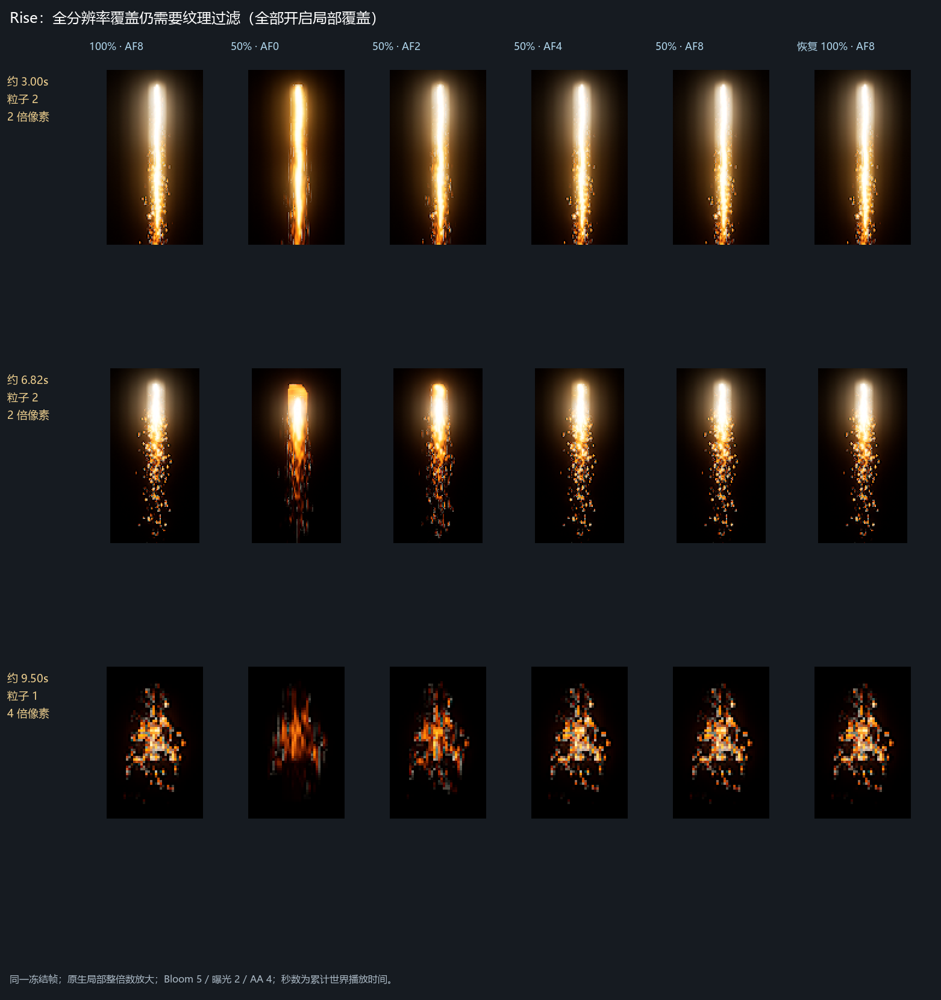
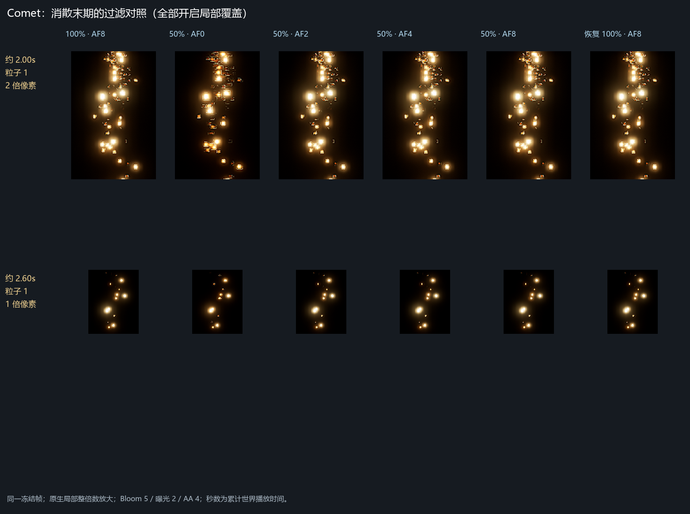
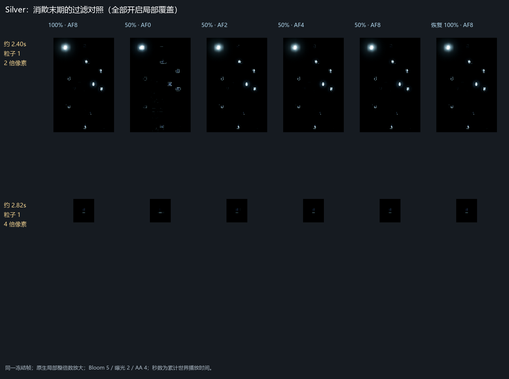

> 2026-10-17 当前方案更新：第三轮已原生移动复现并保存4主图NoMip＋4MI局部全分辨率；当前实际主尾为Comet3_GoldTail、直接影响4个PS。本文旧AF8／五PS候选仅作历史，不作为当前执行方案。见[修复与影响](../QUALITY_BLUR_20261017/修复与影响.md)。

> 2026-10-17 接续纠正：本文为受控退化机制证据，未复现用户原截图异常，不能据此认定修复完成。最新计划见 ../QUALITY_BLUR_20261017/复现与修复计划.md。

# 近远段与消散末期：方案、影响面及证据

2026-10-16，UE4.24.2 定制分支。本报告补充并修正首轮结论；候选实现没有当成用户已经确认的需求。

**两条独立链路均已复现：半透明降分辨率、纹理各向异性过滤降档。只开实例全分辨率不够。当前最简单、保持现有高档外观的已测候选是“四个既有实例局部全分辨率＋AF8 过滤保底”。过滤保底是全局设置，有全场成本，不能称为只影响三束的局部修复。正式资源未落盘，GTX960 异常客户端及完整演出性能尚未验收。**

## 先纠正对象与阶段

ResourcesFX 实际指向 **Comet_Layers_HD、FanSilver_01_HD**，不是旧 FanComet_01_HD，也不是银色球花。Comet 主层寿命随机 3.2–3.6s，Silver 主层 2.8–3.2s；本轮捕获停喷后直至完全消失。运行时确认末期只剩总数1／CPU1／GPU0。早期还有点层，不能单凭 Required.bEnabled=false 认定 GPU 层完全不运行。

主层动态参数的溶解通道为0、Alpha为1，末期消散主要来自**烘焙序列后段**变稀和消失；不能直接把问题当成溶解曲线错误。图中秒数是剔除冻结等待后的累计世界播放时间，不是回调数乘固定步长，也不冒充精确粒子年龄。随机寿命不同的两次播放不作逐像素质量比较。





## 为什么循环近段头部更明显

已用 **RiseTrail_L_HD 原系统近远一起播放**，完整记录到耗尽，并在约3.02s、6.82s 冻结后只隐藏另一份瞬态实例定位。约0.6–7.5s 两粒子同在，之后只剩远段，约11.14s 耗尽。没有改源发射器或用独立预览冒充合播。



Loop 主图2048²、16列×1行，每格128×2048；Far 也是2048²，但16列×4行，每格128×512。**关键遗漏是近段只缩Y的 SizeByLife：约1.41%→82.67%→15%，X不缩。** 末期把长图压进短面片，两个方向的采样密度差距增大；近段还有集中的高亮头，粗采样更容易显出方边。正视、不旋转的几何估算中，近段末期两轴密度比约8:1，远段约4.5:1；这不是 GPU 导数测量。原始 Loop 抽查帧有圆弧／尖部及黑色留边，并非直接烘焙了平齐方头。

A/B 支持这个解释：即使半透明100%，AF8→AF0 也会明显拉糊；已开全分辨率覆盖仍如此。近段6.82s 补测中，AF2不足，AF4仍有差异，AF8最接近重复参考。**“循环本身出错”没有证据；远段看起来轻，不代表它正常。**



## 最小候选与关键取舍

1. 仅给下表四个既有实例打开本分支的全分辨率覆盖，在播放前生效。相同冻结粒子100%→50%→恢复100%的对照已覆盖 Rise 合播／远段末期、Comet／Silver 消散末期。
2. 采样另行保底。本轮组合验证使用 **r.MaxAnisotropy=8**，不能把 AF2／4 的损失擅自当作用户认可的降级。AF4 可以作为 GTX960 性能比较候选，当前未证明它能完整保持现有高档外观。

```text
BasePropertyOverrides.bOverride_TranslucencyRenderFullPercentageLast = true
BasePropertyOverrides.bTranslucencyRenderFullPercentageLast = true
```

测试只复制实例到 Transient，先确认 Parent、标量、矢量、贴图、静态参数与基础覆盖一致，再开上述字段，仅绑定本轮 Actor。现有实例读回未见单独的过滤倍率参数，**全局 AF 保底不等于实例局部修复**。未新增母材质、未写引擎代码，未改颜色、亮度、寿命、形态或溶解阈值。





不采用的捷径：50% 下关闭 AA 仍然粗糊；单独复制 Rise Ramp 且仅关闭 mip，未消除 AF0 拉糊；全局 mip bias -8 找回部分细节，却放大灰白底噪，而且同时影响主图和 Ramp。因此不能据此批量 NoMipmaps、全局负偏置或抬亮度掩盖问题，也不能直接把灰白点全部归因于 BC7。

## 实际影响范围

当前 AssetRegistry 磁盘硬／软包引用如下；不是对动态字符串引用的穷尽证明。

| 既有实例（省略 MI_EFX_FireWorks_ 前缀） | 直接影响的系统 |
| --- | --- |
| RiseTrail_L_Loop_01_HD、RiseTrail_L_Far_01_HD | RiseTrail_L_HD |
| Comet_Layers_L1_Full_01_HD | Comet_Layers_HD、Comet_Layers_S_HD |
| Silver3_Layers_S_Full_01_HD | FanSilver_01_HD、Silver_Layers_S_HD |

所以**原位修改4个实例会影响5个系统**，不只是用户列出的三个系统。AF保底还会影响全场受该设置约束的纹理采样。局部全分辨率增加所涉半透明层的像素成本，不等于整帧成本变成四倍，更不能承诺 GTX960 无性能回退。四实例也不覆盖 Comet／Silver 的早期公共点层。

不建议改公共母材质／火花实例／色带：公共 Spark 实例约260个包引用，Rise Ramp有14个实例引用，均明显扩大范围。

## 验收及尚未闭环的事项

推荐以**四实例覆盖＋AF8**为保持现有高档外观的候选基线，再在 GTX960 实际低／超高预设、固定分辨率／机位／演出时间点上验证。必须读回底层半透明比例和自动降采样、AF、屏幕比例、纹理 streaming bias、AA；`sg.*` 标签可能与实际值不一致。本轮是受控变量实验，不是完整低配预设或异常客户端复现。

重点验收 Rise 近远共存及循环末期、Comet／Silver 停喷至完全消失，以及另外两个共用实例系统的回归；同时查运动拖影、灰白点、峰前／中／后的 GPU帧时、雾、DOF、Bloom、遮挡和排序。定位距离约100／250／600m，不代替项目800–1200m游戏内大小验收。100m局部用于看细点；250m末期补拍保证完整内容在视野内，避免截掉上部。

**远段灰白噪点尚未独立定因或证明全部消除。** 已确认降采样及 mip 选择会改变／放大它，尚未完全拆开源弱灰、压缩与映射的贡献。客户端实际触发、持续及恢复时间仍未验证。正式落地、实机验收、用户艺术认可都没有标成完成。

## 证据与现场

原生2210×1105、HighResShot1。只冻结本轮组件，同组等待后取100／50／恢复100；开启后处理的定位组使用 Bloom5／曝光质量2／AA4，运动模糊关闭；另有关闭 Bloom／曝光的轮廓组。曝光质量开关不等于锁定曝光数值。图只裁切、整倍最近邻放大，没有锐化、补帧、调色或AI修图。像素差异只检查单组变化，不是画质评分；不同随机播放之间不算改善百分比。

详细指标：[半透明对照](二轮/二轮像素指标.json)、[过滤对照](二轮/过滤保底指标.json)。完整读回、原图、脚本和崩溃记录仅留本机 `F:/FireWorksLab/analysis/local/QUALITY_BLUR_20261016/round2/`。

测试期间两次进程退出：首次时段存在 T18 并行及人工操作，后续隔离回调并由用户暂停 T18；第二次是缺符号的 Engine／Slate 访问异常，不能直接归因于测试、开关或人工操作。中断组没有算通过，用户重连后另行补齐。

**最后收尾另有一次本对话的操作失误：**临时Actor已清除、回调已注销、机位／选择／CVar已恢复后，为清除本轮Login地图脏标记，通过接口重载地图触发 `World Memory Leaks` 致命检查。没有保存该地图，也不能称这次收尾正常恢复。以后保留临时地图脏标记并明确交接，不再为清标记在脚本执行中自动重载。用户已重新打开 FXLookDevLevel；之后只读确认本轮Actor0／模块0／内容和地图脏包0，未把旧状态写入新现场。正式资源未保存。最终源参数和磁盘校验见[二轮验证摘要](二轮验证摘要.json)。


记录校验：安全快进至dc0a3bec，保留双方共享记录；JSON、报告链接、11张证据PNG、差异空白检查及合入门禁体检通过。未提交／推送。
