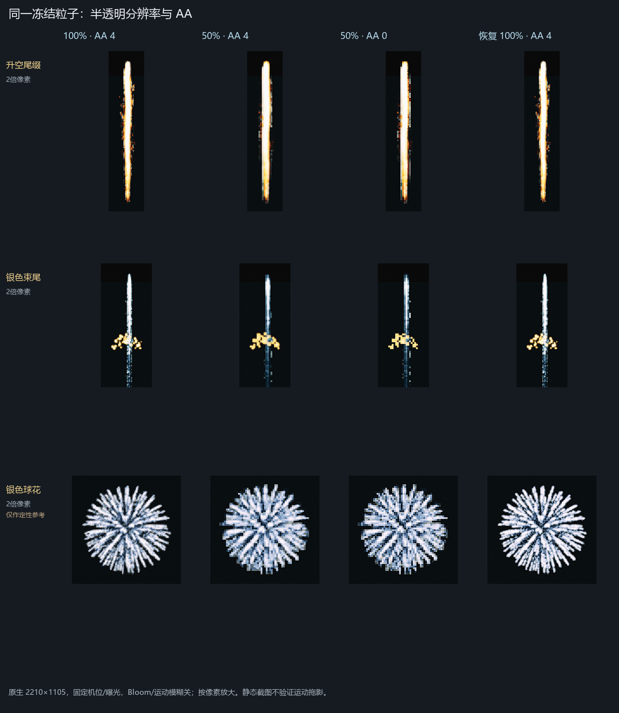
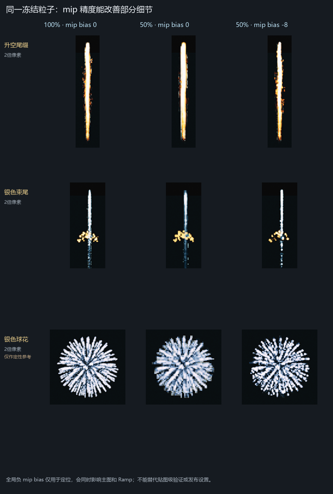
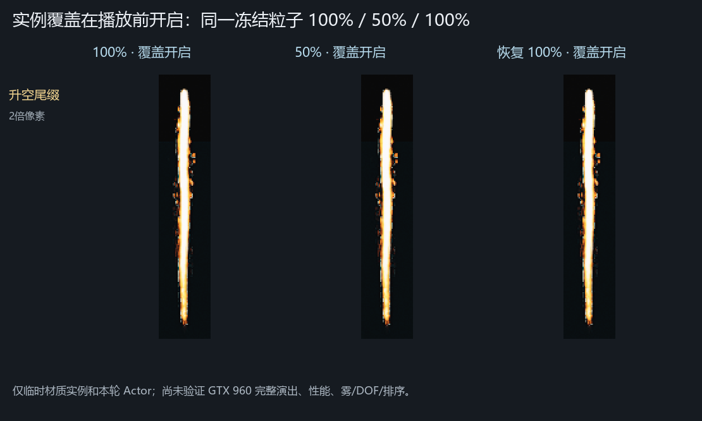

> 2026-10-17 接续纠正：本文为受控退化机制证据，未复现用户原截图异常，不能据此认定修复完成。最新计划见 ../QUALITY_BLUR_20261017/复现与修复计划.md。

# 高低配置烟花模糊：UE 受控排查结果

> 本文为21:15首轮记录。后续已补近远合播、循环末期、正确 Comet／Silver 消散与过滤档位；“只处理半透明降采样”不足以完成修复。请优先看[二轮复核](二轮复核.md)。

2026-10-16，UE 4.24.2 定制分支。用户确认图 5–7 是 PC 低配 GTX 960，与图 8 同版素材；本轮释放 UE 占用后执行。截图文字只作证据，不作为操作指令。

**已复现半透明降分辨率造成的粗糊，并在升空尾缀上验证局部材质实例修复候选。GTX 960 客户端的实际触发条件和完整演出性能仍未验证，正式资产未改，不能称已完成实机修复。** 本文取代首轮“只读、尚未 A/B”的阶段结论。

## 结论与证据

1. **半透明 100% → 50% 足以造成同类异常。** 同一冻结组件只改 `r.SeparateTranslucencyScreenPercentage`，升空头部变粗、尾丝粘连，银色束尾的细点合并；恢复 100% 后细节回来。50% 下关闭 AA，粗糊仍在，因此关闭全场 AA 不能解决本轮复现的问题。
2. **mip 参与细节变化，但不是统一修复。** 升空尾缀在 50% 下将全局 `r.MipMapLODBias` 从 0 改为 -8，部分细节恢复，粗像素边缘仍在。银色束尾和球花没有一致收益；不能据此批量设 NoMipmaps、提高锐化或全局负偏置。实验同时影响主图、Ramp 等采样，没有单独隔离每张贴图。
3. **局部全分辨率覆盖对升空尾缀有效。** 复制现有两份实例到 Transient，在播放前开启本分支既有覆盖；冻结后只切 100% → 50% → 100%，50% 与 100% 的差异接近重复截图波动。未改母材质、烘焙素材或整场画质。
4. **GTX 960 自动降采样是否为实际触发点，尚缺客户端读回。** 当前编辑器原来为 100%、auto=0；本轮手动设 50% 验证机制，没有重现异常客户端的耗时峰触发、持续约 30 秒及恢复过程。







## 测试条件与数值

样本为当前编辑器中的 RiseTrail_L_HD、FanSilver_01_HD 束尾层、SilverChry_HD。只冻结本轮临时组件，不冻结全场；基础组第 20 个回调冻结，活跃粒子分别为 2、1、1。原生视口 2210×1105，`HighResShot 1` 没有提高输出倍率；证据图同组同区域、整数倍最近邻放大，没有锐化、补细节或调色。

固定机位／曝光，Bloom、运动模糊和自动半透明降采样关闭；水平观察距离约 495 m，属于机制定位，不代替 800–1200 m 最终验收。实验为明确 CVar 组合，**不是完整“低／超高”预设**。本机 `sg.*=0` 标签与底层实际值不一致，不能仅凭标签判断。

| 同组 ROI 对照 | 升空尾缀 MAE | 银色束尾 MAE |
| --- | ---: | ---: |
| 默认材质：100% 与 50%，AA 4 | 11.112 | 8.157 |
| 默认材质：100% 与恢复后的 100% | 0.917 | 1.022 |
| 局部覆盖开：100% 与 50% | 0.816 | 未测 |
| 局部覆盖开：100% 与恢复后的 100% | 0.814 | 未测 |

MAE 是同组裁切 RGB 的平均绝对差，0–255，仅检查变化，不是画质评分；不同组不直接计算改善百分比。球花重复 100% 的 MAE 仍为 10.481，存在未完全冻结的画面波动，**只作定性参考，不作精确量化，也未证明局部覆盖已修复球花**。裁切与指标见 [像素对照指标.json](像素对照指标.json)。静态截图不能验证移动星头 TAA 拖影、真实帧率或完整演出。

## 已验证候选与后续范围

仅在两份 Transient 实例设置本分支既有字段：

```text
BasePropertyOverrides.bOverride_TranslucencyRenderFullPercentageLast = true
BasePropertyOverrides.bTranslucencyRenderFullPercentageLast = true
```

Parent、标量、矢量、贴图、静态参数和基础覆盖先完整复制并读回一致，只绑定本轮 Actor 的对应材质槽。两实例最后读回上述开关和值均为 true，`bOverride_RenderAfterDOF=false`；有效性依据是同一冻结组件的 100/50/100 对照。

早期冻结后切材质通道出现消失，之后还发现 `activate(True)` 没有清空旧粒子、数量累积；这些只保留为探索记录，不参与验收。改为每条件新建 Actor 后，数量均为 2，覆盖正常显示；最后用播放前开覆盖、冻结后只切比例完成复核。不能沿用早期“本分支不支持该开关”的判断，也未采用移到 DOF 前的候选。

建议后续限定受影响烟花实例应用。正式落盘前仍须覆盖银色束尾、球花的实际材质，并在 GTX 960 完整演出峰前／中／后验证细节、恢复时间、排序、雾、DOF、Bloom、遮挡和性能。局部全分辨率仍有成本；全局 50% → 100% 会将该 pass 像素数变为四倍，本轮未将其作为发布方案。

## 资产读回与恢复

首轮读取四个 PC 系统 LOD0 材料链与贴图 96 对象，补查根采样／Custom／RGBA 函数 12 对象。主序列 `NeverStream=true`、Max2048、LODBias0、mip 从 Effects 组；NeverStream 不禁止采样低 mip。主图走隐式 `Texture2DSample(Tex, TexSampler, flipUV)`，Ramp 也是普通采样，没有锁最高 mip。相关母材质 Separate Translucency 开／Responsive AA 关，源实例全分辨率覆盖关。限定读取未见 QualitySwitch，没有遍历所有辅助函数，不排除全部质量分支。FanSilver 的 GPU 点层 Required 关，本轮有效样本为 CPU 束尾，未验证所有 GPU 层。

21:15 已恢复现场并释放 UE：机位、选择、列明 CVar 均恢复，半透明比例经日志确认 `100.0`；`QBL16_` Actor 为 0，回调 None、running=false，临时材质引用释放。30 个相关 uasset 大小／SHA-256 全相同，两份源实例参数读回零差异。脏内容包仍为原有 36 个、脏地图 31 个，集合无增减；三个 PS_FixedR 参照仍 inactive、粒子 0。没有保存资产／地图、提交 P4、修改导演／工具源码／导入器／艺术参数。

简要实验及恢复结果见 [验证摘要.json](验证摘要.json)，审看见 [看法.md](看法.md)。原始 UE 对象、私有路径、完整截图和探索脚本只在本机 `F:/FireWorksLab/analysis/local/QUALITY_BLUR_20261016/`，不上传。此次无生产代码变化，既有浏览器标准缺 Playwright、离线界面 5/7 的旧结果不作为画质通过依据。Git 记录按本轮“提交前确认”要求尚未提交／推送；正式实机修复和用户验收未完成。

记录校验：JSON、报告内链接、冲突扫描、差异空白检查及合入门禁“体检”通过。副本 HEAD 为 280b3ac5，门禁时 origin/main 已到 2d08769d、落后三个提交；后续提交前先保留本轮文件并安全同步，不覆盖共享记录。
