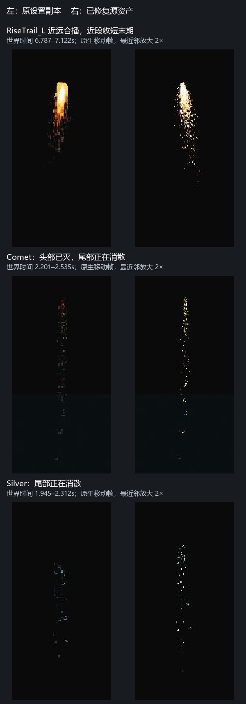
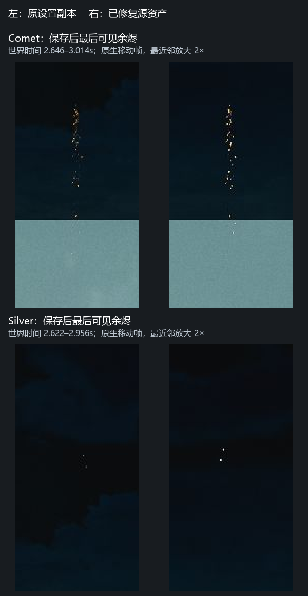
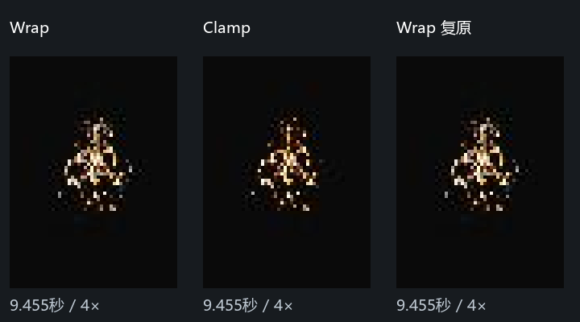

# 方头与消散模糊：局部修复和剩余范围

2026-10-17，当前 ResourcesFX 的 PC 入口。以下为 AI 自检，尚无用户画质验收。

**本机已保存8个源资产：4张主图改NoMip，4个既有材质实例开启局部全分辨率末尾透明通道。** RiseTrail_L原系统近远合播的方头、Comet／Silver头部消失后的尾部粗糊，已经原生移动播放复现，再用源资产回归。远段灰白边点另有Ramp寻址原因，正式修改范围尚待用户选择；不能宣称原问题全部解决。

## 对照和测试边界

前两轮冻结／HighResShot只能证明退化机制。第三轮先播放当前源系统并记录移动帧，再做单因素及冻结的可逆对照。图中时间为**世界播放时间的截图前后区间**，不是精确的单粒子年龄。

左为修改前设置的临时副本，右为**没有材质覆盖的实际源PS**；同一原生视口播放，裁剪后仅最近邻放大2倍，没有调曝光、锐化或改像素。Comet约2.2秒已只剩主尾，Silver后段也转为只剩主尾；这里没有用升空头部代替消散验收。原设置的暗灰块与粗轮廓，在修复源资产上恢复为离散火星。Silver随机寿命／早期附加粒子有差异，不用两侧亮点数量算改善百分比。

保存后补采Comet 2.646–3.014秒、Silver 2.622–2.956秒，覆盖最后可见余烬。有效正式回归均记录到耗尽：Rise 12秒、其余4.2秒的结束帧粒子数为零。一次Comet 3.068–4.204秒及额外Silver系统的一次过迟截图已经空白，不作视觉通过证据。

低档应用引擎／项目Texture、Effects、AA、PostProcess的`@0`配置中60个有效可查询设置，另固定透明通道50%、自动降采样关、VRS关、视口上限30fps；核心条件为AF0、AA0、材质质量1、Streaming.MipBias16。高档恢复开工数值，包括AF8、AA4、材质质量4、透明通道100%。**没有冒充GTX960客户端完整设备预设。**

本机进程为DX12／SM6；GTX960实际RHI、着色器路径、客户端打包和完整演出帧预算未验证。截图有逻辑像素／系统缩放，不能直接当作1080p渲染。1000米与原Dam机位补测是定性回归，不是GTX960性能通过。源PS自身的FixedTime／10fps字段保持；30fps指本轮视口上限，不是重采样素材。

## 为什么近段循环更明显

**采样退化与透明通道降采样叠加。** 全分辨率单独使用仍保留部分块状细节；NoMip单独使用也不足以保护Silver在低分辨率透明通道里的轮廓。组合后在当前低档条件有效。主图原本已经NeverStream=true，这不等于关闭渲染时的mip选择。

近／远是同一原系统内两个发射器，不能直接理解成按距离切换的LOD。RiseLoop主图为16×1、RGBA接力，每格128×2048；TrailFar为16×4，每格128×512。近段初始尺寸约8.88×119.72米，SizeByLife只乘Y，峰值约0.827、末期降至0.15；远段约18.75×338.30米，没有同样的Y收短。

**据此推断：** 近段末期的面片比例与纹素比例约有7.9倍轴向不匹配，远段约4.5倍。这是未计视角、对齐与实际导数的估算，只解释敏感程度，不是统一AF8的规格。循环反复显示亮头使退化更显眼，不能认定循环次数或烘焙头部本身就是根因。保持曲线不变，仅修采样即解除明显方头，是本轮实测依据。远段也受采样／透明通道影响；NoMip只能保住现有信息，不能补出窄格原图没有的细节。

## 灰白边点：独立原因，范围待定

母材质用灰度值查EmissiveRampTex。原Rise Ramp的Wrap使低灰度端过滤可能跨到另一端颜色，与主图细节压成块是两件事。

实时看到边点后，固定同一远段粒子在世界时间9.455秒，关闭自动曝光、Bloom和时域AA，保持主图NoMip／局部全分辨率不变，仅将临时实例Ramp做 **Wrap → Clamp → Wrap**。Clamp减少外围灰白点，换回Wrap恢复。相同裁剪区Wrap复原平均像素差约0.055/255，Wrap与Clamp差约3.051/255，只核对可逆性，不是画质评分。

原Ramp被16个实例共用、间接覆盖12个PS，包含PC／手机Hero，**尚未正式修改**。推荐复制已有Ramp、像素不变，只改Clamp并接给RiseTrail_L近远两个实例：增加1张贴图，影响限于RiseTrail_L。直接改共享Ramp则要回归上述16实例／12系统。

这里把新增贴图资产视为可能超出[CLAUDE.md](../../../CLAUDE.md)“只用……已有的发射器、材质、贴图”的约束，已请求用户选择范围。这是范围解释，不是用户确认的新需求。答复前，8资产修复独立落地，灰白点仍待正式处理。

## 已保存字段与影响

名称均位于既有`Effects_HD/Common_HD`目录，前缀为`MI_EFX_FireWorks_`／`T_EFX_FireWorks_`，后缀为`_01_HD`。

| 资源 | 已保存变化 | 直接引用系统 |
| --- | --- | --- |
| MI RiseTrail_L_Loop、RiseTrail_L_Far | `bOverride_TranslucencyRenderFullPercentageLast=true`，对应值=true | RiseTrail_L_HD |
| MI Comet3_GoldTail_Full | 同上 | Comet_Layers_HD |
| MI Silver3_Layers_S_Full | 同上 | FanSilver_01_HD、Silver_Layers_S_HD |
| T RiseTrail_L_Loop_16x1、RiseTrail_L_Far_16x4 | `MipGenSettings: FromTextureGroup → NoMipmaps` | 各自仅上述一个MI |
| T Comet3_GoldTail_Full_16x1、Silver3_Layers_S_Full_16x1 | 同上 | 各自仅上述一个MI |

**当前直接影响4个PC系统**，取代二轮旧缓存“五个PS＋全局AF8”的范围与建议。手机、M／S／XS／Tiny／Hero、共享Spark、共享Ramp未正式改动；父材质、颜色／亮度／溶解标量、纹理绑定和静态参数均保持。4张主图修复前后从UE导出的源RGBA像素SHA256全部相同，没有改暗、隐藏某层或重烘。

本轮纠正了对象错误：PC表FanComet_01仍指向Comet_Layers_HD，实际主尾已是 **L1_TrailFull／槽3／Comet3_GoldTail**，共4个LOD。两次复用旧槽0／旧Comet_Layers_L1材质的候选试验无效，已排除。最终脚本从实时PC表与发射器名查所有目标LOD，不缓存旧槽号。共用系统Silver_Layers_S_HD也已单独回归。

## 取舍和验收

- 局部全分辨率增加这些面片的像素工作量；每边50%转全分辨率，相关像素数量可到4倍，不代表整帧或全部透明耗时4倍。原Dam合播已目视核对；专门DOF／其他透明互遮挡组合与完整演出峰值未覆盖。
- NoMip移除低级别平均过滤，可能增加远景闪烁、采样缓存压力。原主图已NeverStream，不能解释为新开全局最高纹理常驻策略。1000米高档观察未见新的大块轮廓，连续运动／GTX960预算未自动通过。
- 本轮只修现有8个UE资源设置，没有扩成全部烟花的导入默认。新导入或覆盖后应跑校验，发现设置被重置再定位导入流程；共享烘焙器和导入器没有改动。

客户端验收用同一PC表、同机位／实际分辨率／RHI，低高档均30fps连播：Rise近远同播全寿命，重点看近段收短的方头和远段末期边点；Comet／Silver看头部消失后至最后余烬。确认没有宽平头、灰块／雾状消散，同时高档主体不削减，再查整场峰值帧时间与透明遮挡。Ramp范围及GTX960检查未完成，不标用户通过。

## 保存、恢复与接续

8个源uasset已备份、限定签出、逐包保存，保持本机Perforce签出，**没有P4提交或客户端发布**。读回仅上表字段变化。初始19个监测文件中13个哈希相同、6个是预期改动；新增核对的Comet3两文件由正式8文件备份覆盖。地图及其他原有脏内容未保存。

最终Actor总数34751与开工一致，本轮Actor0、回调None、机位／选择恢复；原5内容脏包、29地图脏包集合相同。复制接口生成的9个Engine临时文件已归档本机`analysis/local/QUALITY_BLUR_20261017/`，对应临时包清脏，Engine目录无残留临时文件，清理没有重载地图。PID145568全程存活；加载阻塞／RPC断连未误判为崩溃，也没有盲目重复写入。

测试CVar有效数值已恢复并读回无差异；**部分变量保留了Console优先级**，如原为Constructor的Streaming.MipBias／PostProcessAAQuality，以及原为Scalability的t.MaxFPS。本轮公开接口未找到恢复优先级的方法，未为清理而重启、丢弃原有未保存工作。这个进程后续切画质可能被覆盖，应正常保存原有工作、重启UE后再做预设／客户端验收。未改项目画质ini作为持久策略。

[字段与引用校验脚本](../../scripts/ue_quality_blur_fix.mjs)支持snapshot／apply／verify／save；写请求不自动重试，应用前核当前PC表、全部目标LOD、源文件／备份哈希和签出状态，仅保存8源包。先有失败检查，应用后／保存后通过。像素校验、回归摘要和保存哈希见[验证摘要](验证摘要.json)。原始桌面截图、uasset、P4明细及备份只留本机，Git仅提交脚本、精选证据和记录。
