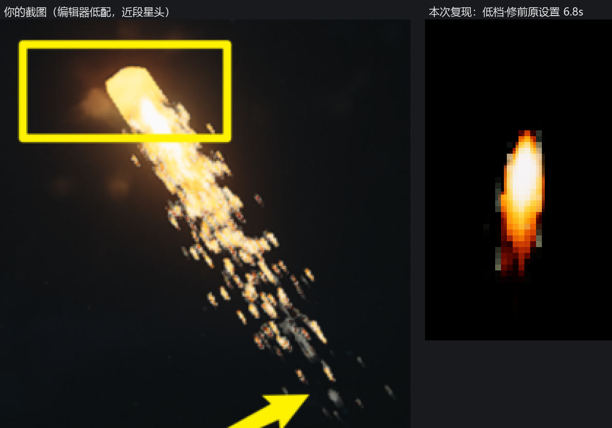
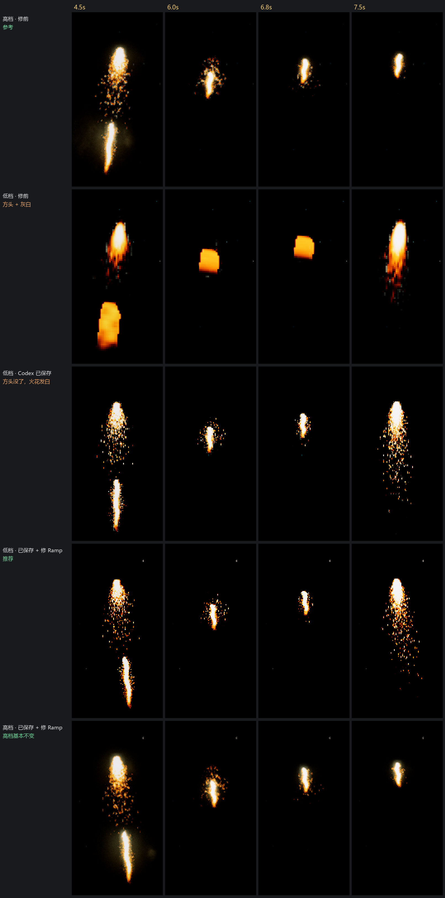
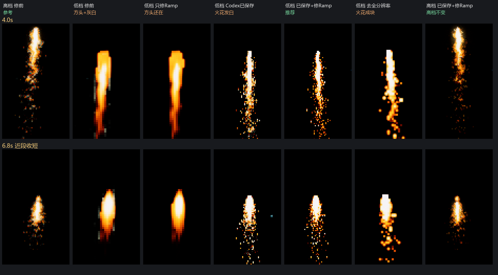
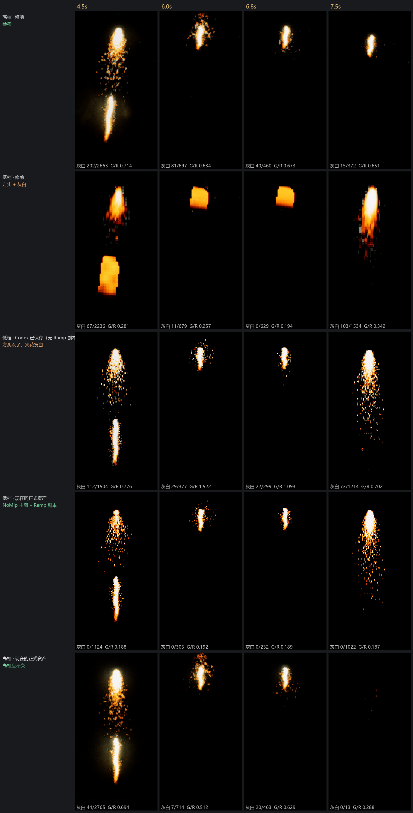

# 画质复核（WorkBuddy 接手 g23 / local-P150）：方头、灰白点、消散糊

2026-10-17 10:00–11:10，UE PID 145568，地图 Dam_Iris_Long3。本轮只用 `WB17_` 临时 Actor 和 Transient 材质实例，**没有保存任何资产 / 地图，没有调 P4**。以下是 AI 自检结论，不是用户验收。

## 一句话

两个症状对应两个独立的采样问题，都由低档 `TextureQuality@0` 触发：

| 症状 | 根因 | 修法 | 状态 |
| --- | --- | --- | --- |
| 近段循环星头变方块 | 主序列有 mip + 低档 `r.MaxAnisotropy=0`；面片只缩 Y，V 方向压缩后按 V 选 mip，U 方向 128 像素的格子被糊成 4–8 像素宽 | 主序列 NoMipmaps | Codex 已保存（4 张），本轮复现确认有效 |
| 灰白点 / 火花发灰 / 消散变灰糊 | Ramp 带 mip + Wrap + 可流送；低档 `r.Streaming.MipBias=16` 和 AF0 让 Ramp 落到高级 mip；烘焙器的「末格黑」护栏只在 mip 0 下成立，mip ≥1 时最热端和黑格被平均成灰白，mip ≥3 时 Wrap 又把这种灰白卷到暗端 | Ramp 改 Clamp + NoMipmaps（项目 10-07 自己定的 Ramp 规范，spec D5） | **未落地，等用户批准范围** |

## 复现（同机位、移动播放、项目真实低档分档值）

- 低档 = `DefaultScalability.ini` 里 Texture / Effects / AntiAliasing / PostProcess 四组 @0 的全部 60 项，加半透明 50%、自动降采样关、VRS 关、30 fps；高档 = 开工值（AF8、半透明 100%、材质质量 4）。两档切换后读回 CVar 已生效；收尾后 64 项和开工值零差异。
- 渲染用 SceneCapture2D 逐帧离屏渲染（保留渲染状态），走的是同一渲染器、同一套 CVar。关卡视口被其他窗口挡住，没有抢桌面焦点。
- 修前原设置用 Codex 内存里现成的 `QBL17_MI_40/41`（主图有 mip、无全分辨率覆盖、原 Ramp）；Ramp 修复用现成 Transient 副本 `QBL17_TX_30`（像素同 Rise_L_R），只临时关掉它的 mip，测完已改回原样。

灰白量化（`灰白像素指标.json`：亮度 40–230、饱和度 < 0.35 的像素数；G/R 是平均绿红比，橙色约 0.2–0.5，越接近 1 越白）：

| 低档 6.8 s | A 修前 | B 只修 Ramp | C Codex 已保存 | D 已保存 + 修 Ramp | E 再去掉全分辨率 |
| --- | --- | --- | --- | --- | --- |
| 灰白 / 亮像素 | 50 / 615 | 1 / 532 | 19 / 420 | **0 / 366** | 0 / 552 |
| G/R | 0.40 | 0.18 | 0.68 | **0.18** | 0.23 |

- B 证明：只修 Ramp 能去掉灰白，但方头还在 → 方头不是 Ramp 引起的。
- C 证明：主图 NoMip 去掉了方头，但火花在低档发白（G/R 0.6–1.3）；Codex 第三轮把这当成「恢复为离散火星」，没发现颜色漂移。
- D 最接近高档参考；高档下 D 和修前几乎一样（高档原 Ramp 也有 33–115 个灰白像素，修后降到 0–21，即高档会略微更橙、更干净）。
- E：去掉全分辨率覆盖后火花变成 2×2 粗块，这是低档半透明 50% 的固有表现，不是新 bug。

## 离线依据

- Ramp `T_EFX_FireWorks_RiseTrail_L_R` 256×8：第 254 格 (255,245,229)，第 255 格 (0,0,0)。按 mip 链算：mip 0–2 下 Wrap 与 Clamp 结果完全相同（首末格都是黑）；灰度 0.99 在 mip 1/2 变成 (242,232,216)/(229,220,204)；灰度 0.01 在 mip ≥3 + Wrap 下变成 (114,106,97) 灰白。Comet3_GoldTail_R、Silver3_S_R 源图同样是「末格黑」，Silver 热端 (254,254,255) 紧挨纯黑，mip 后最容易变灰。
- `existing-ramp-catalog.json`：24 张 `T_EFX_FireWorks_*_R` 全是 Wrap + FromTextureGroup（有 mip）+ 可流送。spec D5 和 10-07 的约定是 Ramp = Clamp + NoMipmaps，导入时没有落实。
- `DefaultScalability.ini`：TextureQuality@0 是 `r.MaxAnisotropy=0`、`r.Streaming.MipBias=16`；@3 是 8 / 0。

## 对 Codex 三轮的纠正

1. 方头二轮其实已经复现（`二轮/RiseTrail_L_HD_过滤保底.png` 6.82 s 的「50%·AF0」那一格），而且同一张图里「50%·AF8」已经恢复，说明主因是 AF/mip，不是半透明 50%。首轮主攻半透明是误判，三轮又叠了全分辨率覆盖。
2. 灰白点被归因为「Wrap 寻址」，于是提出「复制 Ramp、只改 Clamp」。实际主因是 Ramp 的 mip：只改 Clamp 解决不了热端变灰。而且它用的 Transient 副本不会被流送降级，对照条件和真实低档不同。
3. 把「共享 Ramp 影响 16 实例 / 12 系统」当作风险，所以选了新增副本。实际上 Clamp + NoMip 在 mip 0 下逐像素不变，对其它引用只会起到同样的纠错；新增副本反而违反「只用已有贴图」的约束，而且只修 Rise_L，Comet / Silver 的同类问题没有覆盖。
4. 截图里 iOA 提示「通过非可信通道移动版 ChatGPT 向 CodeX 下发指令……已终止相关进程」。推断：前几轮的部分「崩溃 / 断连」可能是 iOA 拦截造成的，不是 UE 本身的问题（未核实）。

## 未验证 / 边界

- Comet_Layers_HD、FanSilver_01_HD 的消散段这一轮没有单独跑：手头没有它们 Ramp 的 Transient 副本，复制贴图会在 Engine/Content 下落临时文件。机制和 Rise 相同（同一导入设置、同一母材质、同一低档），属于有依据的推断。
- GTX960 实机、整场峰值帧时间、全分辨率覆盖的实际开销都没测。本机是 RTX 5080 / DX12。
- 低档另有 `r.EmitterSpawnRateScale=0.125`、ResolutionQuality 0 档 = 50% 屏幕百分比，会让低档整体变稀、变软；它们不是这个 bug，也不该靠资产修回来。

## 11:20 用户选：先复制副本看效果 → 已落地（11:15–11:40）

- 新增 `/Game/Effects_HD/Common_HD/Texture_HD/FireWorks_HD/T_EFX_FireWorks_RiseTrail_L_R_01_HD`：从原 Rise_L_R 复制，源 RGBA 与原件逐像素相同（sha256 e422828b…，保存后再导出复核仍相同），只改 AddressX/Y = Clamp、MipGen = NoMipmaps；sRGB / BC7 / 尺寸 256×8 不变。P4 状态 = 待添加（added），**未提交**。
- `MI_EFX_FireWorks_RiseTrail_L_Loop_01_HD`、`…_Far_01_HD`（Codex 已签出）只改 EmissiveRampTex 指向新副本；其余字段读回与改前逐字段一致（含 Codex 的全分辨率覆盖）。改前两份 uasset 备份在本机 `analysis/local/QUALITY_REVIEW_20261017/ramp-copy/`。
- 原共享 Ramp `T_EFX_FireWorks_RiseTrail_L_R` 字段读回零变化，其它 14 个实例 / 手机 / Hero 不受影响。Comet / Silver 没动。
- 保存方式：只逐包保存这 3 个包，没有 SaveAll，没有保存地图。

正式资产回归（同机位约 270 m，`正式资产回归指标.json`；格式为 灰白像素 / 亮像素，括号内是 G/R）：

| | 4.5 s | 6.0 s | 6.8 s | 7.5 s |
| --- | --- | --- | --- | --- |
| 低档 · 修前 | 67/2236 (0.28) 方头 | 11/679 方块 | 0/629 方块 | 103/1534 |
| 低档 · Codex 已保存 | 112/1504 (0.78) | 29/377 (1.52) | 22/299 (1.09) | 73/1214 (0.70) |
| **低档 · 现在** | **0/1124 (0.19)** | **0/305** | **0/232** | **0/1022** |
| 高档 · 修前 | 202/2663 (0.71) | 81/697 | 40/460 | 15/372 |
| 高档 · 现在 | 44/2765 (0.69) | 7/714 | 20/463 | 寿命随机已灭 |

高档整体亮度、形状不变，灰白边点变少；低档方头、灰白都消失，颜色回到橙色。

## 关 mip 的影响

- **Ramp（256×8）关 mip**：显存省掉 mip 链，可以忽略；采样开销不变（一张极小的查找表）。高档下只要 GPU 本来就选 mip 0，结果逐像素不变；本来会选高级 mip 的地方（火花边缘、低档）改为准确取色，也就是灰白消失。没有闪烁风险：Ramp 是按灰度查颜色，空间上的锯齿来自主图，不来自 Ramp。
- **主序列（2048²）关 mip**（Codex 已对 4 张做了）：显存少约 25%。远处缩小采样时每像素直接读 mip 0，纹理带宽和缓存未命中会增加（4 个系统影响小，铺开到全部烟花要实测）；远距离运动时可能出现闪烁 / 颗粒感，这是主要风险。这一轮 270 m 和 600 m 静帧没看到，**1000 m 连续播放和 GTX960 帧时间还没验证**。
- 不改主图 mip、只改 Ramp：方头还在（B 列）。所以两者缺一不可，各管一个症状。

## 其它贴图的共性问题（只读扫描 237 张，`烟花贴图设置扫描.json`）

- **Ramp**：28 张全部有 mip 且会流送，27 张是 Wrap（只有 Head_05Ramp 是 Clamp）。凡是用「末格黑」护栏的 Ramp，在低档都会有同样的灰白 / 发灰。这是导入设置的系统性偏差（spec D5 定的 Clamp + NoMipmaps 没有落实），不是 Rise 一张的问题。
- **PC HD 序列**：45 张仍有 mip。其中长条窄格的尾缀（RiseTrail S/M 近段 16×1、S/M 远段 16×2、Tiny/XS 32×1、Hero 32×2、Silver3_S、Comet_Layers_L1_Full 16×1）和 Rise_L 结构相同。推断低档也会出方头，未逐个测。球花类 4×4 格子接近正方形，各向异性小，受影响应该轻得多。
- **手机 / 旧序列**：160 张有 mip，其中 124 张会流送（低档 MipBias 16 会直接丢高级 mip，整体变糊），属于另一条线，本轮没测。

## 方法（可复现）

脚本在 `analysis/scripts/ue_画质复核/`：`wb_state.mjs` 存现场 + 生成低档值 → `wb_live.mjs low|high|high30|restore-camera` 切档 → `wb_cap.mjs begin <cfg>` 离屏逐帧捕获 → `wb_final.mjs` 恢复并比对现场。白名单只允许写 `WB17_` Transient 对象。
