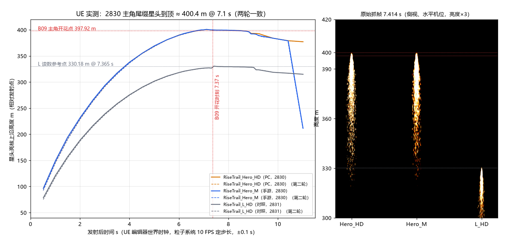

① 2830「超大_尾缀」现指的 `RiseTrail_Hero_HD`（PC）/ `RiseTrail_Hero_M`（手游）在 UE 里星头亮核上沿到顶 **400.4 m / 400.6–400.9 m，约 7.1 s（±0.1 s）**，两轮一致；② B09 开花时刻 7.37 s 时星头在 **399.5 / 399.7 m**，比开花点 397.92 m 高 1.6–1.8 m（< 2 m），**B09 的 397.9 m、7.37 s 不用改**；③ 方法对照：330 m 的 `RiseTrail_L_HD` 实测 330.4 m @ 7.41 s，和读数参考点 330.18 m @ 7.365 s 差 0.2 m / 0.05 s。

WorkBuddy（本机）· 接续派活 T19 唯一没做完的一项（原报告 [B09主角读数.md](B09主角读数.md) 写「Hero 可见到顶高度 / 时间未测」）。UE 实测，香港时间 2026-10-17 12:10–12:20，两轮。执行结束：是；AI 自检：两轮一致 + 对照通过；用户通过：—。

## 结果

| 尾缀（ResourceId） | 到顶（亮核上沿） | 到顶时刻 | 离顶 1 m 以内的时段 | 7.37 s 时 | 光晕上沿比亮核高 |
|---|---|---|---|---|---|
| Hero_HD（2830 PC） | 400.38 m（两轮相同） | 7.12 / 7.09 s | 6.9–7.7 s | 399.49 m | ≤ 0.26 m |
| Hero_M（2830 手游） | 400.88 / 400.62 m | 7.12 / 7.09 s | 6.9–7.4 s | 399.74 m | ≤ 0.26 m |
| L_HD（2831，对照） | 330.38 m（两轮相同） | 7.41 / 7.42 s | 7.4–8.2 s | 328.5–328.7 m | 0 |

星头高度随时间（两轮平均，m）：

| 时刻 s | 2 | 4 | 5 | 6 | 6.8 | 7.0 | 7.1 | 7.37 | 8.0 | 8.5 | 9.0 | 9.8 | 10.4 |
|---|---|---|---|---|---|---|---|---|---|---|---|---|---|
| Hero_HD | 229.4 | 337.1 | 368.3 | 389.5 | 398.6 | 399.9 | 400.3 | 399.5 | 399.1 | 398.4 | 393.0 | 384.1 | 379.1 |
| Hero_M | 229.9 | 337.1 | 368.4 | 389.6 | 398.9 | 400.0 | 400.6 | 399.7 | 399.2 | 398.3 | 392.1 | 384.0 | 379.0 |
| L_HD | 187.4 | 274.9 | 301.1 | 318.0 | 325.4 | 326.4 | 326.7 | 328.6 | 329.4 | 328.9 | 328.0 | 318.7 | 316.9 |

- PC / 手游两根几乎重合（差 ≤ 0.5 m），手游用同一开花点即可。
- Hero 星头 6.9 s 到 399 m，7.1 s 最高，到 8.5 s 仍在 398 m 以上，9 s 后才慢慢下沉 —— 7.37 s 正好在平台段里，开花时没有「花开在尾缀上方」或「尾缀穿出花」的高差。
- 原报告里 Hero 面片上沿 405.9–411.3 m 是整块图的边，含留边，不是星头；B09 按「尾缀顶端 400.2 m」对位的假设和实测 400.4 m 一致。

## 给跨年秀（22）

- **2830 的 397.92 m、7.37 s 保持不变**；B09 §2「前提是 2830 指到 400 m 的粒子」已满足（现指 Hero_HD / Hero_M，实测 400.4 m）。
- B09 §1 第 1 条「2830 指 RiseTrail_L_HD、花会在尾缀顶上方约 70 m 处开」已过时（10-17 05:13 读回起 2830 已和 2831 分开），可在 B09 记录里标作废。
- 想做到零高差也只差 1.6 m（开花点 399.5 m）；花本身 400 m 宽，不建议为此改编排。

## 怎么测的（可复现：`analysis/scripts/ue_T19_主角尾缀/`）

- 现场：Dam_Iris_Long3，无 PIE，没有别人的临时对象；状态清单已认领（a503bf65）。
- 只建 `WB19_` 前缀临时 Emitter ×3（三根并排、横向间隔 120 m、发射点离地约 2 km，避开地形）+ SceneCapture2D ×1 和 Transient 渲染目标；抓完全部销毁。
- 机位：水平（pitch 0）看 -Y，距尾缀平面 2000 m，横向 FOV 11.42°，1600×2000 → 尾缀平面上 0.25 m / 像素。尾缀是 `EPAL_ROTATE_Z`（只绕世界 Z 转），竖直线上每点深度都等于 2000 m，像素→高度是精确线性，没有透视误差，也和玩家机位仰角无关。
- 抓帧组件关掉 TemporalAA / AA / 运动模糊 / Bloom / 自动曝光 / 雾 / 镜头光晕 / 景深（只影响这台临时相机），避免光晕把头顶「撑高」；减去激活前的背景帧。
- 星头 = 每根 ±80 px 列带里，从上往下第一行亮度 ≥ 本帧该根最大值 50%（亮核上沿）/ 10%（光晕上沿）；两者差 ≤ 0.26 m，星头边缘清楚。
- 时间：编辑器世界时钟，从 Activate 算起；这三个粒子系统都是 FixedTime 10 FPS，时刻分辨率约 ±0.1 s；每张图按实际时刻记录（导出 PNG 拖慢帧率，抓帧间隔约 0.1 s）。
- 原始数据：[B09主角_Hero到顶实测.json](B09主角_Hero到顶实测.json)（两轮逐张：时刻、粒子数、亮核 / 光晕上沿、亮区下沿、列中心）。原始 PNG 只留本机 `analysis/local/T19_HERO_APEX_20261017/`。

## 没保存、没动的

- 没有保存任何资产 / 地图 / 蓝图，没提交 P4；没碰导演、ResourceFX、CVar；没用 ProfileGPU。
- 前后现场逐项相同：Actor 34753 → 34753，脏资产包 5 → 5、脏地图包 29 → 29（都是开工前就有的，不是本次造成），视口机位、选择不变，`WB19_` 对象 0、回调 None。
- 说明：派活 T19 原文写「UE 只读」。本次按用户 12:01「现在 ue 有空……把优先级最高的做了」建了临时对象（不落盘、做完销毁），和 10-17 上午画质复核同一做法。

## 没测的（不冒报）

- 没用导演实放（B09 里 2830 缩放 ×1.0，等同本次）；没拍与金垂柳的同画面接头截图；没上手机真机；没测性能。
- 游戏里有 Bloom 和自动曝光，光晕会比本次看起来高几米，不改变星头位置。
- 顺带看到（只记录不下结论）：L_HD 在 7.32 → 7.41 s 星头从 326.6 m 跳到 330.4 m（近段 RiseLoop 7.365 s 到寿、远段接手；本次机位距尾缀 2000 m）；和看板 n45「尾缀近远段交接」有关，没展开。
