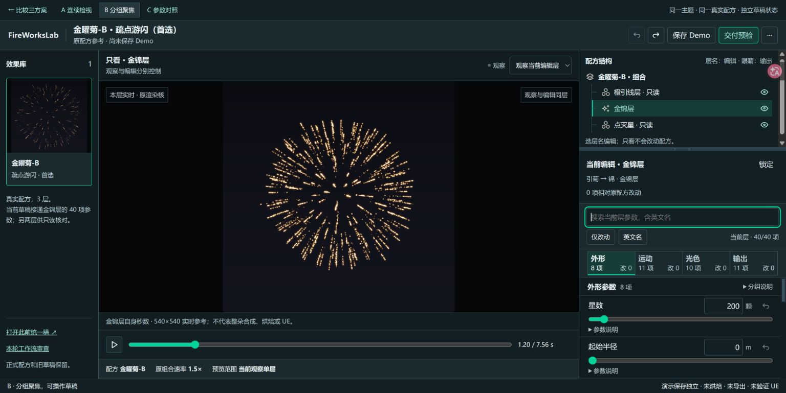

# 设计自检 · 三套工作流 Demo

状态：**本轮有限自检通过，待用户视觉评审**。不是生产组件库验收，也不把官方体系的标准等同于本页已达标。

## 交付与对照

A 连续检视、B 分组聚焦、C 参数对照均可独立操作，同一真实数据与原核。比较入口 `review.html`；三张1920×1080实际图与同尺度右栏图在 `screenshots/`。旧V3入口与已有未提交探索保留。原截图与新图使用相同CSS视口、金锦默认值及本层1.2秒；像素差异不作画质或业务通过判据。旧V3的静态示意与本轮真实单层预览有能力差别，不把二者误标成同一业务产物。

## 实际改进

| 首轮发现 | 已做的修订 | 复核 |
| --- | --- | --- |
| B组头重复说明、每字段约175px，短窗难调 | 标题收成单行、说明按需、标签与精确值同一行 | 数字字段约81px；1366完整2项并露第三项，短高滚动区约90px |
| C重复身份、表格前空耗 | 身份只留共用固定路径；对照头/分组缩短 | 460px栏宽及683×384表尾可达；必要原因不隐藏 |
| A连续行留白、工作区底行错轨 | 帮助归左、输入归右；显式网格行 | 1920图五个字段入口可见；底栏与滚动正确 |
| 暂停仍60fps，大窗口/DPR重建目标、坏帧没及时报告 | 原核固定540²/DPR1、按需绘制、去重、释放与手动重试 | 两浏览器A/B/C实页、像素变化、换页/刷新/切层/多视口；原dist=1000 |
| 观察入口重复，B标题额外选择无用途 | 观察只在画布上方；B名称为真实label | 不合并编辑/观察/输出；label聚焦、独立状态链通过 |
| “打开时”、保存状态与枚举单位有误导 | 固定基线称原配方，保存快照另算；无量纲不印成单位1 | 刷新仍有原配方对照；未保存初始状态、0=全程、条件状态复核 |
| 交付说明挤压预览，勾选退回系统蓝 | 窄清单、输出方案中文摘要、范围说明折叠、继承u-checkbox | 1366预览884+清单320；有效画布520²；四块标题/导入选择直接可见 |

[同尺度迭代对照](../../../../analysis/results/20261029_三套工作流Demo/迭代对照.png)保留首版与修订版真实像素，未缩小字号。

## 验证范围

- Chrome 154.0.8037.58、Edge 156.0.4314.50。212项控件/保存刷新/错误与只读/搜索滚动/焦点/菜单/尺寸检查：受控503专测渲染未就绪也可操作，不能冒充真实预览验证。
- 66项真实原核实页复核：A/B/C首帧、修改参数后的可见预览像素差异、精确输入、错误保留、三层观察、保存刷新、DPR2、失去context后只手动重试；无非预期JS异常或外部/API请求。
- 末轮23项增补：交付实际面积/四块与导入控件、中文输出方案、初始保存状态、主题勾选、分隔条键盘及ARIA。它是对末轮局部修订的补查，不把早期图当终版。
- 1920×1080、1366×768、2560×1440为CSS视口；683×384另以deviceScaleFactor=2验证，390×844补窄宽。没有把“27寸”或未知用户系统缩放充当尺寸证据。
- 减少动态效果CSS取消非必要动画；树/分组/布局直接切换。烟花播放由用户主动触发，是任务内容。
- 比对前先核实源码及真实字段。169个原稿/生产/未提交成果的保护哈希无变化。所有正式数据、共享tokens与生产源码未改。

完整小数据见 [verification.json](verification.json)，原始操作报告和截图在 `analysis/local/20261029_三套工作流Demo/`。原先直接读取非preserve WebGL缓冲得到空图的像素测量已弃用；终版使用实际可见画布截图，过程失败报告保留。

## 完成边界

本轮没有开放完整三工具参数集、多对象/整朵联动、真实烘焙/素材包/正式保存另存/导入或UE；也没有进行完整读屏及跨硬件性能认证。40字段、原层数据和当前接通范围均在页面明确标注。没有未处理的本轮阻塞排版问题；用户审美选择与正式迁移仍待下一阶段。

## 常用浏览器最终入口确认

实际在用户Chrome打开比较页和B，截图检查三张实页缩略图与真实预览；搜索sparkSize、0.75→1.5、离开输入、撤销回0.75、清空回40项完成，未执行生产保存。补修原生自动填入路径的focusout提交及即时ARIA/撤销状态，212项控件主链再次复核通过。两个入口已作为交付页保留。

实测CSS视口1536×769、浏览器报告DPR2.5；无法据此分开判定系统缩放与页面缩放，未改用户设置。截图返回JPEG，按原像素无裁切转存PNG，没有伪造界面内容。

最终反馈补查：Chrome/Edge四项错误与演示预算恢复检查通过；错误值不进入原核，修正后清除过期提示。此后功能源码冻结。
