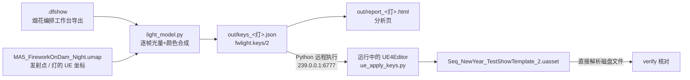

# 新年烟花秀 → UE 灯光曲线 交接文档

> **一句话**：把「烟花编排工作台」导出的 `.dfshow` 编排，按每一发烟花的开花时刻、花型、大小、颜色、与灯的距离，算成灯光的 `Intensity` / `LightColor` 关键帧，写进 `Seq_NewYear_TestShowTemplate_2`。
>
> 交接包：`FireworkLight_Handover/`（本文件所在目录）｜工具入口：`fwlight.py`｜整理日期：2026-10-15

---

## 0. 速览：三步复现

```bat
:: 1) 改 config.json 里的 ue.project_root / ue.engine_root 为你机器上的路径，打开 UE 编辑器（DeltaForce 工程）
python fwlight.py check                         :: 环境自检，全部 [OK] 再往下
:: 2) 复现：重新计算并与 10-15 写入版本逐键比对，应输出“两个文件完全一致”
python fwlight.py build --light SpotLight2
python fwlight.py diff  out/keys_SpotLight2.json baseline/keys_SpotLight2_written_20261015.json
:: 3) 重调：临时改参数 → 看报告 → 写入编辑器 → 磁盘核对
python fwlight.py all --light SpotLight2 --set i_peak=2000 --set gamma=0.8
```

只用于看结果、不碰 UE：`build` + `report` 两条命令即可，不需要打开编辑器。

---

## 1. 当前交付状态（截至 2026-10-15 22:27）

| 灯（序列绑定） | 组件 | Intensity 键 | LightColor 键（R/G/B/A） | 曲线来源 |
|---|---|---|---|---|
| **SpotLight2** | LightComponent0 | 1502 | 1058 / 1058 / 1058 / 0 | 本工具按 SpotLight2 自身位置计算（**主交付**） |
| SpotLight | LightComponent0 | 1502 | 1058 ×3 / 0 | 与 SpotLight2 完全相同 |
| SpotLight3 | LightComponent0 | 1502 | 1058 ×3 / 0 | 与 SpotLight2 完全相同 |
| SkyLight | SkyLightComponent0 | 1502 | 1058 ×3 / 0 | 颜色相同，强度 = SpotLight2 × **0.003846**（峰值约 6.92） |

- 10-15 21:33 本工具首次写入 SpotLight2。21:48 资产再次保存时，另外三盏灯已经是上表状态（推测是在编辑器里复制过去的）。`config.json` 用 `curve_from` 复现了这个状态。如果希望三盏 SpotLight 各自按位置独立计算，见 §7.4。
- 所有键均为 **Linear** 插值；Alpha 通道无键，默认值恒为 1。
- 已用磁盘级解析核对：四盏灯的曲线逐键与 keys 文件一致（`python fwlight.py verify --light ALL`）。
- 写入前的原始文件：`baseline/Seq_NewYear_TestShowTemplate_2.before_20261015.uasset`（sha256 `908333a7…64dd55`，412,626 字节）。现在的文件约 1.0 MB。

---

## 2. 整体链路



| 阶段 | 运行位置 | 文件 | 说明 |
|---|---|---|---|
| 读取编排 | 宿主机 Python 3.8+ | `lib/light_model.py` | 读 `.dfshow` 的事件、花型、片段 |
| 读取坐标 | 宿主机 | `lib/uepkg.py` | 直接解析 umap 二进制，**不需要打开关卡**；结果缓存在 `data/level_positions_*.json`，找不到 umap 时自动用缓存 |
| 计算曲线 | 宿主机 | `lib/light_model.py` | 30 fps 逐帧合成 → 精简为关键帧 |
| 写入 | **UE 编辑器内 Python 2.7** | `ue/ue_apply_keys.py` | 由 `lib/ue_bridge.py` 远程触发 |
| 核对 | 宿主机 | `lib/disk_verify.py` | 解析保存后的 uasset，精确到指定灯的通道 |

---

## 3. 输入数据

### 3.1 `.dfshow`（`data/NewYearFireWorks_v01-v13.dfshow`）

工作台的工程文件（JSON，约 8 MB），节目 `NewYearFireWorks_v01` v13，时长 214.4 s，曲目「VO倒计时+汪洋与浩渺」。用到的字段：

| 路径 | 用途 |
|---|---|
| `payload.doc.events[]` | 每一发：`templateId`、`pointId`、`cueId`、`effectiveLaunch`/`effectiveBurst`/`effectiveEnd`（秒）、`zone` |
| `payload.doc.templateLibrary[]` | 花型：`kind`(small/medium/large/fan/comet)、`diameter`(m)、`flightHeight`(m)、`color`(#hex)、`name` |
| `payload.doc.cues[]` | 片段：`mobile` = `False`（PC）/ `"only"`（手游替身）/ `None`（通用） |
| `payload.doc.sections[]` | 13 个编排段落（只用于报告统计） |

> ⚠️ **PC 和手游是同一时刻的两套片段**（例如 `B03_CD10` 银冠菊 / `B03_CD10m5` 点灭星），计光时只能取一套，否则会重复计光。默认取 PC：去掉 `mobile=="only"` 的片段，剩 **936** 个事件（坝顶 709 + 小平台 227）。

### 3.2 UE 资产

| 资产 | 关键信息 |
|---|---|
| `/Game/BluePrints/ShowDirector/Instance/Ma5_NewYearFireworks/Seq_NewYear_TestShowTemplate_2` | 显示帧率 30 fps，Tick 24000；播放 0–7214 帧（0–240.47 s）。绑定：SkyLight、SpotLight、SpotLight2、SpotLight3，各自的组件下都有 Intensity / LightColor / AttenuationRadius / SourceRadius 等轨道，每条轨道一个无边界 Section |
| `/Game/Maps/Dam_Iris_Long3/DynamicRequest/Event/MA5_FireworkOnDam/MA5_FireworkOnDam_Night` | 36 个 `NewYear_Night_ShowEffect_*` 发射点（P0–P8、B0–B7、F0–F6、Lm/Rm），以及 SpotLight_1 / SpotLight2 / SpotLight3 |
| `BP_NewYearFireworks_ShowDirector_Night` | `SequenceScheduleGroups → Light → light_A`，**StartTime = 0**，`LocalTimeOffset = 0` ⇒ **序列秒 = 节目秒**，因此 `time_offset_s = 0` |

> 序列里的绑定名 **SpotLight** 对应关卡里的 Actor **SpotLight_1**（`config.json` 的 `level_actor` 字段负责这层映射）。

### 3.3 坐标速查（UE 世界坐标，cm）

| 对象 | X | Y | Z | 备注 |
|---|---|---|---|---|
| **SpotLight2** | 344384 | -800522 | -1017 | 坝体 P7/P8 一端，比坝顶高约 24 m；内/外锥角 60°/80°，衰减半径 20000 |
| SpotLight_1（SpotLight） | 372901 | -796930 | -1502 | 中段，靠 P4 |
| SpotLight3 | 394226 | -777684 | -2559 | P0 一端 |
| P0 / P4 / P8 | 401962 / 371995 / 340580 | -784978 / -805151 / -809863 | -3401 | 坝顶主发射点 |
| B0 … B7 | 399287 … 343357 | -788278 … -810283 | -3401 | 坝顶点间扇形点 |
| F0 … F6 | 377577 … 360683 | -794925 … -801367 | -11797 | 小平台 |

爆点高度 = 发射点 Z + `flightHeight × 100`（小 150 m / 中 210 m / 大 330 m）。

---

## 4. 光照模型

全部在 `lib/light_model.py`，按 30 fps 逐帧累加。`f` 为帧号，`S[f]` 为加权光量，`RGB[f]` 为加权颜色。

### 4.1 单发的光量包络

**球花（small / medium / large）**，记 `tt` = 开花后秒数，`life = effectiveEnd − effectiveBurst`，`u = tt / life`：

| 阶段 | 公式 | 颜色 |
|---|---|---|
| 炮口闪（发射帧 + 下一帧） | `launch_flash·P·w₀`，`0.4·launch_flash·P·w₀` | `#ffd59a` |
| 升空尾缀（发射 → 开花） | `rise_glow·P·w(h)·min(1,4u)·(1−0.5u)` | `#ffc47a` |
| 开花 | `v = fl·e^(−tt/τ) + body·min(1, tt/0.12)·(1−u)^k`，τ = `flash_tau_s` | 花型色 |

花型档案（按 `templateId` 关键字匹配，**自上而下取第一个命中**，代码 `PROFILES`）：

| 关键字 | 花型 | fl | body | k | 额外调制 | 本场发数 |
|---|---|---|---|---|---|---|
| Kamuro | 金垂柳 | 0.70 | 0.60 | 0.85 | 燃烧段改为 `e^(−tt/0.42life)·(1−u)^0.5`，长拖尾 | 5 |
| Crackle / `_CR_` | 裂星 / 爆裂星 / 小平台短爆裂 | 1.00 | 0.35 | 1.6 | 末段 u=0.62/0.72/0.82 叠三次白光噼啪 `#fff1d8`（σ=0.045 s） | 114 |
| Strobe | 点灭星 | 0.80 | 0.50 | 1.0 | 燃烧段 ×(0.65+0.35·(0.5+0.5·sin(2π·6Hz·tt+φ))) | 83 |
| Glitter | 辉星 | 0.90 | 0.50 | 1.1 | 燃烧段 ×(0.88+0.12·sin(2π·9Hz·tt+φ)) | 40 |
| MultiLayer | 多重菊 | 1.00 | 0.55 | 1.4 | +0.55 闪 @0.3 s，+0.35 闪 @0.6 s | 43 |
| Prism | 彩千轮 | 0.60 | 0.35 | 1.3 | +0.9·e^(−(tt−1)/0.45) 二次爆 @1.0 s | 18 |
| Spark / `_GS_` | 金锦菊 / 小金花簇 | 0.90 | 0.60 | 1.1 | — | (含在下行) |
| Peony / Lime | 牡丹 / 青柠 | 1.00 | 0.50 | 1.5 | — | (含在下行) |
| （默认） | 各类菊 | 1.00 | 0.55 | 1.3 | — | 以上三行合计 434 |

`φ` 为每发随机相位，由 `seed` 固定，**重跑结果完全一致**。

**扇形（fan）/ 彗星（comet）**：持续型，从开花（即发射）时刻起：
`env = min(1, tt/0.15) × (u<0.6 ? 1 : 1−(u−0.6)/0.4)`，光量 = `fan_power_per_beam × 束数`（扇形，束数取名称中的 1/5/9/13）或 `comet_power`（彗星），位置取发射点上方 `fan_height_m`。本场扇形 180 发、彗星 19 发。

### 4.2 光量大小与距离

- 球花光通量：`P = (diameter / 150 m) ^ size_exp` → 90 m ≈ 0.28，150 m = 1，230 m ≈ 2.9，280 m（主角金垂柳）≈ 4.7。
- 距离软衰减：`w = R₀² / (R₀² + r²)`，`r` = 灯到爆点（或升空中的当前位置）的 3D 距离（m），`R₀ = r0_m`。
  以 SpotLight2 为例（中号爆点）：P7/P8 ≈ 212 m → 权重 1.00；P4 ≈ 336 m → 0.66；P0 ≈ 625 m → 0.28。
- 每发对该帧的贡献 = 包络 × `P` × `w`。

### 4.3 合成、动态范围与颜色

1. `S[f] = Σ 贡献`，`RGB[f] = Σ 贡献 × 线性颜色`。花型颜色先由 sRGB 转线性空间，再做饱和度增强 `sat_boost`（以 Rec.709 亮度为轴向外推；多色混合会发灰）。
2. **Intensity** `= i_peak × (S / S_max)^gamma`。`S_max` 是**全场最亮一帧**，所以 `i_peak` 就是全场最亮那一帧的强度（SpotLight2 在 164.77 s，9 发金芒菊齐开）。
3. **LightColor** = `RGB/S`，按最大通道归一（亮度交给 Intensity），值在线性空间 0–1（UE 写入 `FColor` 时自动转 sRGB 8 位）。`S < 0.4% S_max` 时保持上一帧颜色；弱光时按 `a = min(1, S / (dark_color_hold·S_max))` 向上一颜色过渡，避免黑场里颜色乱跳。起始颜色 `start_color`。

### 4.4 关键帧精简

- 逐帧曲线（7215 帧）→ 贪心线性精简：线性重建误差 ≤ `int_tol × i_peak`（强度）/ `col_tol`（颜色，RGB 三通道共用帧号）。
- **强制保留所有局部峰值**（> 2% `i_peak`），不会削掉任何一次开花闪光。SpotLight2 共 788 个强制峰值。
- 写入用 Linear 插值。如果用 Cubic/Auto，快速闪光会过冲出负强度。

### 4.5 当前参数下的结果（SpotLight2）

| 段落 | 时间 (s) | 平均强度 | 峰值 |
|---|---|---|---|
| 倒计时 | 0–16.2 | 94 | 231 |
| 开场高潮 | 16.2–28.5 | 402 | 873 |
| 密集问答 | 28.5–41.5 | 356 | 1106 |
| 往返扫射 | 41.5–54.5 | 341 | 692 |
| **第一次抬升** | 54.5–67.5 | **782** | 1383 |
| 低位密奏 | 67.5–80.4 | 347 | 975 |
| 第二次递进 A | 80.4–93.4 | 416 | 1233 |
| 蓄势收窄 | 93.4–108.0 | 402 | 1367 |
| **高潮 II** | 108.0–133.9 | **822** | 1487 |
| 转场铺色 A | 133.9–145.3 | 389 | 897 |
| 转场铺色 B | 145.3–158.3 | 485 | 1075 |
| **终章** | 158.3–193.9 | **832** | **1800** |
| 白色收束 | 193.9–214.4 | 321 | 1383 |

量级参考：写入前美术手调的旧曲线范围 0–2203、均值约 481；新曲线均值约 510。完整图表见 `out/report_SpotLight2.html`。

---

## 5. 写入 UE 的实现细节

### 5.1 远程执行

- 项目 `Config/DefaultEngine.ini` 已开启：`[/Script/PythonScriptPlugin.PythonScriptPluginSettings] bRemoteExecution=True`，组播 `239.0.0.1:6777`（注意不是引擎默认的 6766），TTL 0（仅本机）。
- `lib/ue_bridge.py` 在运行时加载引擎自带的 `Engine/Plugins/Experimental/PythonScriptPlugin/Content/Python/remote_execution.py`（不随包分发 Epic 源码），并打两个补丁：
  1. 去掉 `json.loads(..., encoding=)`：这个参数在 Python 3.9+ 已移除；
  2. 原版只 `recv(4096)` 一次，回包超过 4 KB 就报 *Remote party failed to send a valid response*。改为循环接收，直到 JSON 完整。
- 编辑器忙（加载关卡、编译 Shader、有模态弹窗）时发现不到节点，会自动重试 4 次。

### 5.2 UE 侧脚本（Python 2.7）

- 以「文件路径 + 参数」方式执行（ExecuteFile 模式），参数只有一个 `job_*.json`，结果写回 `out/*.json`。UE 内的 Python 是 **2.7**，所以这些脚本里不能用 f-string、`nonlocal` 等 Py3 语法。
- `ue_inspect_sequence.py`：只读，导出全部绑定/轨道/关键帧（含子帧、插值、切线）。
- `ue_apply_keys.py`：写入，流程如下：
  1. **未保存修改保护**：序列包已有未保存修改时直接拒绝（`--force` 才继续），避免把别人的半成品一起存盘；
  2. **AssetRegistry 加载保护**：刚启动编辑器或刚打开大地图时无法保存，此时不做任何修改，宿主机每 10 s 重试，最多等 3 分钟；
  3. 在一个 Undo 事务（`fwlight: <灯> Intensity/LightColor`）里清空并重写 Intensity 与 LightColor 的 R/G/B/A 和默认值；
  4. **时间统一换算成 Tick（24000/s）写入**。⚠️ UE4.24 的 `add_key` 在 DISPLAY_RATE 单位下会**丢弃子帧**（实测 491.9 帧会被写成 491 帧）；
  5. 逐键读回比对，不一致就不保存；
  6. 如果序列正在 Sequencer 中打开，关闭后重开以刷新曲线显示（保持播放头位置；`--no-reopen` 可关闭此行为）；
  7. `EditorAssetLibrary.save_loaded_asset` 保存。
- `ue_save_sequence.py`：只保存（apply 已写入但保存失败时用）。

### 5.3 磁盘核对原理

这套定制引擎里 `FMovieSceneFloatChannel` 是**带标签属性**序列化的（`Times` 为 int32 tick 数组，`Values` 的每个元素前 4 字节是 float 值）。`lib/disk_verify.py` 沿着 `MovieScene.Possessables`（Guid/Name/ParentGuid）→ `ObjectBindings.Tracks` → `Track.PropertyName / Sections` → `Section.FloatCurve / Red|Green|Blue|AlphaCurve` 这条引用链，**精确定位到指定那盏灯**的通道，再逐键比较。写错灯也能查出来。

---

## 6. 在同事机器上复现

### 6.1 前置条件

- [ ] Windows，**Python 3.8+**（宿主机，任意发行版，无第三方依赖）
- [ ] 已同步 DeltaForce 工程，能打开 UE4Editor；工程 `DefaultEngine.ini` 里的远程执行配置随 P4 同步，不需要手改
- [ ] 序列 `Seq_NewYear_TestShowTemplate_2.uasset` 已在 **P4 checkout**（只读文件无法保存）
- [ ] 交接包放在**纯英文、无空格路径**下（例如 `D:\Tools\FireworkLight_Handover`），因为 UE 内的 Python 2.7 读不了中文路径
- [ ] 首次运行时如果 Windows 防火墙弹窗，点允许

### 6.2 修改 `config.json`

一般只需改两行（路径用 `/`）：

```json
"project_root": "D:/你的路径/DFMEditor/DFM",
"engine_root":  "D:/你的路径/DFMEditor/Engine",
```

其他字段说明见附录 B。

### 6.3 步骤与预期输出

| # | 命令 | 预期 |
|---|---|---|
| 1 | 打开 UE 编辑器（任意地图都行，**不需要**打开 Dam 关卡） | 标题栏显示「虚幻编辑器 - DeltaForce」 |
| 2 | `python fwlight.py check` | 全部 `[OK]`，最后显示「全部通过。」；会列出 36 个发射点、四盏灯的绑定与轨道 |
| 3 | `python fwlight.py build --light SpotLight2` | `事件 936  Intensity 键 1502  Color 键 1058`，以及 13 段统计（同 §4.5） |
| 4 | `python fwlight.py diff out/keys_SpotLight2.json baseline/keys_SpotLight2_written_20261015.json` | 「两个文件完全一致。」→ **复现成功** |
| 5 | `python fwlight.py verify --light ALL` | 四盏灯全部 OK（说明你机器上的资产就是 10-15 版本） |
| 6 | `python fwlight.py report --light SpotLight2` | 生成 `out/report_SpotLight2.html`，用 Chrome/Edge 打开 |

第 3–4 步只依赖本包内的数据（`.dfshow` + 坐标缓存），**不连编辑器、甚至没同步工程也能跑**；第 5 步只读磁盘文件。

---

## 7. 重调指南

### 7.1 推荐工作流

```bat
:: ① 临时改参（不写回 config）→ 看报告
python fwlight.py build  --light SpotLight2 --set i_peak=2200 --set gamma=0.8
python fwlight.py report --light SpotLight2
:: ② 只写进编辑器内存，不保存 → 在 Sequencer 里拖播放头 / 播放看效果
python fwlight.py apply  --light SpotLight2 --no-save
::    不满意：编辑器里 Ctrl+Z，或改参数后再 apply --no-save（第二次要加 --force，因为序列已是“未保存”状态）
::    满意：
python fwlight.py save
python fwlight.py verify --light SpotLight2
:: ③ 把满意的参数写进 config.json 的 "model"（全局）或 "model_overrides": {"SpotLight2": {...}}（单灯）
:: ④ 多盏灯一起更新（每盏灯自动备份 → 写入 → 保存 → 核对）
python fwlight.py all --light ALL
```

> `apply` 会**整条覆盖**目标灯的 Intensity 和 LightColor（全部键）。在 Sequencer 里手改的键会丢失，所以应该改参数后重新生成，而不是手修。

### 7.2 参数表（`config.json → model`）

| 参数 | 当前值 | 作用 | 调大 → | 建议范围 |
|---|---|---|---|---|
| `i_peak` | 1800 | 全场最亮一帧的强度，整体线性缩放 | 整体更亮 | 1200–3000 |
| `gamma` | 0.72 | 动态范围压缩（1 = 线性） | 对比更强：高潮更突出，安静段更暗 | 0.5–1.0 |
| `r0_m` | 300 | 距离衰减半径 | 远处烟花权重变大，各灯差异变小 | 150–800 |
| `size_exp` | 2.5 | 花径对光量的影响（2≈面积，3≈体积） | 大号/主角花更压场 | 1.5–3.0 |
| `sat_boost` | 1.30 | 颜色饱和度补偿 | 颜色更艳 | 1.0–1.6 |
| `flash_tau_s` | 0.09 | 开花闪光衰减时间 | 闪光更“软”、更长 | 0.05–0.2 |
| `fan_power_per_beam` | 0.04 | 扇形每束光量 | 扇形/银星/红彗星更亮 | 0.02–0.1 |
| `comet_power` | 0.06 | 小平台 V 形彗星光量 | — | 0.03–0.15 |
| `fan_height_m` | 60 | 扇形光源等效高度 | — | 30–100 |
| `launch_flash` | 0.10 | 炮口闪光 | 发射瞬间更亮 | 0–0.3 |
| `rise_glow` | 0.025 | 升空尾缀微光 | 开花前有更明显的“预亮” | 0–0.08 |
| `dark_color_hold` | 0.03 | 弱光时颜色向上一颜色过渡的阈值 | 暗处颜色更稳 | 0.01–0.1 |
| `start_color` | `#f0d69d` | 开场第一颜色（暖金） | — | — |
| `int_tol` | 0.015 | 强度精简容差（相对 `i_peak`） | 键更少、细节更少 | 0.005–0.03 |
| `col_tol` | 0.03 | 颜色精简容差 | 键更少 | 0.01–0.06 |
| `seed` | 20261231 | 点灭星/辉星闪烁相位 | 换个值，闪烁节奏不同 | 任意整数 |
| `fps` | 30 | 必须等于序列显示帧率 | — | 不要改 |

`show` 段：`platform`（`pc`/`mobile`）、`time_offset_s`（序列秒 = 节目秒 + 偏移）、`seq_end_s`（与序列播放结束对齐）、`exclude_zones`（如 `["front"]` 不算小平台）、`exclude_templates`（按 templateId 排除）。

> `S_max` 是全局归一化的：改变最亮时刻（终章 164.8 s）的因素会让整场一起缩放。只改安静段的因素（比如排除小平台）对整体量级几乎没有影响（实测 `S_max` 8.275→8.274）。

### 7.3 常见诉求 → 怎么改

| 诉求 | 改法 |
|---|---|
| 整体太亮/太暗 | `i_peak` |
| 安静段太暗、高潮和平时差太大 | `gamma` 调小（0.6） |
| 高潮不够突出、平时太亮 | `gamma` 调大（0.85–1.0） |
| 灯只响应附近的烟花（三盏灯各有侧重） | `r0_m` 调小（150–200），并按 §7.4 让各灯独立计算 |
| 大号花/金垂柳太抢 | `size_exp` 调小（2.0） |
| 扇形、红彗星段落太暗 | `fan_power_per_beam` 调大 |
| 颜色发灰 / 太艳 | `sat_boost` |
| 颜色跳得太频繁 | `col_tol` 调大、`dark_color_hold` 调大 |
| 闪得太碎 | `flash_tau_s` 调大；`int_tol` 调大 |
| 不想计入小平台（F 点） | `"exclude_zones": ["front"]` |
| 光比烟花整体早/晚 | `time_offset_s`（正数 = 灯光延后） |
| 出手游版曲线 | `"platform": "mobile"`。注意序列只有一份，PC 和手游共用 |
| 某类花型的“质感”不对 | 改 `lib/light_model.py` 的 `PROFILES`（见 §4.1 表） |

### 7.4 换灯、加灯、独立计算

- **三盏 SpotLight 各自按位置计算**：删掉 `lights.SpotLight` / `lights.SpotLight3` 里的 `curve_from`，然后 `python fwlight.py all --light SpotLight,SpotLight3`。
- **SkyLight**：目前复用 SpotLight2 的曲线，强度 ×0.003846。改 `intensity_scale` 即可调整天光比例。
- **新增一盏灯**：在 Sequencer 里给它的组件加好 Intensity 和 LightColor 轨道（工具不会自动建轨道），再在 `lights` 里加一项 `binding` / `component` / `level_actor`。
- **单灯参数**：`"model_overrides": {"SpotLight3": {"r0_m": 200}}`。对 `curve_from` 的灯用 `--set` 时，改动会作用在它的源灯上。

### 7.5 编排更新了怎么办

1. 在工作台里「下载节目版本文件」得到新的 `.dfshow`，放进 `data/`，改 `show.dfshow`；
2. 新编排如果用到了关卡里没有的发射点，`build` 会报「关卡中缺少发射点」。关卡里挪了发射点或灯的位置后，只要能读到 umap，坐标缓存会自动更新；
3. 序列时长变了要同步 `show.seq_end_s`（`check` 会提示）；
4. Director 里 light_A 的 `StartTime` 改了，要同步 `time_offset_s`；
5. 重新 `all --light ALL`。

---

## 8. 校验与回滚

| 手段 | 命令 / 位置 | 适用场景 |
|---|---|---|
| 编辑器撤销 | Ctrl+Z（事务名 `fwlight: …`） | 刚写入、还没关编辑器 |
| 回到 10-15 写入前的曲线 | `python fwlight.py apply --light SpotLight2 --keys baseline/rollback_SpotLight2_before_20261015.json`（四盏灯各有一份） | 已实测：写回后与原曲线逐键一致（含子帧、Auto 切线） |
| 回到任意一次 apply 之前 | `backup/<文件名>.<时间>.bak` + `backup/backup_log.txt`（每次 apply 保存前自动备份） | **先关闭编辑器**，P4 checkout 后把 .bak 复制回原路径并去掉后缀 |
| 原始文件 | `baseline/Seq_NewYear_TestShowTemplate_2.before_20261015.uasset` | 同上 |
| 把编辑器里的现有曲线存成文件 | `inspect` → `export-keys --light X --from out/inspect_latest.json` | 改之前先存一份，或把一盏灯的曲线拷给另一盏 |
| 比较两版曲线 | `python fwlight.py diff a.json b.json` | 确认复现、查看改参影响 |
| 磁盘核对 | `python fwlight.py verify --light ALL` | 确认已保存、确认没写错灯 |

---

## 9. 已知限制与注意事项

1. **模型是经验模型，不是光度学计算**，没有在 UE 实机效果下标定过，最终要靠肉眼在关卡里调参。
2. 花型尺寸和升空高度用的是 `.dfshow` 的设计值（文件自己标注了 `engineSizeVerified=false`）。发射点用的是关卡里的真实坐标。
3. `.dfshow` 时序与 Director 实际导入的三表要一致。如果 Director 后来又从工作台导入过新版本，要重新导出 `.dfshow`。
4. LightColor 是 `FColor`（8 位 sRGB），极暗的颜色细节会被量化。
5. 只写每条轨道的**第一个 Section**；轨道缺失会报错，不会自动创建。
6. apply 默认会关闭并重开 Sequencer 窗口（为了刷新显示），不想要可以加 `--no-reopen`。
7. `--force` 会把序列里其他未保存的修改一起保存，用之前先确认。
8. SkyLight 的 0.003846 倍是从资产现状反推的，不是工具原始设计。

---

## 10. 故障排查

| 现象 | 原因 / 处理 |
|---|---|
| 没有发现运行中的 UE 编辑器 | 编辑器没开 / 正在加载或编译 / 有模态弹窗 / 防火墙拦截。等编辑器空闲后重试；确认 `remote_multicast_port` 与 `DefaultEngine.ini` 一致（6777）；如果本机 `Saved/Config` 覆盖了端口，以覆盖后的为准 |
| `AssetRegistry 正在加载` / 自动重试 | 刚启动编辑器或刚打开大地图，工具会自动等待（最多 3 分钟） |
| 关键帧已写进编辑器但保存失败 | 稍后运行 `python fwlight.py save` 即可，不用重新 apply |
| 序列文件只读 | 先在 P4 checkout |
| 序列在编辑器中有未保存的修改 | 先在编辑器里保存或撤销；确认无害后可加 `--force` |
| 读回校验失败（未保存） | 编辑器里 Ctrl+Z；把 `out/apply_<灯>.json` 发给维护人 |
| 交接包所在路径含非 ASCII 字符 | 把包挪到纯英文路径 |
| 关卡中找不到灯光 Actor / 缺少发射点 | `level_asset`、`level_actor`、`effect_point_prefix` 与实际不符，或新编排用了新点位 |
| verify 显示 FAIL，但 apply 成功了 | 还没保存（`--no-save`），或之后有人保存了别的版本。先 `save` 再 verify |
| `UE 脚本执行失败: SyntaxError` | 改 `ue/*.py` 时用了 Python 3 语法；UE 内是 2.7 |
| 报告图表空白 | 用新版 Chrome/Edge 打开；这是单文件 HTML，不需要联网 |

---

## 11. 文件清单

```
FireworkLight_Handover/
├─ 交接文档_烟花灯光曲线.md        本文档
├─ config.json                     路径 / 灯 / 模型参数（换机器只改这里）
├─ fwlight.py                      统一命令行入口（宿主机 Python 3.8+）
├─ lib/
│  ├─ common.py                    配置读取、资产路径→文件路径
│  ├─ light_model.py               光照模型 + 关键帧精简（核心）
│  ├─ report.py / report_template.html   HTML 分析页
│  ├─ ue_bridge.py                 远程执行桥（运行时修补引擎 remote_execution.py）
│  ├─ disk_verify.py               磁盘 uasset 核对
│  └─ uepkg.py                     极简 UE4 包解析器（只读）
├─ ue/                             在 UE 编辑器内执行（Python 2.7）
│  ├─ ue_inspect_sequence.py       只读导出序列
│  ├─ ue_apply_keys.py             写入 + 读回 + 保存
│  └─ ue_save_sequence.py          只保存
├─ data/
│  ├─ NewYearFireWorks_v01-v13.dfshow              编排输入（v13）
│  └─ level_positions_MA5_FireworkOnDam_Night.json 关卡坐标缓存（读 umap 时自动刷新）
├─ baseline/
│  ├─ keys_SpotLight2_written_20261015.json        10-15 写入版本（复现比对基准）
│  ├─ rollback_<灯>_before_20261015.json  ×4       写入前原曲线（回滚用）
│  ├─ inspect_before_20261015.json                 写入前序列完整导出
│  └─ Seq_NewYear_TestShowTemplate_2.before_20261015.uasset   写入前原文件
├─ out/      生成物：keys_*.json、frames_*.json、report_*.html、inspect_*.json、apply_*.json（附带一份 SpotLight2 的样例）
└─ backup/   每次 apply 保存前的自动备份 + backup_log.txt
```

---

## 附录 A：keys 文件格式 `fwlight.keys/2`

```json
{
  "format": "fwlight.keys/2",
  "light": "SpotLight2", "binding": "SpotLight2", "component": "LightComponent0",
  "fps": 30,
  "interp": "linear",
  "intensity": { "default": 0.0, "keys": [[0, 0.0], [40, 16.078], [128, 151.462]] },
  "color": {
    "R": { "default": 1.0,    "keys": [[0, 1.0], [128, 0.7851]] },
    "G": { "default": 0.7206, "keys": [[0, 0.7206], [128, 0.8363]] },
    "B": { "default": 0.2497, "keys": [[0, 0.2497], [128, 0.9444]] },
    "A": { "default": 1.0,    "keys": [] }
  },
  "meta": { "generated_at": "...", "dfshow_sha256": "...", "params": { } }
}
```

- 键为 `[显示帧, 值]` 或 `[显示帧, 值, 子帧]`。写入时换算成 tick：`round((帧+子帧) × 800)`。
- `interp`：`linear` / `auto`（= Cubic 自动切线）/ `constant`，对整个文件生效。
- `default` 为 `null` 时表示清除通道默认值。
- 颜色值是线性空间 0–1。

## 附录 B：`config.json` 字段

| 字段 | 说明 |
|---|---|
| `ue.project_root` / `ue.engine_root` | 工程 DFM 目录 / 引擎 Engine 目录（**换机器必改**） |
| `ue.remote_multicast_group/port/bind`、`remote_command_port` | 远程执行网络参数，与 `DefaultEngine.ini` 保持一致 |
| `ue.remote_discover_timeout_s` / `retries` | 发现编辑器的等待时间和重试次数 |
| `ue.sequence_asset` / `ue.level_asset` | 目标序列 / 取坐标的关卡（`/Game/...` 路径） |
| `ue.effect_point_prefix` | 关卡发射点 Actor 名前缀，去掉前缀后应等于 `.dfshow` 的 `pointId` |
| `ue.tick_resolution` | 序列 Tick 分辨率（`inspect` 后会自动以实际值为准） |
| `show.*` | 见 §7.2 |
| `lights.<名>.binding` | 序列里灯 Actor 的绑定名 |
| `lights.<名>.component` | 其下组件绑定名（SpotLight 为 `LightComponent0`，SkyLight 为 `SkyLightComponent0`） |
| `lights.<名>.level_actor` | 关卡里的 Actor 名（取坐标用；`curve_from` 的灯可以不填） |
| `lights.<名>.curve_from` | 复用另一盏灯的计算结果 |
| `lights.<名>.intensity_scale` / `intensity_offset` | 对复用的强度做 `v×scale+offset` |
| `model` / `model_overrides.<名>` | 全局模型参数 / 单灯覆盖 |

## 附录 C：命令一览

| 命令 | 连编辑器 | 改资产 | 说明 |
|---|---|---|---|
| `check` | ✓ | ✗ | 环境、路径、坐标、绑定与轨道自检 |
| `inspect [--out]` | ✓ | ✗ | 导出序列现状 → `out/inspect_latest.json` |
| `build --light X [--set k=v]` | ✗ | ✗ | 计算 → `out/keys_X.json`、`out/frames_X.json` |
| `report --light X [--compare baseline\|latest\|none\|路径]` | ✗ | ✗ | → `out/report_X.html` |
| `diff a.json b.json` | ✗ | ✗ | 比较两个 keys 文件 |
| `backup` | ✗ | ✗ | 复制序列 uasset 到 `backup/` |
| `apply --light X [--keys] [--no-save] [--force] [--no-backup] [--no-reopen]` | ✓ | ✓ | 写入（默认会先备份再保存） |
| `save [--always]` | ✓ | ✓ | 只保存序列 |
| `verify --light X [--keys]` | ✗ | ✗ | 解析磁盘文件，逐键核对 |
| `export-keys --light X --from inspect.json [--out] [--interp]` | ✗ | ✗ | 把现有曲线存成 keys 文件 |
| `all --light X` | ✓ | ✓ | build → report → apply → verify |

`--light` 支持逗号分隔（`SpotLight,SpotLight3`）或 `ALL`（`config.lights` 中的全部灯）。
